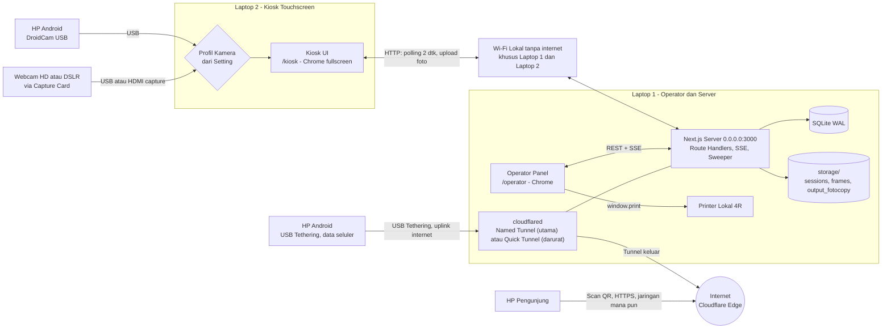
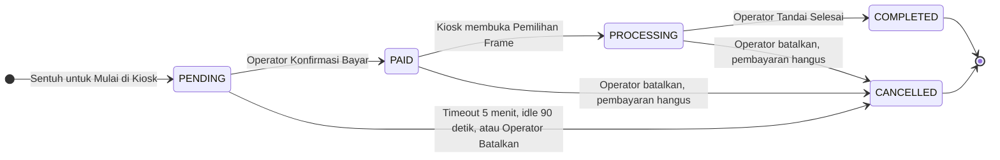
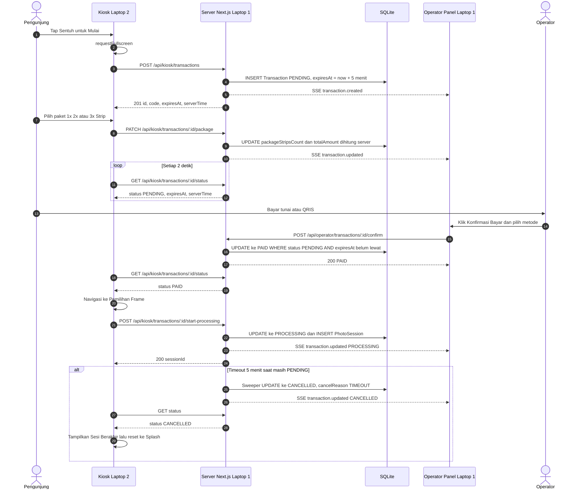
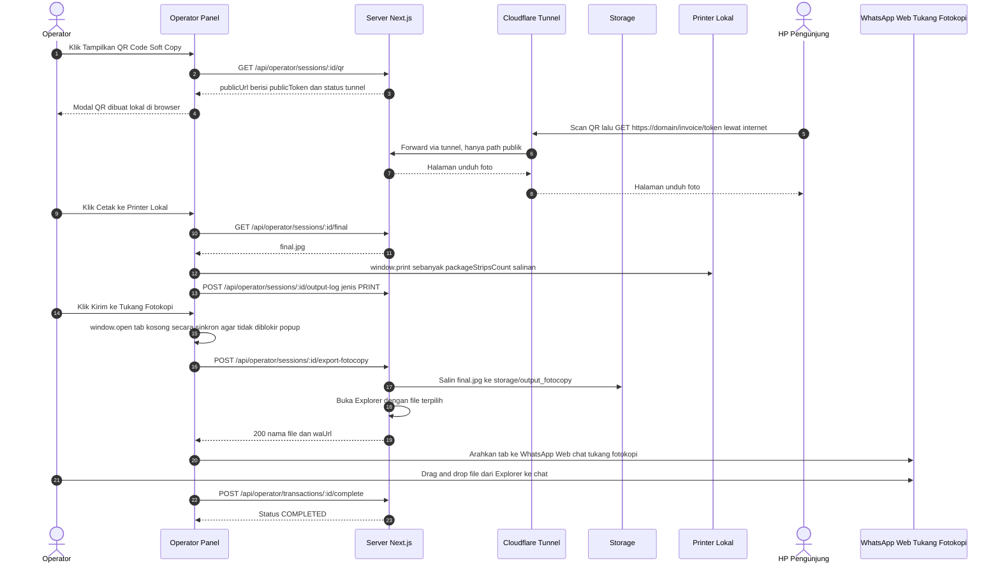
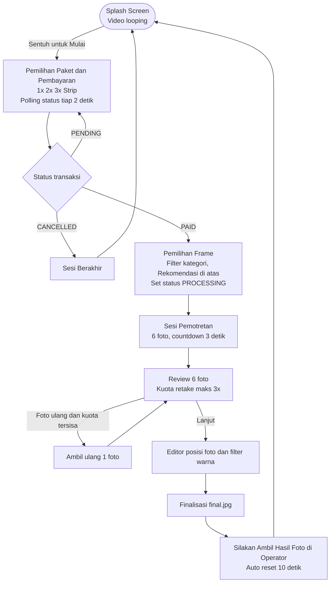
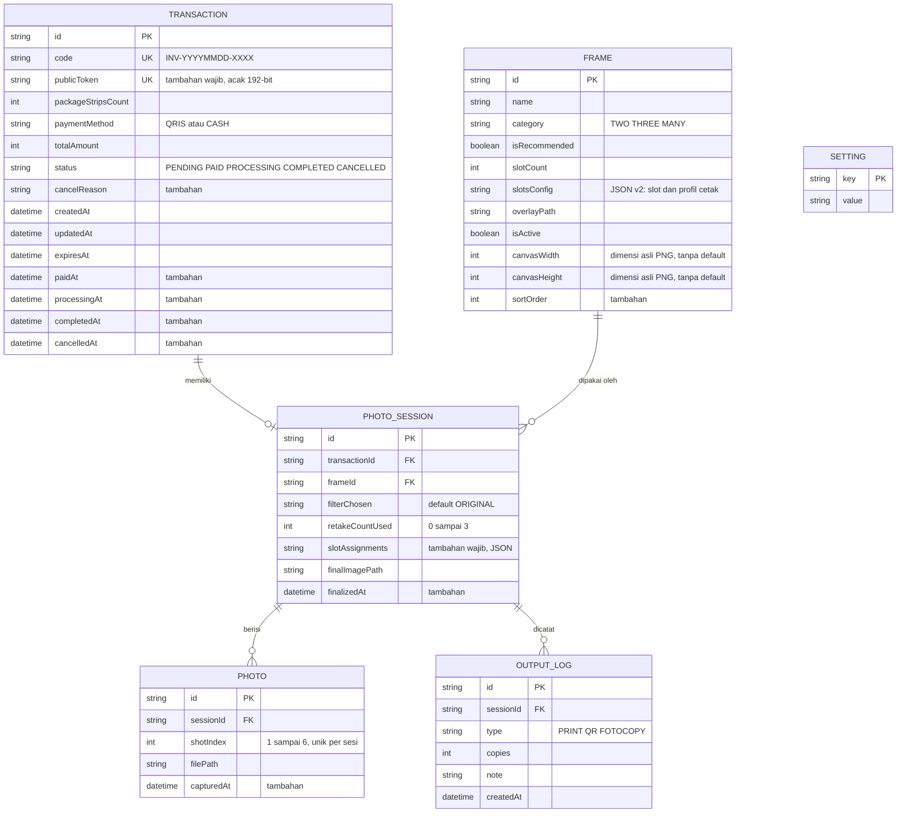

# Happy Click 2.0: Concept & System Update

| Atribut | Nilai |
|---|---|
| **Produk** | Happy Click (sebelumnya codename *Localhost Photobooth Kios* di `prd.md` / `design.md`) |
| **Versi Dokumen** | 2.0 rev. 5 (Q1–Q25 terjawab, **Q15 digantikan Q26: dimensi frame dinamis**, lihat §1.4 dan §6.3) |
| **Tanggal** | 18 Oktober 2026 |
| **Peran Penyusun** | Lead System Architect & Senior Product Manager |
| **Sifat Dokumen** | Konsep dan blueprint pembaruan sistem. Menjadi acuan untuk memperbarui kode, `prd.md`, `design.md`, dan `design-requirements.md` |
| **Sumber** | Spesifikasi "2 Laptop + Multi-Camera + Alur Transaksi Real-Time" dari pemilik produk |
| **Dokumen Terkait** | `prd.md` v1.0, `design.md` v1.0, `design-requirements.md` v1.0 |

> **Cara membaca:** bagian yang berasal langsung dari spesifikasi Anda ditulis apa adanya. Bagian yang **saya tambahkan karena ada celah, risiko, atau keputusan yang belum ditentukan** ditandai **[Usulan]** atau **[Celah]** supaya mudah Anda terima atau tolak.

## Daftar Isi

1. [Ringkasan Konsep 2.0](#1-ringkasan-konsep-20)
2. [Identitas & Branding](#2-identitas--branding)
3. [Perubahan dari v1.0 ke v2.0](#3-perubahan-dari-v10-ke-v20)
4. [Arsitektur Sistem 2 Laptop](#4-arsitektur-sistem-2-laptop)
5. [Siklus Hidup Transaksi](#5-siklus-hidup-transaksi)
6. [Laptop 1: Operator Control Panel](#6-laptop-1-operator-control-panel-operator)
7. [Laptop 2: Kiosk Touchscreen](#7-laptop-2-kiosk-touchscreen-kiosk)
8. [Data, Schema Prisma, dan Penyimpanan](#8-data-schema-prisma-dan-penyimpanan)
9. [Kontrak API](#9-kontrak-api)
10. [Dampak ke UI dan Layout](#10-dampak-ke-ui-dan-layout)
11. [Keamanan dan Keandalan](#11-keamanan-dan-keandalan)
12. [Rencana Implementasi, Migrasi, dan UAT](#12-rencana-implementasi-migrasi-dan-uat)
13. [Keputusan, Asumsi, dan Pertanyaan Terbuka](#13-keputusan-asumsi-dan-pertanyaan-terbuka)

---

## 1. Ringkasan Konsep 2.0

Versi 1.0 mengasumsikan **satu laptop** yang berperan sebagai kios sekaligus server, dengan operator berdiri di sebelahnya. Versi 2.0 memisahkan peran menjadi **dua laptop** dalam satu jaringan lokal:

| | **Laptop 1: Operator** | **Laptop 2: Kiosk** |
|---|---|---|
| Rute | `/operator` | `/kiosk` (dan `/` yang mengarah ke sana) |
| Pengguna | Operator / pemilik | Pengunjung |
| Tugas utama | Memantau antrean real-time, konfirmasi bayar, kelola frame dan kamera, keluarkan hard copy dan soft copy | Splash, pilih paket, bayar, pilih frame, foto 6×, retake, edit posisi + filter, finalisasi |
| Perangkat keras | Printer lokal, folder export fotokopi | Layar sentuh, kamera (DroidCam USB **atau** webcam/DSLR via capture card) |
| Peran jaringan | **Server** (Next.js + SQLite + storage) *(dikonfirmasi)* | Klien (browser fullscreen) |

**Perubahan konsep terbesar:**

1. **Pembayaran dikonfirmasi lintas perangkat.** Kiosk membuat transaksi, operator mengonfirmasi dari laptop lain, kiosk mendeteksi perubahan lewat polling 2 detik.
2. **Siklus hidup transaksi 5 status**: `PENDING → PAID → PROCESSING → COMPLETED`, dan `CANCELLED`.
3. **Output tidak lagi otomatis di kiosk.** Kiosk hanya menghasilkan `final.jpg`. Operator memutuskan: tampilkan QR soft copy, cetak lokal, kirim ke tukang fotokopi, lalu tandai selesai.
4. **Pengambilan foto 6×** dengan **kuota retake 3×**, lalu **editor posisi foto ke slot frame** (menggantikan "pilih 2 dari 5").
5. **Multi-kamera** dipilih operator dari panel.
6. **Manajemen frame** lewat upload PNG overlay (dari Canva) dengan kategori `2 Frame`, `3 Frame`, `Frame Banyak`.

### 1.1 Keputusan yang Sudah Ditetapkan (Q1–Q4 dan Q13–Q16)

| # | Pertanyaan | Keputusan | Dampak pada dokumen |
|---|---|---|---|
| **Q1** | Arti "1 strip" | **1 strip = 1 lembar frame foto.** Frame adalah template berisi slot foto sebanyak yang disediakan template. Paket `2x Strip` = 2 lembar hasil frame yang sama. Tidak ada konsep "2 strip 2×6 per lembar" | Jumlah salinan cetak = `packageStripsCount`. Ukuran halaman cetak mengikuti **profil cetak tiap frame** (§6.3.2, Q26). §6.4, §7.3 |
| **Q2** | Cakupan retake | **Kuota 3 retake berlaku total untuk seluruh 6 foto dalam satu sesi** (bukan 3 per foto, bukan 3×6). Satu retake = mengganti satu foto yang kurang bagus | §7.6, UAT-08 |
| **Q3** | Lokasi server dan jalur Laptop 1 ↔ Laptop 2 | **Server di Laptop 1.** Komunikasi Laptop 1 ↔ Laptop 2 lewat **Wi-Fi lokal yang sama** | §4.1, §4.2, §4.4 |
| **Q4** | Pengiriman soft copy | **Cloudflare Tunnel**, karena HP pengunjung belum tentu satu Wi-Fi dengan booth | Tunnel menjadi komponen **wajib**. QR berisi URL publik `https`. Tidak ada mode LAN untuk soft copy. §4.1, §4.4, §6.4, §11 |
| **Q13** | Internet di Wi-Fi lokal | Wi-Fi lokal (router portable / hotspot) **tidak perlu internet**: 100% untuk lalu lintas offline Laptop 1 ↔ Laptop 2 agar kiosk bebas lag. Laptop 1 mendapat internet dari **USB Tethering HP** (atau jaringan seluler terpisah) **khusus untuk `cloudflared`** | Laptop 1 memakai **dua adapter aktif**. §4.4, **§4.6** (setup dan routing), §11.2 |
| **Q14** | Domain Cloudflare | **Named Tunnel** dengan domain/subdomain milik sendiri (contoh `foto.happyclick.id`, akun Cloudflare gratis) sebagai **rekomendasi jangka panjang**: URL permanen. **Quick Tunnel** (`trycloudflare.com`) sebagai opsi darurat. **Untuk event pertama dipakai Quick Tunnel karena belum ada domain (Q17)** | **§4.7**, §8.4 (`tunnel.mode`), §11.1, UAT-26 |
| **Q15** | Ukuran kanvas frame | ~~Semua frame wajib tepat 1200×1800 px~~ **Digantikan Q26**: dimensi kanvas **mengikuti PNG yang diunggah** (4R potret, 4R lansekap, strip 2×6, 4:5, 9:16, dst.). Tidak ada hardcode 1200 atau 1800 | **§1.4**, §6.3.1 sampai §6.3.4 |
| **Q16** | Masa hidup soft copy | **Unduh di lokasi / hari-H.** Pengunjung diimbau langsung mengunduh ke HP selama Laptop 1 aktif. **Tanpa cloud storage** di MVP | Masa berlaku link mengikuti **jam event** (keputusan Q18, §6.6). Teks pengingat di modal QR dan halaman invoice. §6.4, §8.4, UAT-24 |

**Konsekuensi dari keputusan di atas** (perlu diperhatikan saat setup):

| # | Konsekuensi | Penanganan | Status |
|---|---|---|---|
| K1 | Ada **dua jalur jaringan**: Wi-Fi lokal (offline) dan internet lewat tethering | Setup adapter ganda di §4.6 | ✔ Diselesaikan Q13 |
| K2 | Wi-Fi umum venue sering mengaktifkan *client isolation*, sehingga Laptop 2 tidak bisa menjangkau Laptop 1 | Pakai router portable milik sendiri, matikan client isolation | Berlaku |
| K3 | **Link soft copy hanya hidup selama Laptop 1 menyala, tunnel tersambung, dan event masih dibuka** | Diterima oleh Q16 dan Q18. Dikurangi lewat jendela event (§6.6), teks pengingat, dan imbauan operator agar pengunjung mengunduh langsung | ✔ Diterima |
| K4 | ~~Semua template harus cocok dengan satu ukuran kertas~~ | ~~Kanvas wajib 1200×1800~~ | ⛔ Digantikan Q26, lihat K19 |
| K5 | **Laptop 1 punya dua adapter.** Router tanpa internet tetap mengiklankan gateway, sehingga Windows bisa memilih jalur itu untuk internet dan tunnel gagal | Adapter Wi-Fi lokal diberi IP statis **tanpa default gateway** (§4.6) | Baru |
| K6 | Seluruh unduhan soft copy melewati **kuota dan sinyal seluler** HP tethering | Anggaran data dan pemantauan di §4.6. Laptop dan HP tethering tetap tercolok daya | Baru |
| K7 | Laptop 2 tidak punya internet, sehingga tidak bisa sinkron waktu (NTP) | Aman: hitung mundur memakai **waktu server** (§5.4) | Baru |
| K8 | Pada mode **Quick Tunnel** (dipakai di event pertama), URL berubah tiap restart dan tidak ada pembatasan path di sisi tunnel | Middleware menjadi satu-satunya lapis pembatas path (§4.7). QR dibuat on-demand dari URL aktif. SOP dan UAT-26 wajib lulus sebelum event | Berlaku di event pertama |

### 1.2 Keputusan Tambahan (Q5–Q12, Q17, Q18)

> **Catatan penomoran:** Q5–Q12 di bawah mengikuti **judul pada daftar jawaban Anda**, yang berbeda dari urutan pertanyaan di versi dokumen sebelumnya. Pertanyaan lama yang belum terjawab dipindahkan ke **Q19–Q25**, dan kini sudah dijawab (§1.3).

| # | Topik | Keputusan | Dampak pada dokumen |
|---|---|---|---|
| **Q5** | Metode dan konfirmasi pembayaran | Metode: **QRIS** dan **Tunai** (kode `CASH`). Alur: pengunjung membayar ke operator, operator menekan **`[Konfirmasi Bayar]`** di Laptop 1, status `PENDING → PAID`, lalu layar kiosk (Laptop 2) **otomatis lanjut ke Pemilihan Frame**. *(Alur Anda tidak menyebut PIN per konfirmasi, sehingga dokumen memakai login operator sekali. Koreksi bila Anda ingin PIN per konfirmasi.)* | §5.2 (T2, T3), §6.1. Tidak ada perubahan alur |
| **Q6** | Struktur harga paket | **1 Strip Rp 10.000** (1 cetakan 4R + soft copy), **2 Strip Rp 15.000** (2 cetakan + soft copy), **3 Strip Rp 20.000** (3 cetakan + soft copy). **Dinamis**, dapat diubah lewat menu Setting Operator | §6.5, §7.3, §8.4, UAT-27 |
| **Q7** | Batasan foto dan kamera | 6 foto otomatis (countdown 3 detik). Retake maks 3× per sesi, terkunci bila habis. Sumber kamera dipilih lewat dropdown di Laptop 1 (DroidCam / Kamera Sungguhan via Capture Card) | Sudah sesuai §6.3, §7.5, §7.6. Tidak ada perubahan |
| **Q8** | Serah-terima ke tukang fotokopi | Via **WhatsApp**. Nomor WA tukang fotokopi diisi di Setting Operator. Tombol `[Kirim ke Tukang Fotokopi]`: (1) `final.jpg` tersimpan di `./storage/output_fotocopy/`, (2) **tab baru WhatsApp Web** terbuka ke chat toko, (3) operator **drag-and-drop** file dari folder ke chat | §6.4 (diagram dan baris Fotokopi), §6.5, UAT-28 |
| **Q9** | Alur cetak lokal | Tombol `[Cetak ke Printer Lokal]` di Laptop 1 **langsung memicu cetak** (`window.print()` / driver 4R lokal) tanpa pindah aplikasi | §6.4. Sudah sesuai, ditegaskan |
| **Q10** | Standar frame dan upload Canva | **PNG transparan** dengan dimensi **mengikuti berkas** (bukan lagi tetap 1200×1800, lihat Q26). Kategori `2 Frame`, `3 Frame`, `Frame Banyak` (4–6 slot). Frame **Recommended** muncul paling atas di katalog kiosk | §6.3.1, §7.4 |
| **Q11** | Timeout dan auto-reset | Transaksi `PENDING` tidak dibayar **5 menit** → `CANCELLED` dan kiosk reset ke Video Splash. Setelah sesi penyusunan foto selesai: pesan "Silakan Ambil Hasil Foto di Operator", reset ke Splash dalam **10 detik** | §5.4, §7.8, §8.4 (`kiosk.autoResetSec` = 10), UAT-18 |
| **Q12** | Pembagian tugas laptop | **Laptop 1:** antrean, konfirmasi bayar, input kamera, upload frame, pencetakan (Printer / WA fotokopi), penampil QR soft copy. **Laptop 2:** Fullscreen PWA Video Splash, pilih paket, katalog frame, 6× foto + retake, editor posisi, filter warna | Sudah sesuai §1, §6, §7 |
| **Q17** | Setup domain dan tunnel | **Belum ada domain**: event pertama memakai **Quick Tunnel** (`trycloudflare.com`), gratis. Syarat: terminal `cloudflared` di Laptop 1 **tidak boleh ditutup atau di-restart** selama acara | **§4.7** (dirombak, termasuk SOP), UAT-26 |
| **Q18** | Masa aktif link soft copy | Link **tidak aktif 24 jam**. **Hanya berlaku selama jam event.** Pengunjung diimbau langsung mengunduh di lokasi | **§6.6** (Jendela Event), §8.4, UAT-24, UAT-30 |

**Konsekuensi tambahan dari keputusan di atas:**

| # | Konsekuensi | Penanganan | Status |
|---|---|---|---|
| K9 | **WhatsApp Web membutuhkan internet** di browser Laptop 1 (lewat tethering) dan akun WhatsApp operator sudah login di Chrome Laptop 1. Upload ±1–2 MB per pesanan menambah pemakaian kuota seluler | Anggaran data §4.6 diperbarui. Bila internet mati, file tetap tersimpan di folder dan dapat dipindahkan lewat USB | Baru |
| K10 | WhatsApp dapat **mengompres** gambar yang dikirim sebagai *foto*, sehingga mutu cetak turun | Bila hasil terkompres, kirim sebagai **Dokumen** lewat ikon lampiran. Dicatat di SOP operator | Baru |
| K11 | Event pertama memakai Quick Tunnel: URL baru setiap `cloudflared` dimulai, tanpa jaminan ketersediaan, satu lapis pembatas path | SOP di §4.7. **UAT-26 wajib lulus sebelum event** | Baru |
| K12 | "Jam event" belum punya definisi operasional | **Jendela Event otomatis** (§6.6): dibuka oleh transaksi pertama, berakhir saat aplikasi ditutup atau operator menekan Akhiri Event, ditambah pengaman `softcopy.maxHours` | ✔ Disederhanakan oleh Q25 |

### 1.3 Keputusan Tambahan (Q19–Q25)

| # | Topik | Keputusan | Dampak pada dokumen |
|---|---|---|---|
| **Q19** | Pembatalan setelah `PAID` | Operator dapat membatalkan transaksi yang sudah `PAID`. **Pembayaran dianggap hangus, tanpa pengembalian uang.** Status menjadi `CANCELLED` dan layar kios otomatis reset ke Splash. *(Dokumen menerapkannya pada `PAID` dan `PROCESSING`, karena `PAID` hanya sekejap sebelum kios membuka layar Frame.)* | §5.2 (T7), §6.1, §6.7, §7.10, §8.2 (`paidAt`, `cancelReason`), UAT-31 |
| **Q20** | Deteksi slot frame | **Otomatis dari alpha channel** PNG transparan berdimensi apa pun (`sharp` di server atau HTML Canvas), menghasilkan `x, y, width, height` tanpa ukur manual. Panel operator menyediakan pratinjau dan penyesuaian sederhana | §6.3.1, UAT-11 |
| **Q21** | Kamera sungguhan | Resolusi **Full HD (1920×1080) atau 4K**. Mendukung **USB Webcam HD** serta **DSLR/Mirrorless (Canon, Sony, Nikon)** lewat **HDMI Capture Card USB** | §6.3, §6.5, §8.4, UAT-12 |
| **Q22** | Transaksi "hantu" | Bila pengunjung menekan "Sentuh untuk Mulai" lalu pergi tanpa lanjut ke pembayaran, **idle timer 90 detik**. Habis: transaksi `CANCELLED` dan kios kembali ke Video Splash | §5.2 (T8), §7.2, §7.3, §8.4, UAT-32 |
| **Q23** | Bahasa UI | **Bahasa Indonesia penuh** di Kios dan Panel Operator, ramah dan konsisten (mis. "Sentuh untuk Mulai", "Pilih Paket Foto", "Pilih Frame Favoritmu"), **kecuali nama brand Happy Click** | **§2** (kamus teks), seluruh dokumen, UAT-33 |
| **Q24** | Kuota tethering | **1–3 GB** cukup untuk acara setengah hari | §4.6 |
| **Q25** | Penutupan event dan riwayat | Acara selesai cukup dengan **menutup aplikasi** di Laptop Operator. Seluruh transaksi (semua status), rincian pemasukan, dan jumlah pesanan **tetap tersimpan di SQLite lokal (`dev.db`)** dan dapat dibuka kembali kapan saja untuk mengecek riwayat dan menghitung total | §6.6, §6.7, §8.6, UAT-30, UAT-34, UAT-35 |

**Konsekuensi tambahan:**

| # | Konsekuensi | Penanganan | Status |
|---|---|---|---|
| K13 | Pembatalan oleh operator bisa terjadi **kapan saja selama sesi**, tidak hanya di layar pembayaran | Kios memantau status sepanjang sesi (polling 2 detik di semua layar). Unggahan ditolak `409` setelah `CANCELLED` (§7.10) | Baru |
| K14 | Pembayaran hangus **tetap menjadi pemasukan** | Pemasukan dihitung dari transaksi dengan `paidAt` terisi, termasuk `CANCELLED` yang sudah dibayar. `paidAt` dan `cancelReason` menjadi kolom wajib (§8.2, §6.7) | Baru |
| K15 | Idle 90 detik tidak boleh membatalkan pengunjung yang **sedang menunggu operator** mengonfirmasi pembayaran | Layar paket dibuat dua tahap. Idle hanya di tahap "Pilih Paket". Setelah itu berlaku timeout 5 menit (§7.3) | Baru |
| K16 | Slot terdeteksi bisa meleset pada bentuk tidak persegi atau tepi anti-alias | Pratinjau, penyesuaian manual, dan *bleed* 2 px (§6.3.1) | Baru |
| K17 | 4K menambah latensi, memori, dan ukuran unggahan tanpa manfaat nyata pada cetak 4R | Default Full HD, 4K opsional lewat `camera.maxResolution` (§6.3) | Baru |
| K18 | `dev.db` memakai mode WAL dan dapat tereset oleh perintah Prisma untuk pengembangan. "Tersimpan aman" belum berarti "tercadangkan" | Cadangan lewat `VACUUM INTO`, shutdown halus, larangan perintah reset di laptop operator, checklist penutupan (§6.7, §8.6) | Baru |

### 1.4 Perubahan Keputusan: Dimensi Frame Dinamis (Q26, Menggantikan Q15)

**Keputusan Q26:** dimensi kanvas **tidak lagi tetap** pada 1200×1800 px. Dimensi diambil **otomatis dari PNG template yang diunggah operator**, dan seluruh alur (deteksi slot, penyimpanan, pratinjau kios, editor, `final.jpg`, cetak) mengikuti dimensi itu. Format apa pun didukung selama lolos batas validasi: 4R potret, 4R lansekap, strip 2×6, 4:5, 9:16, persegi, dan seterusnya.

| Aspek | Sebelumnya (Q15) | Sekarang (Q26) |
|---|---|---|
| Dimensi kanvas | Tetap 1200×1800 | Dibaca dari metadata PNG (`sharp`), disimpan di `canvasWidth` / `canvasHeight` |
| Validasi upload | Harus tepat 1200×1800 | PNG beralfa dalam **batas validasi** (sisi 300–6000 px, ≤ 24 MP, rasio ≤ 4:1, ≤ 20 MB) |
| Deteksi slot | Ambang piksel tetap (≈ 21.600 px, 150×150 px, *bleed* 2 px) | **Proporsional** terhadap ukuran kanvas |
| Penyimpanan | `canvasWidth @default(1200)`, `canvasHeight @default(1800)` | Kolom **wajib tanpa default** + `slotsConfig` v2 (slot dalam piksel kanvas asli + profil cetak) |
| Pratinjau dan final | Kanvas tetap | Satu fungsi `composeFrame(targetWidth)`. Final = dimensi asli frame |
| Penempatan foto | *Cover-fit* | *Cover-fit* (crop tanpa distorsi) pada slot berukuran apa pun |
| Cetak | `@page { size: 4in 6in }` tetap | **Profil cetak per frame** (kertas, DPI, mode fit) |
| Thumbnail dan katalog | Rasio 2:3 | Rasio asli frame |
| Validasi `final.jpg` | 1200×1800 | Harus sama dengan `canvasWidth × canvasHeight` frame |

> **Trade-off yang perlu disadari.** Q15 dibuat agar printer 4R tidak perlu ganti kertas. Dimensi dinamis **mengembalikan risiko itu**: frame strip 2×6 atau lansekap membutuhkan kertas atau pengaturan driver yang berbeda. Mitigasinya ada di K19 dan §6.3.2 (profil cetak, peringatan kertas, filter katalog opsional).

**Konsekuensi baru:**

| # | Konsekuensi | Penanganan | Status |
|---|---|---|---|
| K19 | **Kertas campuran**: tiap format butuh kertas atau orientasi berbeda | Profil cetak per frame. Setting `print.activePaper`. Peringatan "Pastikan kertas ... terpasang" saat cetak. Opsional katalog kios hanya menampilkan frame yang cocok dengan kertas aktif (§6.3.2) | Baru |
| K20 | **Ketajaman cetak bervariasi** (DPI efektif bergantung ukuran piksel dan kertas) | Hitung DPI efektif saat upload. Peringatan bila < 200 DPI, penyimpanan ditolak bila < 100 DPI *[Usulan]* | Baru |
| K21 | **Memori dan waktu render naik** pada kanvas besar | Batas 24 MP (disarankan ≤ 12 MP). `OffscreenCanvas`, tanpa retina scaling pada render final. Target render ≤ 3 detik berlaku untuk ≈ 3 MP, ukur ulang untuk yang lebih besar (§6.3.3) | Baru |
| K22 | **Foto kamera di-upscale** bila slot lebih besar daripada resolusi kamera | Panel menghitung faktor *upscale* per slot dan memperingatkan bila > 1,25 (§6.3.3) | Baru |
| K23 | **Layout kios harus fleksibel** terhadap rasio frame (potret, lansekap, persegi, strip) | FitBox dengan rasio dari data, thumbnail rasio asli, editor menyesuaikan orientasi (§6.3.3, §10) | Baru |
| K24 | Teks "cetakan 4R" pada paket dan pesan WhatsApp tidak selalu benar | Gunakan `{paper}` di template pesan dan nama berkas. Ganti teks paket menjadi "cetakan" | Baru |
| K25 | **Frame lama** (hardcode 1200×1800) | Migrasi membaca ulang dimensi dari berkas overlay dan mengonversi `slotsConfig` (§12.2) | Baru |

**Dampak ke dokumen lain** (masih memuat 1200×1800 atau 4×6 tetap; belum diubah):

| Dokumen | Bagian |
|---|---|
| `prd.md` | FR-16 (kanvas 1200×1800), FR-21 (`@page` 4×6), NFR-P04 (render 1200×1800), FR-08 |
| `design.md` | ERD `canvasWidth` / `canvasHeight` dan contoh `slotsConfig`, kode `printImage` (4×6), wireframe caption "1200 x 1800 px", prompt AI untuk layar Frame dan Editor (mock rasio 2:3) |
| `design-requirements.md` | §2.1 pengecualian "Canvas final 1200×1800", §2.3 FitBox 2:3 (rasio kini dari data frame), §3.4 caption, contoh `aspect-[2/3]` |

---

## 2. Identitas & Branding

| Aspek | Ketentuan |
|---|---|
| **Nama aplikasi** | **Happy Click** |
| **Tema UI** | Neo-Brutalisme: border solid hitam **4 px**, hard shadow **4 px / 6 px**, warna kontras tinggi, **radius 0** |
| **Palet dan tipografi** | Tetap memakai token `design.md` §4.1 (kuning `#FFDE00`, pink `#FF6BB5`, cyan `#4DD8FF`, hijau `#3DDC84`, merah `#FF4D4D`, violet `#B197FC`, latar `#FFFBEB`) |
| **Skala responsif** | Tetap memakai `design-requirements.md`: border 4 px dan shadow 4 px (laptop 14") / 6 px (laptop 15.6" dan TV) di kios dan operator. Halaman invoice di HP memakai border 2 px dan shadow 3 px sebagai pengecualian mobile |
| **Rename** | Semua string "Photobooth Kios" / "Localhost Photobooth Kios" pada UI, `<title>`, manifest, README, dan wireframe diganti **"HAPPY CLICK"**. Nama paket: `happy-click` |
| **Kode invoice** | `INV-YYYYMMDD-XXXX` (XXXX = urutan harian 4 digit) |

**Label status di UI (Bahasa Indonesia) dan warna badge** *(keputusan Q23)*:

| Status (kode di database) | Label UI | Warna | Catatan |
|---|---|---|---|
| `PENDING` | MENUNGGU BAYAR | Kuning `#FFDE00` | Tampilkan sisa waktu |
| `PAID` | SUDAH BAYAR | Cyan `#4DD8FF` | Transien, kios sedang berpindah layar |
| `PROCESSING` | DIPROSES | Violet `#B197FC` | Sesi berjalan atau menunggu keluaran |
| `COMPLETED` | SELESAI | Hijau `#3DDC84` | Selesai |
| `CANCELLED` | DIBATALKAN | Merah `#FF4D4D` | Batal, timeout, idle, atau **HANGUS** (dibatalkan setelah bayar, label tambahan "HANGUS") |

Nilai di database dan API tetap kode bahasa Inggris. Label UI diambil dari kamus teks.

**Kamus teks UI: Bahasa Indonesia penuh, kecuali brand "Happy Click"** *(keputusan Q23)*:

| Konteks | Teks UI |
|---|---|
| Splash | **"Sentuh untuk Mulai"** dan **"Abadikan Momenmu"** *(terjemahan usulan untuk "Abadikan Momenmu")* |
| Pilih paket | **"Pilih Paket Foto"**, tombol "Lanjut ke Pembayaran" |
| Pembayaran | "Silakan Lakukan Pembayaran ke Operator". Metode: **QRIS** / **Tunai** (kode `CASH`) |
| Timeout, idle, atau dibatalkan | "Sesi Berakhir" |
| Peringatan idle | "Masih di sini? Sentuh layar untuk melanjutkan" *[Usulan]* |
| Katalog frame | **"Pilih Frame Favoritmu"**. Filter: "Semua", "2 Frame", "3 Frame", "Frame Banyak". Lencana "Rekomendasi" |
| Pemotretan | "Foto ke-n dari 6", hitung mundur 3-2-1 |
| Tinjau | "Foto Ulang", "Sisa foto ulang: n dari 3" |
| Editor | "Atur Posisi Foto", "Pilih Filter" |
| Nama filter | Asli (`ORIGINAL`), Hitam Putih (`BW`), Cerah (`VIVID`), Sepia (`SEPIA`), Vintage (`VINTAGE`), Hangat (`WARM`), Dingin (`COOL`), Pudar (`FADE`) |
| Setelah finalisasi | "Silakan Ambil Hasil Foto di Operator" |
| Tombol operator | "Konfirmasi Bayar (Tunai / QRIS)", "Batalkan", "Batalkan (Hangus)", "Tampilkan QR Code Soft Copy", "Cetak ke Printer Lokal", "Kirim ke Tukang Fotokopi", "Tandai Selesai" |
| Tahap `PROCESSING` | "Pilih Frame", "Foto n/6", "Tinjau / Edit", "Hasil Siap" |
| Kesalahan koneksi | "Menghubungkan ulang..." |

**Aturan penerapan:** (1) seluruh teks UI bersumber dari satu berkas kamus `src/lib/copy.id.ts` dan tidak ada string UI di dalam komponen *[Usulan]*, (2) `<html lang="id">`, (3) istilah serapan yang dipertahankan: QR Code, QRIS, Soft Copy, Frame, Filter, Printer, (4) satu-satunya pengecualian adalah nama brand **Happy Click**.

**PWA / Fullscreen:** manifest memakai `"name": "Happy Click"`, `"display": "fullscreen"`, `"orientation": "landscape"`, `"theme_color": "#FFDE00"`, `"background_color": "#FFFBEB"`. Karena `requestFullscreen()` hanya diizinkan setelah gestur pengguna, **tap "Sentuh untuk Mulai" adalah tempat yang tepat** untuk memanggilnya.

---

## 3. Perubahan dari v1.0 ke v2.0

| Area | v1.0 | v2.0 |
|---|---|---|
| Perangkat | 1 laptop (kios + server + operator) | **2 laptop**: Operator (server) + Kiosk |
| Status transaksi | `PENDING`, `PAID`, `CANCELLED`, `EXPIRED`, `COMPLETED`, `VOIDED` | **5 status**: `PENDING`, `PAID`, `PROCESSING`, `COMPLETED`, `CANCELLED` |
| Timeout bayar | 3 menit → `EXPIRED` | **5 menit** → `CANCELLED` |
| Konfirmasi bayar | Di layar kios, dilindungi PIN per aksi | Di **laptop operator**, dibantu login operator *[Usulan: PIN per aksi tidak lagi perlu]* |
| Pembuatan transaksi | Tap "MULAI FOTO" | Tap **"Sentuh untuk Mulai"** (sekaligus fullscreen) |
| Paket | Satu harga per sesi | **Paket 1x, 2x, 3x Strip**, dst. |
| Foto | 5× jepret, pilih 2 | **6× jepret**, kuota **retake 3×**, lalu **editor posisi** |
| Frame | Daftar frame, 2 slot | Kategori **TWO / THREE / MANY**, flag **Rekomendasi**, upload dari panel operator |
| Kamera | DroidCam | **DroidCam USB atau Kamera Sungguhan**, dipilih operator |
| Output | Kios mencetak otomatis, QR tampil di kios | Kios hanya membuat `final.jpg`. **Operator** memicu QR, cetak lokal, atau kirim ke tukang fotokopi |
| Pembaruan layar | Polling lokal | **Real-time**: kiosk polling 2 detik, operator real-time *[Usulan: SSE]* |
| Auto reset kios | 30 detik setelah QR | **10 detik** setelah finalisasi |

**Catatan scope:** `prd.md` §7 menetapkan "multi-laptop sync" sebagai *Scope Out*. Itu berbicara tentang **sinkronisasi data antar kios**. Pada 2.0 hanya ada **satu database dan satu server**, kedua laptop adalah klien dari server yang sama, jadi tidak ada sinkronisasi dan tidak bertentangan. **Cloud storage permanen untuk soft copy tetap di luar MVP** (keputusan Q16).

### 3.1 Dampak ke Dokumen Lain

| Dokumen | Bagian yang perlu diperbarui |
|---|---|
| `prd.md` | §1–2 (konteks 2 laptop), §4 (user stories operator), §5 FR-01 s/d FR-27 (status, alur, 6 foto, retake, frame, output), §6 NFR (timeout 5 menit, real-time), Lampiran A (status), §7 scope |
| `design.md` | §1.3 arsitektur, §1.5 ADR, §1.6 rute dan API, §2 BPMN, §3 use case, sequence, ERD, state diagram, §4.2 wireframe (Splash, Paket, Retake/Review, Editor, Operator), §5 prompt AI, §6.6 UAT |
| `design-requirements.md` | §3.3 resep layar (Editor 2 kolom + grid 6 foto, Operator antrean), §4 (peta warna badge), §5 checklist |

---

## 4. Arsitektur Sistem 2 Laptop

### 4.1 Topologi



### 4.2 Keputusan Penempatan Server *[Ditetapkan: Opsi A]*

Dua opsi dipertimbangkan. **Opsi A dikonfirmasi**: server di Laptop 1, komunikasi Laptop 1 ↔ Laptop 2 lewat Wi-Fi lokal yang sama.

| Opsi | Kelebihan | Kekurangan |
|---|---|---|
| **A. Server di Laptop 1 (Operator)** ← **DIPILIH** | Data, `./storage/`, dan folder `output_fotocopy/` ada di tangan operator. Kiosk menjadi klien yang "boleh mati" tanpa kehilangan data. Printer lokal dan export fotokopi bekerja langsung dari disk. Beban render kamera di kiosk tidak bercampur dengan server | Kiosk mengakses server lewat LAN (HTTP) sehingga perlu penyelesaian **secure context** untuk kamera (§4.3) |
| **B. Server di Laptop 2 (Kiosk)** | Kamera berjalan di `localhost` (secure context otomatis) | Data ada di perangkat yang dihadapi publik. Kiosk menanggung beban video + server + database. Operator memakai `http://IP-kiosk:3000/operator` |

Seluruh dokumen ini mengikuti **Opsi A** (keputusan Q3).

### 4.3 [Celah Kritis] Akses Kamera dari Kiosk via LAN

Browser hanya mengizinkan `getUserMedia()` pada **secure context** (HTTPS atau `localhost`). Bila kiosk membuka `http://192.168.x.x:3000`, **kamera akan diblokir**. Pilihan solusi:

| Solusi | Cara | Catatan |
|---|---|---|
| **1. Flag Chrome pada launcher kiosk** ← paling sederhana | `--unsafely-treat-insecure-origin-as-secure="http://192.168.50.10:3000"` bersama `--user-data-dir` | Kiosk adalah perangkat milik sendiri, jadi risikonya terkendali. Harus pakai IP tetap |
| 2. HTTPS lokal | Sertifikat dengan `mkcert` untuk `happyclick.local` / IP, pasang CA di Laptop 2 | Paling bersih. Setup awal lebih panjang. Memungkinkan PWA dan service worker penuh |
| 3. Tunnel HTTPS | Kiosk membuka domain Cloudflare | Mengorbankan prinsip offline-first |

**Keputusan yang diusulkan:** Solusi 1 untuk MVP, Solusi 2 sebagai peningkatan.

### 4.4 Jaringan dan Setup

| Item | Ketentuan |
|---|---|
| Wi-Fi lokal | Router portable (atau hotspot dari perangkat terpisah), **tanpa internet**. Laptop 1 dan Laptop 2 terhubung ke Wi-Fi yang sama (satu subnet). Jalur ini **100% untuk lalu lintas data offline** antar laptop (polling, SSE, upload foto) agar kiosk bebas lag |
| Client isolation | Fitur *AP / client isolation* di router harus **dimatikan**. Bila aktif, Laptop 2 tidak bisa menjangkau Laptop 1. Wi-Fi umum venue biasanya mengaktifkannya, sehingga gunakan router atau hotspot milik sendiri |
| IP | Laptop 1 diberi **IP tetap / DHCP reservation** (mis. `192.168.50.10`) |
| Server | `next start -H 0.0.0.0 -p 3000` (jangan hanya `localhost`) |
| Firewall | Windows Defender Firewall Laptop 1: izinkan TCP 3000 untuk profil **Private** saja |
| Jam | Laptop 1 mendapat waktu dari internet (tethering). **Laptop 2 tidak punya NTP**, jadi hitung mundur **selalu memakai waktu server** (lihat §5.4) |
| Launcher | `start-operator.bat` (server + Chrome `/operator`) dan `start-kiosk.bat` (Chrome kiosk ke `http://IP-L1:3000/kiosk`) |
| Uplink internet (Laptop 1) | **USB Tethering dari HP** (atau jaringan seluler terpisah), dipakai **khusus untuk `cloudflared`**. Laptop 2 tidak memerlukan internet. Alur foto, antrean, cetak, dan fotokopi tetap berjalan tanpa internet |
| Dua adapter di Laptop 1 | Wi-Fi lokal (offline) + USB tethering (internet). Pengaturan routing, firewall, dan data seluler di **§4.6**. Gunakan **perangkat berbeda** untuk Wi-Fi lokal dan HP tethering |
| Tunnel | **Named Tunnel** dengan domain sendiri (mis. `foto.happyclick.id`) sebagai utama, **Quick Tunnel** sebagai darurat (detail di **§4.7**). Ingress Named Tunnel hanya meneruskan `/invoice`, `/api/public`, dan aset statis (`design.md` §6.2). **Kiosk tidak memakai tunnel**, ia mengakses server lewat Wi-Fi lokal |

### 4.5 Mekanisme Real-Time

| Sisi | Mekanisme | Alasan |
|---|---|---|
| **Kiosk → status transaksi** | **Polling `GET .../status` tiap 2 detik** (sesuai spesifikasi) | Sederhana, tahan terhadap koneksi putus-nyambung |
| **Operator → antrean** | **SSE** (`/api/operator/stream`) dengan fallback polling 2 detik *[Usulan]* | Antrean muncul seketika. SSE cukup (hanya server → klien) |
| **Pemancar event** | `EventBus` in-memory (singleton di `globalThis`) yang dipanggil setiap transisi status dan heartbeat kiosk | Cocok untuk satu proses Node. SQLite tidak punya LISTEN/NOTIFY |
| **Pemulihan** | Saat SSE tersambung (atau tersambung ulang), server mengirim **snapshot penuh** terlebih dahulu | Event yang terlewat tidak membuat antrean salah |

### 4.6 Setup Jaringan Laptop 1 (Adapter Ganda) *[Keputusan Q13]*

**Peran perangkat:**

| Perangkat | Koneksi | Fungsi |
|---|---|---|
| Router portable (atau hotspot dari perangkat terpisah) | Memancarkan Wi-Fi lokal, **tanpa internet** | Jaringan Laptop 1 ↔ Laptop 2 |
| HP-A (DroidCam) | Kabel USB ke **Laptop 2** | Kamera pada mode `DROIDCAM_USB` |
| HP-B (tethering) | Kabel USB ke **Laptop 1**, USB Tethering aktif | Internet khusus untuk `cloudflared` |

> Gunakan perangkat berbeda untuk Wi-Fi lokal dan HP-B. Satu HP yang sekaligus menjadi hotspot dan sumber tethering USB cenderung tidak stabil.

**Langkah pada Laptop 1:**

| # | Langkah | Alasan |
|---|---|---|
| 1 | Sambungkan ke Wi-Fi lokal. Atur IPv4 **statis** (mis. `192.168.50.10`, mask `255.255.255.0`) dengan **Default Gateway dan DNS dikosongkan** | Router tanpa internet tetap mengiklankan gateway. Tanpa langkah ini Windows bisa mengirim lalu lintas internet ke jalur yang buntu dan tunnel gagal. Dengan gateway kosong, subnet lokal tetap terjangkau |
| 2 | Colok HP-B, aktifkan **USB Tethering** (Android: Pengaturan → Hotspot & tethering). Windows membuat adapter baru yang mendapat IP otomatis | Menjadi satu-satunya jalur internet |
| 3 | Verifikasi: `route print 0.0.0.0` hanya menampilkan **satu** default route (lewat tethering). `ping 1.1.1.1` berhasil. `ping 192.168.50.20` (Laptop 2) berhasil | Memastikan pembagian jalur benar |
| 4 | Profil jaringan Windows: Wi-Fi lokal = **Private**, tethering = **Public**. Aturan firewall inbound TCP 3000 hanya untuk profil **Private** | Port server **tidak terbuka** di jaringan tethering/seluler |
| 5 | Tandai koneksi tethering sebagai **metered**. Jeda Windows Update dan sinkronisasi cloud selama event | Mencegah kuota seluler terkuras oleh proses latar |
| 6 | Pasang dan jalankan `cloudflared` (lihat §4.7), lalu cek status tunnel di panel operator | |

**Laptop 2:** hanya terhubung ke Wi-Fi lokal. IP statis opsional (mis. `192.168.50.20`), tanpa gateway. Windows akan menandai jaringan "No internet". Itu normal dan tidak memengaruhi kiosk.

**Anggaran data seluler (perkiraan, ukur dengan hasil nyata):**

| Komponen | Perkiraan |
|---|---|
| Satu unduhan soft copy (`final.jpg`, mis. frame setara 4R @300 DPI) | ±1–2 MB. Frame beresolusi lebih besar menghasilkan berkas lebih besar |
| 100 pengunjung mengunduh | ±100–200 MB |
| Lalu lintas idle `cloudflared` dan halaman invoice | Kecil dibanding unduhan foto |
| Kirim file ke WhatsApp Web (tukang fotokopi) | ±1–2 MB upload per pesanan, lewat tethering yang sama |
| Rekomendasi *(Q24)* | Kuota **1–3 GB** cukup untuk acara setengah hari. Pemotretan dan database berjalan lokal, sehingga internet terpakai terutama saat pengunjung mengunduh soft copy via QR (ditambah upload WhatsApp ke tukang fotokopi dan lalu lintas kecil `cloudflared`). Laptop dan HP-B selalu tercolok daya |
| Perhitungan kasar | 1 GB ≈ 500–1.000 unduhan soft copy (1–2 MB per unduhan), 3 GB ≈ 1.500–3.000 |

**Pemecahan masalah singkat:** bila tunnel gagal tersambung lewat jaringan seluler, coba jalankan `cloudflared` dengan `--protocol http2` (sebagian jaringan seluler memblokir QUIC/UDP).

### 4.7 Mode Tunnel: Quick untuk Event Pertama, Named Setelah Domain Siap *[Keputusan Q14 dan Q17]*

**Rencana penggunaan:**

| Tahap | Mode | Kondisi |
|---|---|---|
| **Event pertama** | **Quick Tunnel** (`trycloudflare.com`, gratis) | Belum ada domain *(keputusan Q17)* |
| Event berikutnya | **Named Tunnel** (mis. `foto.happyclick.id`) | Setelah domain dimiliki dan DNS-nya dikelola di Cloudflare. Migrasi: ubah `tunnel.mode` menjadi `NAMED`, isi `publicBaseUrl` tetap, pasang `cloudflared service install` |

**Perbandingan:**

| Aspek | **Quick Tunnel** (dipakai event pertama) | **Named Tunnel** (jangka panjang) |
|---|---|---|
| Domain | `*.trycloudflare.com` acak | Milik sendiri, DNS di Cloudflare (akun gratis) |
| URL | **Berubah setiap `cloudflared` dimulai ulang** | **Permanen**, QR tidak rusak walau laptop/aplikasi di-restart |
| Konfigurasi | `cloudflared tunnel --url http://localhost:3000`, tanpa ingress path | `config.yml` + ingress **path whitelist** (`design.md` §6.2) |
| Pembatas path | **Satu lapis**: hanya middleware | **Dua lapis**: ingress + middleware |
| Auto start | Tidak ada. Terminal dijaga manual | `cloudflared service install` (layanan Windows) |
| `tunnel.mode` | `QUICK` | `NAMED` |
| Catatan | Cloudflare memposisikan Quick Tunnel untuk pengujian, tanpa jaminan ketersediaan dan dengan batasan tertentu (verifikasi di dokumentasi terbaru) | Rekomendasi jangka panjang |

**SOP Quick Tunnel (syarat Q17: terminal tidak boleh ditutup atau di-restart selama acara):**

| Fase | Langkah |
|---|---|
| **Sebelum event** | 1. Pastikan tidak ada `config.yml` di folder `.cloudflared` yang mengganggu Quick Tunnel (verifikasi pada versi `cloudflared` Anda). 2. Jalankan `scripts\start-tunnel-quick.bat` di **jendela terminal khusus**, lalu minimalkan (jangan ditutup). 3. URL `https://xxxx.trycloudflare.com` muncul di terminal / file log. Aplikasi mengambilnya otomatis dari log *[Usulan]* atau operator menempelkannya di Setting. 4. **Uji dari HP dengan data seluler** (bukan Wi-Fi booth): halaman invoice terbuka, `/operator` dan `/api/kiosk/*` mengembalikan 404 (**UAT-26 wajib lulus**) |
| **Selama event** | Jangan menutup atau me-restart terminal `cloudflared`. Matikan sleep/hibernate. Biarkan HP-B tethering tercolok. Jangan menjalankan Windows Update atau restart laptop |
| **Bila proses mati** | URL **berubah**. Banner "URL tunnel berubah, perbarui di Pengaturan" muncul. Perbarui `publicBaseUrl`. Link lama yang sudah tersimpan di HP pengunjung tidak berlaku. QR berikutnya otomatis memakai URL baru |

```bat
REM scripts\start-tunnel-quick.bat  (JANGAN TUTUP jendela ini selama event)
@echo off
title cloudflared-quick-tunnel
cd /d C:\happy-click
if not exist logs mkdir logs
cloudflared tunnel --url http://localhost:3000 --logfile logs\cloudflared.log
```

**Deteksi URL otomatis dari log** *[Usulan]*: server memantau `logs/cloudflared.log` dan mengambil URL dengan pola `https://[a-z0-9-]+\.trycloudflare\.com`, lalu mengisi `publicBaseUrl`. Isi log perlu diverifikasi pada versi `cloudflared` yang dipakai. Tempel manual tetap tersedia sebagai cadangan.

**Perilaku aplikasi pada mode Quick:**

| Hal | Penanganan |
|---|---|
| QR | Dibuat **on-demand** dari `publicBaseUrl` yang aktif saat modal dibuka, jadi restart tunnel tidak merusak QR yang baru ditampilkan. Hanya link yang sudah tersimpan di HP pengunjung yang mati |
| Keamanan | Karena tidak ada ingress path, middleware **menolak secara default** semua path non-publik untuk request ber-header Cloudflare (hanya `/invoice`, `/api/public`, aset statis yang lolos) |
| Pemantauan | Lencana tunnel di panel operator (`/api/operator/tunnel/status`) menampilkan mode, status online, dan URL aktif |

---

## 5. Siklus Hidup Transaksi

### 5.1 Diagram Status



### 5.2 Tabel Transisi

| # | Transisi | Pemicu | Pelaku | Guard (wajib benar) | Efek samping |
|---|---|---|---|---|---|
| T1 | ∅ → `PENDING` | Tap "Sentuh untuk Mulai" | Kiosk (otomatis) | Kiosk tidak sedang memiliki sesi aktif | Buat `Transaction` dengan `code = INV-YYYYMMDD-XXXX`, `expiresAt = createdAt + 5 menit`, `publicToken` acak. Tampil di antrean operator |
| T1b | `PENDING` (ubah paket) | Pilih paket di kiosk | Kiosk | status `PENDING` **dan** belum kedaluwarsa | Set `packageStripsCount` dan `totalAmount` (**dihitung server** dari harga di `Setting`) |
| T2 | `PENDING` → `PAID` | Klik "Konfirmasi Bayar (Tunai / QRIS)" | Operator | status `PENDING` **dan** `expiresAt > now` **dan** `totalAmount > 0` | Set `paymentMethod`, `paidAt`. Kiosk mendeteksi pada polling berikutnya |
| T3 | `PAID` → `PROCESSING` | Layar Pemilihan Frame dibuka | Kiosk (otomatis) | status `PAID` | Set `processingAt`, buat `PhotoSession` (idempoten) |
| T4 | `PROCESSING` → `COMPLETED` | Klik "Tandai Selesai" | Operator | status `PROCESSING` | Set `completedAt`. Peringatan bila `final.jpg` belum ada |
| T5 | `PENDING` → `CANCELLED` | Timeout | Sistem (sweeper / polling) | status `PENDING` **dan** `expiresAt <= now` | `cancelReason = TIMEOUT`. Kiosk: "Sesi Berakhir" lalu Splash |
| T6 | `PENDING` → `CANCELLED` | Klik "Batalkan" | Operator | status `PENDING` | `cancelReason = OPERATOR` |
| T7 *(Q19)* | `PAID`/`PROCESSING` → `CANCELLED` | Klik "Batalkan (Hangus)" | Operator | status `PAID` atau `PROCESSING`. Dialog konfirmasi: "Pembayaran HANGUS dan tidak dikembalikan. Lanjutkan?" | `cancelReason = OPERATOR_AFTER_PAYMENT`, `cancelledAt`. **`paidAt` dipertahankan**, sehingga pembayaran tetap dihitung sebagai pemasukan. Kios mendeteksi lewat polling, menampilkan "Sesi Berakhir", lalu reset ke Splash. Unggahan foto/final berikutnya ditolak `409` |
| T8 *(Q22)* | `PENDING` → `CANCELLED` | Idle 90 detik di tahap "Pilih Paket" | Kios (otomatis) | status `PENDING` **dan** paket belum dikonfirmasi (`totalAmount = 0`) | `cancelReason = KIOSK_IDLE`. Kios kembali ke Splash |

> **Keputusan Q19:** operator dapat membatalkan transaksi yang sudah dibayar. **Pembayaran hangus, tanpa pengembalian uang** (tidak ada status refund). Jumlah status tetap 5: pembedanya adalah `cancelReason` dan `paidAt`. Idle 90 detik (T8) hanya berlaku **sebelum** paket dikonfirmasi. Setelah itu berlaku timeout 5 menit (T5).

### 5.3 Aturan Atomik (Anti Race Condition)

Dua sumber dapat mengubah transaksi yang sama bersamaan (operator menekan Konfirmasi tepat saat sweeper membatalkan). Semua transisi **wajib memakai update bersyarat**, bukan "baca lalu tulis":

```ts
// Contoh T2: konfirmasi bayar
const { count } = await prisma.transaction.updateMany({
  where: { id, status: "PENDING", expiresAt: { gt: new Date() }, totalAmount: { gt: 0 } },
  data: { status: "PAID", paymentMethod: method, paidAt: new Date() },
});
if (count === 0) return conflict(); // 409, kembalikan status terkini ke UI

// Contoh T5: sweeper
await prisma.transaction.updateMany({
  where: { status: "PENDING", expiresAt: { lte: new Date() } },
  data: { status: "CANCELLED", cancelReason: "TIMEOUT", cancelledAt: new Date() },
});
```

| Prinsip | Penjelasan |
|---|---|
| **Idempoten** | Memanggil transisi yang sudah terjadi mengembalikan `200` dengan status terkini (mis. `start-processing` dipanggil dua kali karena kiosk refresh) |
| **Satu pintu** | Semua perubahan status lewat `TransactionService` (bukan `prisma.transaction.update` tersebar) |
| **Event setelah commit** | `EventBus.emit` hanya dipanggil setelah update berhasil |
| **Pembuatan kode invoice** | Urutan harian dihitung di dalam `prisma.$transaction`. Bila `code` bentrok (unique), ulangi sekali lagi |

### 5.4 Timer 5 Menit

| Aspek | Ketentuan |
|---|---|
| Mulai | Saat T1 (tap "Sentuh untuk Mulai"), **termasuk waktu memilih paket** |
| Sumber waktu | **Server.** `status` mengembalikan `{ status, expiresAt, serverTime }`. Klien menghitung selisih (`offset = serverTime - Date.now()`) agar jam laptop yang berbeda tidak memengaruhi hitung mundur |
| Penegakan | **Dua lapis**: (1) *lazy*: setiap request baca/tulis memeriksa `PENDING` yang kedaluwarsa dan membatalkannya. (2) *sweeper*: interval 5–10 detik yang dimulai dari `instrumentation.ts` (runtime Node) |
| Berlaku untuk | Hanya `PENDING`. Setelah `PAID`, timer tidak lagi relevan |
| Idle kios *(Q22)* | Sebelum paket dikonfirmasi, kios juga membatalkan transaksinya sendiri setelah **idle 90 detik** (T8). Setelah paket dikonfirmasi, hanya timeout 5 menit yang berlaku |
| Tampilan | Kiosk dan baris antrean operator menampilkan sisa waktu `mm:ss` |

### 5.5 Sub-Tahap `PROCESSING` (Diturunkan, Tanpa Kolom Baru) *[Usulan]*

`PROCESSING` mencakup waktu lama: dari layar Frame sampai operator menandai selesai, termasuk saat kiosk sudah reset ke Splash. Agar operator tahu kondisi sebenarnya, tampilkan **sub-tahap yang dihitung dari data sesi**:

| Sub-tahap | Kondisi data | Tombol output operator |
|---|---|---|
| `PILIH FRAME` | `frameId` kosong | Nonaktif |
| `FOTO n/6` | frame ada, jumlah `Photo` < 6 | Nonaktif |
| `TINJAU / EDIT` | 6 foto ada, `finalImagePath` kosong | Nonaktif |
| `HASIL SIAP` | `finalImagePath` terisi | **Aktif**: QR, Cetak, Fotokopi, Tandai Selesai |

Pendekatan "turunan dari data" juga menjadi dasar **pemulihan sesi** saat kiosk di-refresh (§7.9).

### 5.6 Alur Lintas Perangkat



---

## 6. Laptop 1: Operator Control Panel (`/operator`)

### 6.1 Monitoring Antrean Real-Time

Antrean menampilkan transaksi aktif beserta badge status. Urutan: `PENDING` (paling mendesak) → `PROCESSING` → `PAID` → riwayat `COMPLETED`/`CANCELLED` (dapat dilipat).

**Matriks tombol aksi operator:**

| Status | Tombol | Aturan |
|---|---|---|
| `PENDING` | `[Konfirmasi Bayar (Tunai / QRIS)]`, `[Batalkan]` | Konfirmasi memilih metode **Tunai** atau **QRIS** (kode `CASH` / `QRIS`). Nonaktif bila `totalAmount = 0` (kios belum memilih paket), tampilkan "Menunggu pilih paket". Transaksi yang masih di tahap "Pilih Paket" dapat batal sendiri oleh kios (idle 90 detik, Q22) |
| `PAID` | Label "Menunggu kios membuka Frame...". `[Batalkan (Hangus)]` | Transien. Pembatalan mengikuti aturan hangus (Q19) |
| `PROCESSING` | `[Tampilkan QR Code Soft Copy]`, `[Cetak ke Printer Lokal]`, `[Kirim ke Tukang Fotokopi]`, `[Tandai Selesai]`, `[Batalkan (Hangus)]` | Empat tombol keluaran aktif hanya pada tahap **HASIL SIAP** (§5.5). `[Batalkan (Hangus)]` aktif sejak `PAID` sampai sebelum `COMPLETED`, dengan dialog: pembayaran hangus dan tidak dikembalikan *(Q19)* |
| `COMPLETED` / `CANCELLED` | Hanya lihat (cetak ulang dari riwayat *[Usulan]*). Baris `CANCELLED` yang sudah dibayar diberi label **HANGUS** | Rincian di Riwayat dan Rekap (§6.7) |

### 6.2 Wireframe Panel Operator

```text
+----------------------------------------------------------------------------+
| HAPPY CLICK / OPERATOR                          KIOS: AKTIF  TUNNEL: AKTIF |
| -------------------------------------------------------------------------- |
| +----------------------------------------+  +----------------------------+ |
| | ANTREAN (langsung)                     |  | +------------------------+ | |
| +----------------------------------------+  | | INPUT KAMERA           | | |
| | +------------------------------------+ |  | +------------------------+ | |
| | | INV-20261018-0007 [MENUNGGU BAYAR] | |  | | ( ) DroidCam USB       | | |
| | | 2x Strip | Rp 15.000 | sisa 03:12  | |  | | (x) Kamera Sungguhan   | | |
| | | [KONFIRMASI BAYAR]  [BATALKAN]     | |  | | HD Pro Webcam          | | |
| | +------------------------------------+ |  | | [TERAPKAN]             | | |
| | +------------------------------------+ |  | +------------------------+ | |
| | | INV-20261018-0006 [DIPROSES]       | |  | +------------------------+ | |
| | | Tahap: HASIL SIAP                  | |  | | TEMPLATE FRAME         | | |
| | | [QR] [CETAK] [FOTOKOPI]            | |  | +------------------------+ | |
| | | [TANDAI SELESAI] [BATAL (HANGUS)]  | |  | | [+ UNGGAH PNG]         | | |
| | +------------------------------------+ |  | | 2 Frame : 4            | | |
| | +------------------------------------+ |  | | 3 Frame : 2            | | |
| | | INV-20261018-0005 [SUDAH BAYAR]    | |  | | Banyak  : 3            | | |
| | | Menunggu kios membuka Frame...     | |  | | [x] Rekomendasi        | | |
| | +------------------------------------+ |  | +------------------------+ | |
| | Riwayat: SELESAI 12 | DIBATALKAN 2     |  | +------------------------+ | |
| |                                        |  | | [RIWAYAT & REKAP]      | | |
| |                                        |  | +------------------------+ | |
| +----------------------------------------+  +----------------------------+ |
+----------------------------------------------------------------------------+
```


### 6.3 Pemilihan Input Kamera (Multi-Camera)

Operator memilih **profil sumber kamera**; nilainya disimpan di tabel `Setting`.

| Opsi | `camera.source` | Perangkat |
|---|---|---|
| 1 | `DROIDCAM_USB` | Kamera HP lewat DroidCam USB (webcam virtual) |
| 2 | `REAL_CAMERA` | Webcam HD / DSLR / mirrorless via capture card |

**[Celah]** Kamera terpasang di **Laptop 2**, sedangkan dropdown ada di **Laptop 1**. Browser operator tidak bisa mengenumerasi perangkat milik kiosk. Solusinya:

| Langkah | Penjelasan |
|---|---|
| 1. Heartbeat kiosk | Kiosk memanggil `POST /api/kiosk/heartbeat` tiap ±5 detik berisi daftar perangkat video (`label`, `deviceId`), layar aktif, dan status kamera |
| 2. Dropdown dinamis | Panel operator menampilkan opsi dari heartbeat. Operator memilih profil (dan opsional perangkat spesifik) |
| 3. Penyimpanan | `camera.source` + `camera.deviceLabel` di `Setting` (dicocokkan lewat **label**, karena `deviceId` bisa berubah) |
| 4. Penerapan | Kiosk membaca `GET /api/kiosk/config` saat kembali ke Splash. Perubahan **tidak menyela sesi yang sedang berjalan**. Tombol "Terapkan sekarang" hanya aktif bila kiosk idle |

**Profil capture per sumber** *[Usulan]*:

| Profil | Pencocokan perangkat | Constraint ideal | Catatan |
|---|---|---|---|
| `DROIDCAM_USB` | label mengandung "DroidCam" | 1280×720, 30 fps | Latensi capture rendah. Resolusi tergantung versi DroidCam |
| `REAL_CAMERA` | label cocok `deviceLabel`, atau perangkat video non-DroidCam pertama | **1920×1080 (Full HD)**, 30 fps sebagai default. **4K (3840×2160)** hanya bila `camera.maxResolution = 4K` dan perangkat mendukung. Turun ke 1280×720 bila tidak tersedia | USB Webcam HD maupun DSLR/mirrorless lewat capture card (tabel di bawah) |

**Perangkat kamera sungguhan yang didukung** *(keputusan Q21)*:

| Jenis | Koneksi | Catatan |
|---|---|---|
| **USB Webcam HD** | USB (UVC) langsung ke Laptop 2 | Plug and play. Mutu dan fokus otomatis tergantung model |
| **DSLR / Mirrorless** (Canon, Sony, Nikon) | **HDMI → HDMI Capture Card USB** → Laptop 2 | Capture card dikenali browser sebagai webcam biasa (label mis. "USB Video" atau "HDMI Capture"). Pilih lewat `camera.deviceLabel` |

**Full HD sebagai default, 4K opsional** *[Usulan]*: ukuran slot mengikuti frame. Pada frame setara 4R @300 DPI, slot hanya ±1000 px lebar sehingga Full HD sudah cukup tajam. Untuk frame beresolusi lebih besar, panel operator memperingatkan bila foto kamera harus di-*upscale* (§6.3.3). Pada 4K (1) encode JPEG dan memori lebih berat sehingga target latensi jepret ≤ 100 ms lebih sulit dicapai, (2) ukuran unggahan membesar (±2–4 MB per foto, enam foto ditambah retake), dan (3) banyak capture card hanya menyalurkan 4K dengan frame rate rendah. Pilih 4K hanya bila perlu ruang crop atau rencana cetak lebih besar. Pengaturannya: `camera.maxResolution` = `1080P` (default) atau `4K`.

**Checklist DSLR / mirrorless** *[Usulan]*:

| Item | Alasan |
|---|---|
| Output HDMI bersih (*clean HDMI*, tanpa overlay info) | Agar ikon dan angka kamera tidak ikut tertangkap |
| Nonaktifkan *auto power-off* / sleep kamera | Kamera tidak mati di tengah antrean |
| Daya terus-menerus (adaptor AC atau *dummy battery*) | Baterai habis di tengah event |
| Eksposur dan fokus manual (atau kunci fokus) | Mencegah *focus hunting* |
| Keluaran HDMI diatur ke 1080p | Sesuai profil default |
| Tripod dan pencahayaan tetap | Hasil konsisten antar pengunjung |

Catatan: HDMI + capture card dapat menambah puluhan milidetik pada tampilan viewfinder. Ini tidak memengaruhi target latensi jepret (dihitung dari timer sampai frame tertangkap).

**Rasio dan crop.** Foto disimpan **utuh 16:9** dan di-*crop* ke rasio slot saat render (cover-fit). Pada frame dengan rasio slot berbeda-beda (mis. Frame Banyak), crop guide viewfinder memakai rasio slot pertama *[Usulan]*. Target latensi jepret ≤ 100 ms tetap berlaku (`prd.md` NFR-P01).

### 6.3.1 Manajemen Template Frame (Upload Canva) *[Dimensi Dinamis, Q26]*

Dimensi kanvas **tidak ditetapkan oleh aplikasi**. Ia dibaca dari berkas PNG yang diunggah, lalu menjadi dasar seluruh pipeline. Angka pada tabel berikut hanyalah **contoh uji** (300 DPI), bukan konstanta.

| Format | Contoh dimensi | Rasio | Orientasi |
|---|---|---|---|
| 4R potret | 1200×1800 | 2:3 | Potret |
| 4R lansekap | 1800×1200 | 3:2 | Lansekap |
| Strip 2×6 | 600×1800 | 1:3 | Potret |
| 4:5 | 1080×1350 | 4:5 | Potret |
| 9:16 | 1080×1920 | 9:16 | Potret |
| Persegi | 1080×1080 | 1:1 | Persegi |

**Form upload:**

| Field | Aturan |
|---|---|
| File overlay | **PNG transparan** (PNG-24 alpha). Ukuran **bebas** dalam batas validasi di bawah. PNG animasi ditolak. Area foto = **piksel transparan** |
| Dimensi asli | Dibaca otomatis dengan `sharp.metadata()` lalu disimpan ke `canvasWidth` / `canvasHeight`. **Tidak dapat diubah manual** (selalu sama dengan berkas) |
| Nama | Teks bebas (disanitasi) |
| Kategori | `2 Frame` (2 slot) → `TWO`, `3 Frame` (3 slot) → `THREE`, `Frame Banyak` (4–6 slot) → `MANY` |
| Checkbox | "Set sebagai Rekomendasi/Popular" → `isRecommended` |
| Aktif / nonaktif | `isActive` (hapus = nonaktifkan, bukan menghapus fisik) |
| Profil cetak | Terdeteksi otomatis, dapat diubah operator (§6.3.2) |
| Area aman cetak | Letakkan elemen penting ≥ ±3% dari sisi terpendek jauhnya dari tepi. Printer borderless dapat memotong tepi *[Usulan]* |

**Batas validasi** *[Usulan, disimpan sebagai konfigurasi di `frame.config.ts`, bukan ukuran tetap]*:

| Batas | Nilai | Alasan |
|---|---|---|
| Sisi terpendek / terpanjang | 300 px / 6000 px | Terlalu kecil tidak berguna untuk cetak. Terlalu besar membebani memori |
| Total piksel | ≤ 24 MP (disarankan ≤ 12 MP) | Kanvas RGBA memakai 4 byte per piksel: 24 MP ≈ 96 MB per kanvas, dan render memakai beberapa kanvas sekaligus |
| Rasio sisi | 1:4 sampai 4:1 | Mencakup strip panjang dan lansekap lebar |
| Ukuran berkas | ≤ 20 MB | Batas unggah |
| Format | PNG, non-animasi, ada area transparan | Tanpa area transparan tidak ada slot |

**Ringkasan analisis setelah unggah** (ditampilkan di panel sebelum disimpan): dimensi (mis. "1080×1920 px"), rasio dan orientasi, megapiksel, daftar slot terdeteksi, **profil cetak yang disarankan**, **DPI efektif**, dan peringatan (§6.3.2, §6.3.3).

**Konsistensi kategori ↔ jumlah slot (divalidasi server):**

| Kategori | `slotCount` yang valid |
|---|---|
| `TWO` | tepat 2 |
| `THREE` | tepat 3 |
| `MANY` | 4 sampai 6 |

**Deteksi slot otomatis dari alpha channel** *(keputusan Q20, kini proporsional)*. Sistem membaca piksel transparan dan menghitung `x, y, width, height` setiap slot **dalam piksel kanvas asli**, tanpa ukuran tetap apa pun.

| Peran | Dikerjakan di | Alasan |
|---|---|---|
| **Sumber kebenaran**: validasi, dimensi, deteksi slot, thumbnail | **Server** (Route Handler runtime Node) dengan **`sharp`** | Server tidak boleh mempercayai hasil dari klien. Saat menyimpan, server **menganalisis ulang** berkas |
| **Pratinjau dan penyesuaian** | **Browser operator** dengan `<canvas>` | Operator melihat kotak slot di atas overlay |

| Langkah | Detail (semua ambang proporsional) |
|---|---|
| 1. Unggah | Server memvalidasi format PNG, non-animasi, ukuran berkas, dan batas dimensi |
| 2. Dimensi | `sharp(file).metadata()` → `width`, `height` **asli** |
| 3. Alpha | `ensureAlpha().extractChannel(3).raw()` → buffer 1 byte per piksel. Alpha < 10 dianggap transparan |
| 4. Komponen | *Connected components* (flood fill 4 arah, tanpa rekursi) |
| 5. Saring | Buang komponen < **1% luas kanvas** dan yang sisi terpendeknya < **5% sisi terpendek kanvas** |
| 6. Kotak batas | `x, y, w, h` + **rasio isi** (luas komponen / luas kotak). Rasio isi < 0,9 → peringatan "bentuk tidak persegi" |
| 7. Urut | Baris atas ke bawah (toleransi setengah tinggi slot), lalu kiri ke kanan |
| 8. *Bleed* | Perbesar tiap slot sebesar `max(1, round(0,2% × sisi terpendek kanvas))` ke segala arah (≈ 2 px pada sisi 1000 px). Foto berada di bawah overlay sehingga tidak terlihat, dan mencegah garis tipis akibat tepi anti-alias |
| 9. Kandidat | Server mengembalikan kandidat slot. Jumlahnya harus cocok dengan kategori |
| 10. Simpan | `slotsConfig` v2 (di bawah) |

**Penyesuaian sederhana untuk operator:** centang/hapus kandidat, geser atau ubah ukuran kotak (seret atau input angka), ubah urutan slot, "Kembalikan ke hasil deteksi". Penyimpanan ditolak bila jumlah slot tidak cocok kategori, kotak keluar dari kanvas, atau sisi slot < 5% sisi terpendek kanvas.

**Penyimpanan data** *(keputusan Q26)*:

| Data | Lokasi | Keterangan |
|---|---|---|
| `canvasWidth`, `canvasHeight` | **Kolom** tabel `Frame`, **wajib tanpa default** | Dimensi asli PNG. Satu sumber kebenaran, dapat di-query (mis. filter orientasi) |
| Slot dan profil cetak | `slotsConfig` (JSON **v2**) | Koordinat dalam **piksel kanvas asli**. Rasio diturunkan saat dibaca (`w / h`) |
| Overlay dan thumbnail | `storage/frames/{id}.png`, `{id}.thumb.png` | Thumbnail dibuat `sharp` dengan `fit: "inside"` (**rasio dipertahankan**, tidak dipaksa persegi) |

```json
{
  "version": 2,
  "slots": [
    { "x": 90, "y": 90,  "w": 900, "h": 560 },
    { "x": 90, "y": 700, "w": 900, "h": 560 }
  ],
  "print": { "dpi": 300, "paper": "4R", "widthIn": 4, "heightIn": 6, "fit": "CONTAIN" }
}
```

(Contoh untuk kanvas 1080×1350 yang tersimpan di kolom `canvasWidth` / `canvasHeight`.)

**Kode referensi analisis (server):**

```ts
// src/features/frames/frame.config.ts  — batas validasi dan ambang, BUKAN ukuran kanvas
export const FRAME_LIMITS = { minSide: 300, maxSide: 6000, maxPixels: 24_000_000, minRatio: 1 / 4, maxRatio: 4, maxBytes: 20 * 1024 * 1024 };
export const DETECT = { alphaTransparentBelow: 10, minAreaRatio: 0.01, minSlotSideRatio: 0.05, bleedRatio: 0.002, rowToleranceRatio: 0.5, minFillRatio: 0.9 };
export const THUMB_MAX_SIDE = 480;
```

```ts
// src/features/frames/analyze.ts  (runtime nodejs, hanya di server)
import sharp from "sharp";
import { FRAME_LIMITS, DETECT } from "./frame.config";

export type Slot = { x: number; y: number; w: number; h: number };
export class FrameError extends Error { constructor(public code: string, message: string) { super(message); } }

export async function analyzeFrame(file: Buffer) {
  if (file.length > FRAME_LIMITS.maxBytes) throw new FrameError("TOO_BIG", "Berkas terlalu besar");

  const base = sharp(file, { limitInputPixels: FRAME_LIMITS.maxPixels });
  const meta = await base.metadata();
  if (meta.format !== "png") throw new FrameError("FORMAT", "Berkas harus PNG");
  if ((meta.pages ?? 1) > 1) throw new FrameError("ANIMATED", "PNG animasi tidak didukung");

  const width = meta.width!, height = meta.height!;          // dimensi ASLI dari berkas
  const ratio = Math.max(width, height) / Math.min(width, height);
  if (Math.min(width, height) < FRAME_LIMITS.minSide || Math.max(width, height) > FRAME_LIMITS.maxSide ||
      ratio > FRAME_LIMITS.maxRatio) throw new FrameError("BOUNDS", "Dimensi di luar batas yang didukung");

  // 1 byte per piksel: kanal alpha
  const { data } = await base.clone().ensureAlpha().extractChannel(3).raw().toBuffer({ resolveWithObject: true });
  const mask = new Uint8Array(width * height);
  let transparent = 0;
  for (let i = 0; i < mask.length; i++) if (data[i] < DETECT.alphaTransparentBelow) { mask[i] = 1; transparent++; }
  if (transparent === 0) throw new FrameError("NO_ALPHA", "PNG tidak memiliki area transparan");

  // connected components (BFS 4 arah)
  const shortSide = Math.min(width, height);
  const minArea = DETECT.minAreaRatio * width * height;
  const minSide = DETECT.minSlotSideRatio * shortSide;
  const queue = new Int32Array(width * height);
  const found: (Slot & { area: number })[] = [];
  for (let start = 0; start < mask.length; start++) {
    if (mask[start] !== 1) continue;
    let head = 0, tail = 0, area = 0, minX = width, minY = height, maxX = 0, maxY = 0;
    queue[tail++] = start; mask[start] = 2;
    while (head < tail) {
      const p = queue[head++], x = p % width, y = (p - x) / width;
      area++; minX = Math.min(minX, x); maxX = Math.max(maxX, x); minY = Math.min(minY, y); maxY = Math.max(maxY, y);
      if (x > 0 && mask[p - 1] === 1) { mask[p - 1] = 2; queue[tail++] = p - 1; }
      if (x < width - 1 && mask[p + 1] === 1) { mask[p + 1] = 2; queue[tail++] = p + 1; }
      if (y > 0 && mask[p - width] === 1) { mask[p - width] = 2; queue[tail++] = p - width; }
      if (y < height - 1 && mask[p + width] === 1) { mask[p + width] = 2; queue[tail++] = p + width; }
    }
    const w = maxX - minX + 1, h = maxY - minY + 1;
    if (area >= minArea && w >= minSide && h >= minSide) found.push({ x: minX, y: minY, w, h, area });
  }

  const warnings = found.filter((s) => s.area / (s.w * s.h) < DETECT.minFillRatio).map(() => "NON_RECT");
  const bleed = Math.max(1, Math.round(DETECT.bleedRatio * shortSide));
  const slots = sortReadingOrder(found).map((s) => {
    const x = Math.max(0, s.x - bleed), y = Math.max(0, s.y - bleed);
    return { x, y, w: Math.min(width - x, s.w + 2 * bleed), h: Math.min(height - y, s.h + 2 * bleed) };
  });
  return { width, height, slots, warnings };
}

function sortReadingOrder<T extends Slot>(slots: T[]): T[] {
  const rows: T[][] = [];
  for (const s of [...slots].sort((a, b) => a.y - b.y)) {
    const row = rows.find((r) => Math.abs(r[0].y + r[0].h / 2 - (s.y + s.h / 2)) < DETECT.rowToleranceRatio * r[0].h);
    row ? row.push(s) : rows.push([s]);
  }
  return rows.flatMap((r) => r.sort((a, b) => a.x - b.x));
}

// Thumbnail: rasio dipertahankan, tidak diperbesar
export const makeThumb = (file: Buffer, maxSide: number) =>
  sharp(file).resize({ width: maxSide, height: maxSide, fit: "inside", withoutEnlargement: true }).png().toBuffer();
```

**Penyajian file.** File yang diunggah saat runtime disimpan di `storage/frames/` dan disajikan lewat route handler, **bukan** `public/`: berkas yang ditambahkan ke `public/` setelah build tidak dijamin tersaji oleh `next start`. `sharp` memakai binari native yang terpasang saat `npm install` (pasang saat masih ada internet), hanya berjalan di runtime Node (bukan Edge), dan sebaiknya tidak di-bundle (opsi `serverExternalPackages` bila diperlukan). Penggunaan memori deteksi ≈ 5 byte per piksel (mask + antrean), sehingga batas 24 MP menjaga proses tetap aman.

**Alur dua langkah:** `POST /api/operator/frames/analyze` (tidak menyimpan, mengembalikan analisis) lalu `POST /api/operator/frames` (menyimpan, **menganalisis ulang** berkas di server dan mengabaikan dimensi atau slot kiriman klien yang tidak cocok).

### 6.3.2 Profil Cetak per Frame

Karena dimensi bebas, **kertas yang dibutuhkan ikut berbeda**. Piksel tidak menentukan ukuran fisik, sehingga setiap frame punya **profil cetak** di `slotsConfig.print`.

| Field | Arti |
|---|---|
| `dpi` | Kerapatan untuk menurunkan ukuran fisik dari piksel. Default 300. Metadata DPI pada PNG Canva sering kosong atau 96, sehingga **tidak dipakai** |
| `paper` | Preset kertas (`4R`, `5R`, `6R`, `2x6`, `8x10`, `A6`) atau `CUSTOM` |
| `widthIn`, `heightIn` | Ukuran halaman cetak (inci) mengikuti orientasi frame |
| `fit` | `CONTAIN` (muat seluruhnya, ada margin putih bila rasio berbeda) atau `COVER` (penuh, tepi terpotong) |

**Preset kertas** (didefinisikan potret, otomatis diputar untuk frame lansekap):

| ID | Ukuran (inci) | Rasio (panjang : pendek) |
|---|---|---|
| `4R` | 4 × 6 | 1,50 |
| `5R` | 5 × 7 | 1,40 |
| `6R` | 6 × 8 | 1,33 |
| `2x6` | 2 × 6 | 3,00 |
| `8x10` | 8 × 10 | 1,25 |
| `A6` | 4,13 × 5,83 | 1,41 |

**Penentuan profil default (bisa diubah operator):**

| Kondisi | Hasil |
|---|---|
| Ada preset dengan rasio cocok (selisih ≤ 3%) **dan** DPI efektif ≥ `print.minDpiWarn` | Preset itu. Bila kertas aktif (`print.activePaper`) termasuk kandidat, **kertas aktif dipilih** |
| Selain itu (mis. 9:16, persegi, atau frame beresolusi rendah untuk preset besar) | **Kertas aktif** (default `4R`) dengan `fit = CONTAIN` dan peringatan "ada margin putih" |

Syarat DPI mencegah pemasangan otomatis yang buruk. Contoh: frame 4:5 berukuran 1080×1350 px cocok secara rasio dengan kertas 8×10, tetapi di kertas itu DPI efektifnya hanya 135, sehingga default-nya adalah kertas aktif `4R` dengan `CONTAIN` (270 DPI, ada margin putih).

**DPI efektif**, dan peringatan (§6.3.2, §6.3.3).

**Konsistensi kategori ↔ jumlah slot (divalidasi server):**

| Kategori | `slotCount` yang valid |
|---|---|
| `TWO` | tepat 2 |
| `THREE` | tepat 3 |
| `MANY` | 4 sampai 6 |

**Deteksi slot otomatis dari alpha channel** *(keputusan Q20, kini proporsional)*. Sistem membaca piksel transparan dan menghitung `x, y, width, height` setiap slot **dalam piksel kanvas asli**, tanpa ukuran tetap apa pun.

| Peran | Dikerjakan di | Alasan |
|---|---|---|
| **Sumber kebenaran**: validasi, dimensi, deteksi slot, thumbnail | **Server** (Route Handler runtime Node) dengan **`sharp`** | Server tidak boleh mempercayai hasil dari klien. Saat menyimpan, server **menganalisis ulang** berkas |
| **Pratinjau dan penyesuaian** | **Browser operator** dengan `<canvas>` | Operator melihat kotak slot di atas overlay |

| Langkah | Detail (semua ambang proporsional) |
|---|---|
| 1. Unggah | Server memvalidasi format PNG, non-animasi, ukuran berkas, dan batas dimensi |
| 2. Dimensi | `sharp(file).metadata()` → `width`, `height` **asli** |
| 3. Alpha | `ensureAlpha().extractChannel(3).raw()` → buffer 1 byte per piksel. Alpha < 10 dianggap transparan |
| 4. Komponen | *Connected components* (flood fill 4 arah, tanpa rekursi) |
| 5. Saring | Buang komponen < **1% luas kanvas** dan yang sisi terpendeknya < **5% sisi terpendek kanvas** |
| 6. Kotak batas | `x, y, w, h` + **rasio isi** (luas komponen / luas kotak). Rasio isi < 0,9 → peringatan "bentuk tidak persegi" |
| 7. Urut | Baris atas ke bawah (toleransi setengah tinggi slot), lalu kiri ke kanan |
| 8. *Bleed* | Perbesar tiap slot sebesar `max(1, round(0,2% × sisi terpendek kanvas))` ke segala arah (≈ 2 px pada sisi 1000 px). Foto berada di bawah overlay sehingga tidak terlihat, dan mencegah garis tipis akibat tepi anti-alias |
| 9. Kandidat | Server mengembalikan kandidat slot. Jumlahnya harus cocok dengan kategori |
| 10. Simpan | `slotsConfig` v2 (di bawah) |

**Penyesuaian sederhana untuk operator:** centang/hapus kandidat, geser atau ubah ukuran kotak (seret atau input angka), ubah urutan slot, "Kembalikan ke hasil deteksi". Penyimpanan ditolak bila jumlah slot tidak cocok kategori, kotak keluar dari kanvas, atau sisi slot < 5% sisi terpendek kanvas.

**Penyimpanan data** *(keputusan Q26)*:

| Data | Lokasi | Keterangan |
|---|---|---|
| `canvasWidth`, `canvasHeight` | **Kolom** tabel `Frame`, **wajib tanpa default** | Dimensi asli PNG. Satu sumber kebenaran, dapat di-query (mis. filter orientasi) |
| Slot dan profil cetak | `slotsConfig` (JSON **v2**) | Koordinat dalam **piksel kanvas asli**. Rasio diturunkan saat dibaca (`w / h`) |
| Overlay dan thumbnail | `storage/frames/{id}.png`, `{id}.thumb.png` | Thumbnail dibuat `sharp` dengan `fit: "inside"` (**rasio dipertahankan**, tidak dipaksa persegi) |

```json
{
  "version": 2,
  "slots": [
    { "x": 90, "y": 90,  "w": 900, "h": 560 },
    { "x": 90, "y": 700, "w": 900, "h": 560 }
  ],
  "print": { "dpi": 300, "paper": "4R", "widthIn": 4, "heightIn": 6, "fit": "CONTAIN" }
}
```

(Contoh untuk kanvas 1080×1350 yang tersimpan di kolom `canvasWidth` / `canvasHeight`.)

**Kode referensi analisis (server):**

```ts
// src/features/frames/frame.config.ts  — batas validasi dan ambang, BUKAN ukuran kanvas
export const FRAME_LIMITS = { minSide: 300, maxSide: 6000, maxPixels: 24_000_000, minRatio: 1 / 4, maxRatio: 4, maxBytes: 20 * 1024 * 1024 };
export const DETECT = { alphaTransparentBelow: 10, minAreaRatio: 0.01, minSlotSideRatio: 0.05, bleedRatio: 0.002, rowToleranceRatio: 0.5, minFillRatio: 0.9 };
export const THUMB_MAX_SIDE = 480;
```

```ts
// src/features/frames/analyze.ts  (runtime nodejs, hanya di server)
import sharp from "sharp";
import { FRAME_LIMITS, DETECT } from "./frame.config";

export type Slot = { x: number; y: number; w: number; h: number };
export class FrameError extends Error { constructor(public code: string, message: string) { super(message); } }

export async function analyzeFrame(file: Buffer) {
  if (file.length > FRAME_LIMITS.maxBytes) throw new FrameError("TOO_BIG", "Berkas terlalu besar");

  const base = sharp(file, { limitInputPixels: FRAME_LIMITS.maxPixels });
  const meta = await base.metadata();
  if (meta.format !== "png") throw new FrameError("FORMAT", "Berkas harus PNG");
  if ((meta.pages ?? 1) > 1) throw new FrameError("ANIMATED", "PNG animasi tidak didukung");

  const width = meta.width!, height = meta.height!;          // dimensi ASLI dari berkas
  const ratio = Math.max(width, height) / Math.min(width, height);
  if (Math.min(width, height) < FRAME_LIMITS.minSide || Math.max(width, height) > FRAME_LIMITS.maxSide ||
      ratio > FRAME_LIMITS.maxRatio) throw new FrameError("BOUNDS", "Dimensi di luar batas yang didukung");

  // 1 byte per piksel: kanal alpha
  const { data } = await base.clone().ensureAlpha().extractChannel(3).raw().toBuffer({ resolveWithObject: true });
  const mask = new Uint8Array(width * height);
  let transparent = 0;
  for (let i = 0; i < mask.length; i++) if (data[i] < DETECT.alphaTransparentBelow) { mask[i] = 1; transparent++; }
  if (transparent === 0) throw new FrameError("NO_ALPHA", "PNG tidak memiliki area transparan");

  // connected components (BFS 4 arah)
  const shortSide = Math.min(width, height);
  const minArea = DETECT.minAreaRatio * width * height;
  const minSide = DETECT.minSlotSideRatio * shortSide;
  const queue = new Int32Array(width * height);
  const found: (Slot & { area: number })[] = [];
  for (let start = 0; start < mask.length; start++) {
    if (mask[start] !== 1) continue;
    let head = 0, tail = 0, area = 0, minX = width, minY = height, maxX = 0, maxY = 0;
    queue[tail++] = start; mask[start] = 2;
    while (head < tail) {
      const p = queue[head++], x = p % width, y = (p - x) / width;
      area++; minX = Math.min(minX, x); maxX = Math.max(maxX, x); minY = Math.min(minY, y); maxY = Math.max(maxY, y);
      if (x > 0 && mask[p - 1] === 1) { mask[p - 1] = 2; queue[tail++] = p - 1; }
      if (x < width - 1 && mask[p + 1] === 1) { mask[p + 1] = 2; queue[tail++] = p + 1; }
      if (y > 0 && mask[p - width] === 1) { mask[p - width] = 2; queue[tail++] = p - width; }
      if (y < height - 1 && mask[p + width] === 1) { mask[p + width] = 2; queue[tail++] = p + width; }
    }
    const w = maxX - minX + 1, h = maxY - minY + 1;
    if (area >= minArea && w >= minSide && h >= minSide) found.push({ x: minX, y: minY, w, h, area });
  }

  const warnings = found.filter((s) => s.area / (s.w * s.h) < DETECT.minFillRatio).map(() => "NON_RECT");
  const bleed = Math.max(1, Math.round(DETECT.bleedRatio * shortSide));
  const slots = sortReadingOrder(found).map((s) => {
    const x = Math.max(0, s.x - bleed), y = Math.max(0, s.y - bleed);
    return { x, y, w: Math.min(width - x, s.w + 2 * bleed), h: Math.min(height - y, s.h + 2 * bleed) };
  });
  return { width, height, slots, warnings };
}

function sortReadingOrder<T extends Slot>(slots: T[]): T[] {
  const rows: T[][] = [];
  for (const s of [...slots].sort((a, b) => a.y - b.y)) {
    const row = rows.find((r) => Math.abs(r[0].y + r[0].h / 2 - (s.y + s.h / 2)) < DETECT.rowToleranceRatio * r[0].h);
    row ? row.push(s) : rows.push([s]);
  }
  return rows.flatMap((r) => r.sort((a, b) => a.x - b.x));
}

// Thumbnail: rasio dipertahankan, tidak diperbesar
export const makeThumb = (file: Buffer, maxSide: number) =>
  sharp(file).resize({ width: maxSide, height: maxSide, fit: "inside", withoutEnlargement: true }).png().toBuffer();
```

**Penyajian file.** File yang diunggah saat runtime disimpan di `storage/frames/` dan disajikan lewat route handler, **bukan** `public/`: berkas yang ditambahkan ke `public/` setelah build tidak dijamin tersaji oleh `next start`. `sharp` memakai binari native yang terpasang saat `npm install` (pasang saat masih ada internet), hanya berjalan di runtime Node (bukan Edge), dan sebaiknya tidak di-bundle (opsi `serverExternalPackages` bila diperlukan). Penggunaan memori deteksi ≈ 5 byte per piksel (mask + antrean), sehingga batas 24 MP menjaga proses tetap aman.

**Alur dua langkah:** `POST /api/operator/frames/analyze` (tidak menyimpan, mengembalikan analisis) lalu `POST /api/operator/frames` (menyimpan, **menganalisis ulang** berkas di server dan mengabaikan dimensi atau slot kiriman klien yang tidak cocok).

### 6.3.2 Profil Cetak per Frame

Karena dimensi bebas, **kertas yang dibutuhkan ikut berbeda**. Piksel tidak menentukan ukuran fisik, sehingga setiap frame punya **profil cetak** di `slotsConfig.print`.

| Field | Arti |
|---|---|
| `dpi` | Kerapatan untuk menurunkan ukuran fisik dari piksel. Default 300. Metadata DPI pada PNG Canva sering kosong atau 96, sehingga **tidak dipakai** |
| `paper` | Preset kertas (`4R`, `5R`, `6R`, `2x6`, `8x10`, `A6`) atau `CUSTOM` |
| `widthIn`, `heightIn` | Ukuran halaman cetak (inci) mengikuti orientasi frame |
| `fit` | `CONTAIN` (muat seluruhnya, ada margin putih bila rasio berbeda) atau `COVER` (penuh, tepi terpotong) |

**Preset kertas** (didefinisikan potret, otomatis diputar untuk frame lansekap):

| ID | Ukuran (inci) | Rasio (panjang : pendek) |
|---|---|---|
| `4R` | 4 × 6 | 1,50 |
| `5R` | 5 × 7 | 1,40 |
| `6R` | 6 × 8 | 1,33 |
| `2x6` | 2 × 6 | 3,00 |
| `8x10` | 8 × 10 | 1,25 |
| `A6` | 4,13 × 5,83 | 1,41 |

**Penentuan profil default (bisa diubah operator):**

| Kondisi | Hasil |
|---|---|
| Rasio frame cocok dengan sebuah preset (selisih ≤ 3%) | Preset itu, `fit = CONTAIN` (praktis penuh) |
| Tidak ada yang cocok (mis. 9:16, persegi) | **Kertas aktif** (`print.activePaper`, default `4R`) dengan `fit = CONTAIN` dan peringatan "ada margin putih" |

**DPI efektif** = `1 / skala`, dengan `skala = min(lebarKertas / pxLebar, tinggiKertas / pxTinggi)` untuk `CONTAIN` (atau `max` untuk `COVER`). Contoh: 1080×1920 pada kertas 4×6 `CONTAIN` → 320 DPI. Peringatan bila < 200 DPI, penyimpanan ditolak bila < 100 DPI *[Usulan]* (`print.minDpiWarn`, `print.minDpiBlock`).

**Perilaku saat mencetak:**

| Hal | Aturan |
|---|---|
| Halaman cetak | `@page { size: {widthIn}in {heightIn}in; margin: 0 }` dari profil frame, **bukan konstanta** |
| Salinan | `packageStripsCount` halaman, semuanya frame yang sama |
| Kertas berbeda dari `print.activePaper` | Tombol Cetak menampilkan "Kertas diperlukan: Strip 2×6. Pastikan sudah terpasang." dan meminta konfirmasi |
| Katalog kios *[Usulan, opsional]* | `kiosk.filterByActivePaper = true` hanya menampilkan frame yang cocok dengan kertas aktif, sehingga pengunjung tidak memilih frame yang tidak bisa dicetak. Default mati |
| Strip 2×6 | Satu strip = satu lembar *(sesuai Q1)*. Bila printer tidak mendukung 2×6, operator memilih kertas `4R` dengan `CONTAIN` (strip di tengah, margin lebar). Pencetakan dua strip per lembar (*2-up*) tidak termasuk MVP |

```ts
// src/features/print/printProfile.ts
export type PrintProfile = { dpi: number; paper: string; widthIn: number; heightIn: number; fit: "CONTAIN" | "COVER" };
type Preset = { id: string; w: number; h: number };            // potret
export const PAPER_PRESETS: Preset[] = [
  { id: "4R", w: 4, h: 6 }, { id: "5R", w: 5, h: 7 }, { id: "6R", w: 6, h: 8 },
  { id: "2x6", w: 2, h: 6 }, { id: "8x10", w: 8, h: 10 }, { id: "A6", w: 4.13, h: 5.83 },
];
const TOL = 0.03;

export function defaultPrintProfile(W: number, H: number, activePaper: string, dpi: number, minDpiWarn: number): PrintProfile {
  const landscape = W > H;
  const longShort = Math.max(W, H) / Math.min(W, H);
  const profileOf = (p: Preset): PrintProfile => {
    const [w, h] = landscape ? [p.h, p.w] : [p.w, p.h];          // putar untuk frame lansekap
    return { dpi, paper: p.id, widthIn: w, heightIn: h, fit: "CONTAIN" };
  };

  const candidates = PAPER_PRESETS
    .map((p) => ({ p, diff: Math.abs(p.h / p.w - longShort) / longShort }))
    .filter((x) => x.diff <= TOL && effectiveDpi(W, H, profileOf(x.p)) >= minDpiWarn)   // rasio cocok DAN cukup tajam
    .sort((a, b) => a.diff - b.diff);
  const active = PAPER_PRESETS.find((p) => p.id === activePaper)!;
  const chosen = candidates.find((c) => c.p.id === activePaper)?.p ?? candidates[0]?.p ?? active;
  return profileOf(chosen);
}

export function effectiveDpi(W: number, H: number, p: PrintProfile) {
  const s = p.fit === "COVER" ? Math.max(p.widthIn / W, p.heightIn / H) : Math.min(p.widthIn / W, p.heightIn / H);
  return 1 / s;
}

export function buildPrintHtml(src: string, p: PrintProfile, copies: number) {      // src = URL internal, bukan input pengguna
  const fit = p.fit === "COVER" ? "cover" : "contain";
  const imgs = Array.from({ length: copies }, () => ``).join("");
  return `<!doctype html><html><head><style>
    @page { size: ${p.widthIn}in ${p.heightIn}in; margin: 0 }
    html, body { margin: 0; padding: 0 }
    img { display: block; width: ${p.widthIn}in; height: ${p.heightIn}in; object-fit: ${fit}; page-break-after: always }
  </style></head><body>${imgs}</body></html>`;
}
```

### 6.3.3 Render Dinamis di Kios dan `final.jpg`

**Prinsip:** satu fungsi menghasilkan kanvas untuk pratinjau **dan** final. Bedanya hanya `targetWidth`. Final selalu memakai **dimensi asli frame**.

| Elemen | Perilaku dinamis |
|---|---|
| Kanvas final | `canvasWidth × canvasHeight` dari data frame, tanpa konstanta |
| Pratinjau editor | `targetWidth` mengikuti ukuran tampil (maks wajar), skala = `targetWidth / canvasWidth`. Hasil ditampilkan sebagai `` dari blob |
| Penempatan foto | *Cover-fit*: foto di-**crop** agar menutupi slot, **tidak** diregangkan. Foto asli tetap utuh (16:9) dan di-crop per slot saat render |
| Overlay | Digambar mengisi seluruh kanvas (1:1 pada final) |
| Filter | Diterapkan pada **layer foto saja**, overlay tidak difilter *[Asumsi A15]* |
| Crop guide viewfinder | Rasio `slot.w / slot.h` slot pertama frame terpilih *[Asumsi A16]* |
| Kartu katalog dan thumbnail | Rasio asli frame (`object-contain` pada sel seragam) |
| Preview editor | FitBox dengan rasio **dari data**, orientasi memengaruhi pembagian kolom (§10) |

```ts
// src/features/canvas/composeFrame.ts  (browser, tanpa ukuran tetap)
export function coverRect(srcW: number, srcH: number, slotW: number, slotH: number, focus = { x: 0.5, y: 0.5 }) {
  const slotRatio = slotW / slotH, srcRatio = srcW / srcH;
  let sw = srcW, sh = srcH;
  if (srcRatio > slotRatio) sw = srcH * slotRatio; else sh = srcW / slotRatio;   // crop, bukan regang
  return { sx: (srcW - sw) * focus.x, sy: (srcH - sh) * focus.y, sw, sh };
}

export async function composeFrame(o: {
  frame: { canvasWidth: number; canvasHeight: number; slots: { x: number; y: number; w: number; h: number }[] };
  assignments: { slotIndex: number; shotIndex: number }[];
  photos: Map<number, ImageBitmap>;
  overlay: ImageBitmap;
  cssFilter: string;               // "none" atau mis. "grayscale(1)"
  targetWidth: number;             // pratinjau: lebar tampil. Final: frame.canvasWidth
}) {
  const scale = o.targetWidth / o.frame.canvasWidth;
  const W = Math.round(o.frame.canvasWidth * scale);
  const H = Math.round(o.frame.canvasHeight * scale);
  const canvas = new OffscreenCanvas(W, H);                  // devicePixelRatio tidak ikut mengalikan ukuran
  const ctx = canvas.getContext("2d")!;
  ctx.imageSmoothingQuality = "high";
  ctx.fillStyle = "#ffffff"; ctx.fillRect(0, 0, W, H);

  ctx.filter = o.cssFilter;                                  // filter hanya untuk layer foto
  for (const a of o.assignments) {
    const slot = o.frame.slots[a.slotIndex], img = o.photos.get(a.shotIndex);
    if (!slot || !img) continue;
    const { sx, sy, sw, sh } = coverRect(img.width, img.height, slot.w, slot.h);
    const dx = Math.floor(slot.x * scale), dy = Math.floor(slot.y * scale);
    const dw = Math.ceil((slot.x + slot.w) * scale) - dx, dh = Math.ceil((slot.y + slot.h) * scale) - dy;
    ctx.drawImage(img, sx, sy, sw, sh, dx, dy, dw, dh);      // area sumber ber-rasio sama dengan tujuan
  }
  ctx.filter = "none";
  ctx.drawImage(o.overlay, 0, 0, W, H);                      // overlay di atas foto
  return canvas;
}

// Final: dimensi asli frame
// const canvas = await composeFrame({ ...args, targetWidth: frame.canvasWidth });
// const blob = await canvas.convertToBlob({ type: "image/jpeg", quality: 0.95 });
```

> Bila memakai **Fabric.js** `StaticCanvas`, matikan `enableRetinaScaling` pada render final agar ukuran piksel tidak dikalikan `devicePixelRatio`. Pada layar HiDPI hal ini bisa melipatgandakan memori hingga 4×.

**FitBox dinamis.** Tailwind tidak dapat membuat kelas dari nilai runtime, sehingga rasio frame dipasang lewat *inline style*:

```tsx
// Container: [container-type:size] pada parent yang tingginya pasti (design-requirements.md §2.3 pola B)
<div className="relative h-full min-h-0 w-full [container-type:size]">
  <div
    className="absolute left-1/2 top-1/2 -translate-x-1/2 -translate-y-1/2 border-brut border-ink bg-white shadow-brut-lg"
    style={{
      aspectRatio: `${frame.canvasWidth} / ${frame.canvasHeight}`,
      width: `min(100cqw, calc(100cqh * ${frame.canvasWidth} / ${frame.canvasHeight}))`,
    }}
  >
    
  </div>
</div>
```

**Validasi server pada `finalize`** (tidak mempercayai klien dan tanpa konstanta):

```ts
// POST /api/kiosk/sessions/:id/finalize  (runtime nodejs)
const frame = await prisma.frame.findUniqueOrThrow({ where: { id: session.frameId! } });
const meta = await sharp(finalBuf, { limitInputPixels: FRAME_LIMITS.maxPixels }).metadata();
if (meta.format !== "jpeg" || meta.width !== frame.canvasWidth || meta.height !== frame.canvasHeight) {
  return Response.json({ error: "DIMENSI_TIDAK_SESUAI", expected: { w: frame.canvasWidth, h: frame.canvasHeight } }, { status: 422 });
}
```

**Peringatan *upscale* di panel operator.** Faktor perbesaran per slot terhadap kamera aktif (dimensi kamera dari konfigurasi, bukan konstanta):

```ts
export function upscaleFactor(slot: { w: number; h: number }, cam: { w: number; h: number }) {
  const r = slot.w / slot.h;
  const cropW = cam.w / cam.h > r ? cam.h * r : cam.w;      // lebar area kamera yang dipakai slot
  return slot.w / cropW;                                    // > 1 berarti diperbesar
}
```

Faktor > 1,25 menampilkan peringatan "Slot lebih besar daripada resolusi kamera, foto akan tampak lembut". Pada frame beresolusi besar, pertimbangkan `REAL_CAMERA` (§6.3).

**Kinerja.** Target render ≤ 3 detik (`prd.md` NFR-P04) berlaku untuk kanvas ≈ 3 MP. Kanvas lebih besar (hingga batas 24 MP) perlu diukur ulang di laptop kios. Peringatan "render akan lebih lambat" tampil untuk frame > 12 MP.

### 6.3.4 Daftar Hapus Hardcode dan Gerbang CI

| Pola yang dicari | Biasanya ada di | Ganti dengan |
|---|---|---|
| `1200`, `1800`, `1200x1800`, `1200×1800` | konstanta kanvas, inisialisasi Fabric/Canvas, API finalize, validasi upload, seed, uji | `frame.canvasWidth` / `frame.canvasHeight` |
| `@default(1200)`, `@default(1800)` | `schema.prisma` | Tanpa default. Diisi dari metadata PNG |
| `4in 6in`, `size: 4in` | halaman cetak | `buildPrintHtml(src, profil, salinan)` |
| `aspect-[2/3]`, `2 / 3`, `0.6667` | preview, kartu frame, FitBox | `aspectRatio` inline dari data frame |
| `canvas.width = <angka>` | komposer | `composeFrame({ targetWidth })` |
| ambang tetap `21600`, `150`, `bleed = 2`, safe area `40` | deteksi slot dan panduan | `DETECT` proporsional (§6.3.1) |
| `slotsConfig` array tetap di seed | `seed.ts` | Hasil `analyzeFrame()` dari PNG contoh |

**Gerbang CI** (gagal bila ada sisa hardcode di kode aplikasi; fixture uji dikecualikan):

```bash
# harus tidak menemukan apa pun (git grep mengembalikan exit code 1 bila kosong)
! git grep -nE "(^|[^0-9])(1200|1800)([^0-9]|$)" -- src prisma ':!**/*.test.*' ':!tests/**'
```

Hasil positif palsu (mis. `1200` milidetik pada *timeout*) diberi komentar `// allow-dimension-literal` dan dikecualikan lewat filter tambahan.

### 6.4 Pusat Output Hard Copy dan Soft Copy

Aktif untuk transaksi `PROCESSING` pada sub-tahap **HASIL SIAP**.



| Output | Spesifikasi |
|---|---|
| **Soft Copy (QR)** | Modal popup berisi QR (dibuat lokal di browser) + kode invoice + tombol tutup. URL = `publicBaseUrl` (**https, domain Cloudflare Tunnel**) + `/invoice/{publicToken}`. Token acak, **bukan** kode berurutan *(Celah G1, §8.3)*. **Panel memeriksa status tunnel** sebelum menampilkan QR: bila offline, tampilkan peringatan "Tunnel offline, link belum bisa dibuka pengunjung" dan sarankan mencoba lagi atau memakai cetak / fotokopi |
| **Masa aktif link** | Aktif **hanya selama jam event** *(keputusan Q18)*: event berstatus **OPEN** (§6.6) **+** Laptop 1 menyala **+** tunnel tersambung **+** transaksi `PROCESSING`/`COMPLETED` dengan `final.jpg` **+** transaksi dibuat sejak event dibuka. Link **tidak berlaku 24 jam**. Setelah event ditutup (atau melewati `softcopy.maxHours` sebagai pengaman) semua link kembali 404 seragam. Pengunjung diimbau **mengunduh langsung di lokasi**. Tidak ada cloud storage di MVP |
| **Teks pengingat** | Modal QR: "Scan dan unduh sekarang. Link hanya aktif selama jam event." Halaman invoice: "Unduh foto sekarang. Link ini hanya aktif selama jam event dan akan nonaktif setelah event ditutup." Operator mengimbau pengunjung mengunduh sebelum meninggalkan booth |
| **Cetak ke Printer Lokal** | `window.print()` di browser Laptop 1 dengan halaman cetak (iframe) yang dibangun dari **profil cetak frame** (`@page { size: {widthIn}in {heightIn}in; margin: 0 }`, §6.3.2). Jumlah salinan = `packageStripsCount`, yaitu **jumlah lembar hasil frame lengkap** (1 strip = 1 lembar). Tombol **langsung memicu cetak tanpa pindah aplikasi** *(keputusan Q9)*. Bila kertas frame berbeda dari `print.activePaper`, tampil peringatan "Pastikan kertas ... terpasang" dan konfirmasi. Disarankan Chrome operator dijalankan dengan `--kiosk-printing` agar tanpa dialog |
| **Kirim ke Tukang Fotokopi** | **Alur WhatsApp** *(keputusan Q8)*: (1) `final.jpg` disalin ke `./storage/output_fotocopy/` dengan nama `INV-YYYYMMDD-XXXX_x{strip}_{paper}.jpg` (mis. `_4R`, `_2x6`, agar tukang fotokopi tahu kertasnya) (tulis ke file sementara lalu *rename*, idempoten). (2) Server membuka **Windows Explorer dengan file terpilih** *[Usulan]* (`explorer.exe /select,"<jalur file>"` dijalankan server di Laptop 1, hanya untuk sesi operator). (3) **Tab baru WhatsApp Web** terbuka ke chat tukang fotokopi: `https://web.whatsapp.com/send?phone={waNumber}&text={pesan}`. (4) Operator **drag-and-drop** file dari Explorer ke chat. **Catatan teknis:** nomor dari `fotocopy.waNumber` (bila kosong, arahkan operator ke Setting). `window.open` dipanggil **sinkron di dalam event klik** (tab kosong) lalu diarahkan setelah ekspor selesai, agar tidak diblokir popup. Tautan WhatsApp hanya mengisi pesan dan **tidak bisa melampirkan file**, sehingga drag-and-drop tetap manual. Memerlukan internet (tethering) dan akun WhatsApp operator sudah login di Chrome Laptop 1. Bila kualitas terkompres, kirim sebagai **Dokumen** lewat ikon lampiran |
| **Catatan output** | Setiap aksi dicatat di `OutputLog` (§8.2) agar operator tahu apa yang sudah dilakukan |
| **Tandai Selesai** | Memicu T4. Disarankan dialog konfirmasi bila belum ada catatan output apa pun |

### 6.5 Menu Setting Operator

| Grup | Pengaturan | Key | Aturan |
|---|---|---|---|
| **Harga paket** *(Q6)* | Tabel paket: jumlah strip + harga (Rp). Default **1 Strip = 10.000, 2 Strip = 15.000, 3 Strip = 20.000**. Operator dapat menambah, mengubah, menghapus | `pricing.packages` | Jumlah strip bilangan bulat 1–10 dan unik. Harga bilangan bulat > 0 (nilai 0 tidak diizinkan karena `totalAmount > 0` menandai paket sudah dikonfirmasi). Berlaku untuk **transaksi baru**. Transaksi berjalan tidak berubah (`totalAmount` adalah snapshot). Kiosk memuat harga terbaru lewat `/api/kiosk/config` saat kembali ke Splash |
| **Pembayaran** | Gambar QRIS statis | `qris.imagePath` | PNG/JPG ≤ 2 MB, tampil di layar pembayaran kiosk |
| **Kamera** | Dropdown sumber (DroidCam USB / Kamera Sungguhan), perangkat, dan resolusi maksimum (Full HD / 4K) | `camera.source`, `camera.deviceLabel`, `camera.maxResolution` | Lihat §6.3. Berlaku saat kios idle |
| **Fotokopi** *(Q8)* | Nomor WhatsApp tukang fotokopi | `fotocopy.waNumber` | Input bebas (`0812-3456-7890`, `+62 812 3456 7890`) dinormalisasi ke digit internasional tanpa `+` (awalan `0` → `62`). Valid 10–15 digit. Tombol "Tes buka chat" |
| **Fotokopi** | Template pesan | `fotocopy.messageTemplate` | Opsional. Placeholder `{code}`, `{strips}`, dan `{paper}` |
| **Cetak** *(Q26)* | Kertas aktif di printer. Opsi katalog kios hanya menampilkan frame yang cocok dengan kertas aktif | `print.activePaper`, `kiosk.filterByActivePaper` | Default `4R` dan mati. Frame dengan kertas berbeda memicu peringatan saat cetak (§6.3.2) |
| **Event** *(Q18, Q25)* | Indikator event, tombol **Akhiri Event** (opsional), jam tutup otomatis (opsional) | `event.*`, `softcopy.maxHours` | Event dibuka otomatis oleh transaksi pertama (§6.6) |
| **Biaya (opsional)** | Biaya per lembar cetak dan biaya tetap event | `cost.perStrip`, `cost.fixed` | Hanya untuk **estimasi keuntungan** di Riwayat dan Rekap (§6.7). Kosong = hanya pemasukan kotor |
| **Data** | Tombol "Cadangkan Sekarang" | n/a | `VACUUM INTO` ke `storage/backups/` (§8.6) |
| **Tunnel** *(Q17)* | Mode (`QUICK` / `NAMED`), URL tunnel aktif | `tunnel.mode`, `publicBaseUrl` | Wajib `https`. Deteksi otomatis dari log atau tempel manual (§4.7) |
| **Kiosk** | Video splash | `splash.videoPath` | MP4 H.264 |
| **Keamanan** | Ganti PIN operator | `operator.pinHash` | 4–6 digit, disimpan sebagai hash |
| **Dikunci di MVP** | 6 foto, countdown 3 detik, retake 3, timeout bayar 5 menit, idle batal 90 detik, auto reset 10 detik | `shots.count`, `countdown.sec`, `retake.max`, `payment.timeoutSec`, `kiosk.idleCancelSec`, `kiosk.autoResetSec` | Nilai sesuai spesifikasi. Disimpan di `Setting` tetapi **tidak ditampilkan** di UI MVP *[Usulan]* |

### 6.6 Jendela Event Otomatis (Masa Aktif Soft Copy) *[Keputusan Q18 dan Q25]*

Q18 menetapkan link soft copy "hanya berlaku di jam event". Q25 menetapkan acara selesai cukup dengan **menutup aplikasi** di Laptop Operator. Karena itu **tidak ada tombol "Mulai Event" manual**: event dibuka otomatis, dan menutup aplikasi sudah mematikan semua link (server dan tunnel berhenti).

| Aspek | Ketentuan |
|---|---|
| **Pembukaan** | **Otomatis** saat transaksi pertama (T1) dibuat dan belum ada event aktif: `event.status = OPEN`, `event.openedAt = sekarang`. Hanya membuka aplikasi untuk melihat riwayat **tidak** membuka event |
| **Kelangsungan** | Setiap aktivitas memperbarui `event.lastActivityAt`. Bila aplikasi dibuka kembali (mis. setelah crash) dalam `event.gapHours` (default 4 jam), **event yang sama dilanjutkan** sehingga link transaksi sebelumnya tetap hidup. Bila jeda lebih lama, transaksi berikutnya membuka event baru dan link lama tidak berlaku |
| **Penutupan** | (1) **Menutup aplikasi** di Laptop Operator: server dan tunnel berhenti, semua link tidak dapat dibuka *(keputusan Q25)*. (2) Tombol opsional **Akhiri Event** untuk mematikan link lebih awal saat laptop masih menyala. (3) Opsional `event.autoCloseAt` (mis. `21:00`). (4) Pengaman `softcopy.maxHours` |
| Indikator | Header panel: "EVENT: AKTIF sejak 14:05" |
| Penyimpanan | Hanya di `Setting` (tanpa kolom atau tabel baru) |

**Aturan validitas link (dicek di server pada setiap akses publik):**

```text
Link valid  ⇔  event.status = OPEN
           ∧  transaction.createdAt ≥ event.openedAt
           ∧  now − transaction.createdAt ≤ softcopy.maxHours
           ∧  transaction.status ∈ { PROCESSING, COMPLETED }
           ∧  session.finalImagePath ada
           ∧  publicToken cocok
Selain itu  →  404 seragam (anti-enumerasi)
```

Transaksi `CANCELLED` (termasuk yang hangus) tidak memiliki link aktif.

| Skenario | Hasil |
|---|---|
| Belum ada transaksi | Belum ada event dan belum ada link |
| Operator menutup aplikasi, membukanya lagi esok hari | Link lama tidak aktif. Riwayat tetap dapat dilihat (§6.7) |
| Aplikasi crash lalu dibuka lagi dalam 4 jam | Event berlanjut dan link aktif kembali. Pada **Quick Tunnel** URL berubah, sehingga link lama tidak berlaku (K8) |
| Operator menekan Akhiri Event | Semua link 404 seketika. Transaksi berikutnya membuka event baru otomatis |
| Laptop mati atau tunnel putus | Link tidak bisa dibuka (batasan fisik, K3) |

### 6.7 Penutupan Acara, Riwayat, dan Rekap *[Keputusan Q25]*

#### 6.7.1 Menutup Acara

Acara selesai cukup dengan menutup aplikasi. Langkah berikut disarankan agar riwayat rapi dan tidak ada transaksi menggantung:

| # | Langkah | Alasan |
|---|---|---|
| 1 | Selesaikan antrean: transaksi `DIPROSES` yang sudah diambil → **Tandai Selesai**. Yang batal → **Batalkan (Hangus)** | Mencegah baris `PROCESSING` menggantung selamanya |
| 2 | Tekan **Cadangkan Sekarang** (opsional) | Salinan konsisten database (§8.6) |
| 3 | Tutup terminal server, terminal `cloudflared`, lalu Chrome | Server dan tunnel berhenti, semua link nonaktif |

| Hal | Perilaku |
|---|---|
| Transaksi `PENDING` yang tersisa | Dibatalkan otomatis oleh sweeper saat aplikasi dibuka kembali (`cancelReason = TIMEOUT`) |
| Transaksi `PROCESSING` yang tersisa | Tetap `PROCESSING` dan diberi label **MENGGANTUNG** bila lebih tua dari `softcopy.maxHours`. Operator dapat menyelesaikan atau membatalkannya kapan saja *[Usulan]* |
| Shutdown halus | Server menangani `SIGINT` / `SIGTERM` / `SIGHUP` dengan `PRAGMA wal_checkpoint(TRUNCATE)` lalu keluar *[Usulan]*. Mati listrik mendadak tetap aman karena mode WAL menjaga transaksi yang sudah commit |

#### 6.7.2 Riwayat dan Rekap (`/operator/riwayat`)

Laptop Operator dapat dibuka **kapan saja** untuk melihat riwayat dan menghitung total event: cukup jalankan aplikasi dan buka `/operator`. Kios dan tunnel tidak diperlukan.

| Fitur | Keterangan |
|---|---|
| Daftar riwayat | Semua transaksi (MENUNGGU BAYAR, SUDAH BAYAR, DIPROSES, SELESAI, DIBATALKAN). Filter tanggal, status, metode. Cari kode invoice |
| Kartu rekap | Pemasukan, jumlah pesanan, per metode (QRIS / Tunai), per paket (1 / 2 / 3 Strip), total cetakan, dibatalkan (timeout / idle / operator), hangus (jumlah dan Rp), rata-rata durasi sesi |
| Ekspor | **Ekspor CSV** untuk pembukuan |

**Rumus rekap:**

| Angka | Definisi |
|---|---|
| **Pemasukan kotor** | Σ `totalAmount` untuk transaksi dengan `paidAt` terisi: `PAID`, `PROCESSING`, `COMPLETED`, **dan `CANCELLED` yang sudah dibayar (hangus)** |
| **Jumlah pesanan** | Jumlah transaksi dengan `paidAt` terisi. Hangus ditampilkan terpisah |
| **Dibatalkan sebelum bayar** | `CANCELLED` dengan `paidAt` kosong, dipecah `TIMEOUT` / `KIOSK_IDLE` / `OPERATOR`. **Tidak** masuk pemasukan |
| **Hangus** | `CANCELLED` dengan `cancelReason = OPERATOR_AFTER_PAYMENT` (jumlah dan Rp). Tetap masuk pemasukan |
| **Total cetakan** | Σ `packageStripsCount` transaksi `COMPLETED` |
| **Estimasi keuntungan** *[Usulan]* | Pemasukan kotor − (total cetakan × `cost.perStrip`) − `cost.fixed`. Bila biaya tidak diisi, aplikasi hanya menampilkan pemasukan |

> **Pemasukan bukan keuntungan.** Keuntungan bersih memerlukan biaya (kertas, tinta, ongkos fotokopi, sewa) yang tidak tercatat otomatis. Aplikasi menghitung **pemasukan**. Laba hanya dapat diperkirakan bila operator mengisi `cost.perStrip` dan `cost.fixed` di Setting.

---

## 7. Laptop 2: Kiosk Touchscreen (`/kiosk`)

### 7.1 Alur Layar



**Rute kios** *[Usulan, menyatukan "`/kiosk` atau `/`"]*:

| Rute | Layar |
|---|---|
| `/` | Redirect ke `/kiosk` |
| `/kiosk` | Splash Screen |
| `/kiosk/payment/[transactionId]` | Paket + pembayaran |
| `/kiosk/frame/[transactionId]` | Pemilihan frame (memicu T3) |
| `/kiosk/session/[sessionId]/capture` | Pemotretan 6× |
| `/kiosk/session/[sessionId]/review` | Review + retake |
| `/kiosk/session/[sessionId]/editor` | Editor posisi + filter |
| `/kiosk/session/[sessionId]/done` | Pesan selesai + auto reset |

Setiap rute memiliki **guard status** di server (mis. `/kiosk/frame/[id]` hanya untuk `PAID` atau `PROCESSING`).

### 7.2 Mode Intro / Splash Screen

| Aspek | Ketentuan |
|---|---|
| Video | Fullscreen, `loop`, `muted`, `playsInline`, `autoPlay` (autoplay hanya diizinkan bila `muted`). Disimpan lokal (`storage/splash/splash.mp4` + `poster.jpg`) |
| Rekomendasi aset | H.264 MP4, maks 1080p, bitrate ≤ 10–15 Mbps agar ringan di laptop yang juga memegang kamera |
| Overlay | Tombol "Sentuh untuk Mulai" + "Abadikan Momenmu" |
| Aksi tombol | (1) `requestFullscreen()` (gestur pengguna terpenuhi), (2) `POST /api/kiosk/transactions` → `PENDING`, (3) navigasi ke paket/pembayaran |
| Pelindung | Debounce 400 ms. Satu transaksi aktif per kiosk. Bila API gagal, tampilkan pesan ramah dan tetap di Splash |
| Transaksi "hantu" *(Q22)* | Pengunjung yang menekan "Sentuh untuk Mulai" lalu meninggalkan layar tidak boleh meninggalkan transaksi `PENDING` selama 5 menit. Aturan idle 90 detik ada di §7.3 |

### 7.3 Pemilihan Paket dan Pembayaran

| Aspek | Ketentuan |
|---|---|
| Paket | `1x Strip` **Rp 10.000**, `2x Strip` **Rp 15.000**, `3x Strip` **Rp 20.000** (default, **dinamis lewat Setting Operator**, §6.5). Setiap paket berisi N cetakan 4R + soft copy. **1 strip = 1 lembar hasil frame lengkap** (template dengan jumlah foto sesuai slot). Paket `2x Strip` = 2 salinan lembar yang sama *(keputusan Q1 dan Q6)* |
| Ringkasan | Kode invoice, paket, total harga, **QRIS (gambar statis lokal)**, instruksi tunai |
| Pesan wajib | "Silakan Lakukan Pembayaran ke Operator" |
| **Dua tahap layar** *(Q22)* | **(a) Pilih Paket**: pengunjung memilih paket lalu menekan "Lanjut ke Pembayaran" (memanggil `PATCH .../package` dan mengunci paket). **(b) Menunggu Pembayaran**: ringkasan, QRIS, pesan wajib. Tidak ada tombol "Ganti Paket" di (b) supaya jumlah yang ditagih tidak berubah di tengah konfirmasi. Untuk mengganti paket, operator membatalkan dan pengunjung mulai ulang *[Usulan]* |
| **Idle 90 detik** *(Q22)* | Berlaku **hanya di tahap (a)**. Timer mulai saat "Sentuh untuk Mulai" dan di-reset oleh setiap sentuhan. Pada 15 detik terakhir tampil "Masih di sini? Sentuh layar untuk melanjutkan" *[Usulan]*. Bila habis, kios memanggil `POST .../cancel` (`cancelReason = KIOSK_IDLE`) lalu kembali ke Splash. **Server hanya menerima bila status `PENDING` dan `totalAmount = 0`**, sehingga pengunjung yang sedang menunggu konfirmasi pembayaran tidak bisa dibatalkan oleh timer ini. Di tahap (b) berlaku timeout 5 menit (T5), bukan idle |
| Hitung mundur | Sisa waktu dari `expiresAt` dan `serverTime` (§5.4) |
| Polling | Tiap **2 detik** ke `GET .../status` |
| `PAID` | Langsung ke `/kiosk/frame/[id]` |
| `CANCELLED` | Tampilkan "Sesi Berakhir", reset ke Splash |
| Harga | `totalAmount` **dihitung server**. Klien hanya mengirim `packageStripsCount` |
| Koneksi | Setelah 3 polling gagal berturut-turut, tampilkan overlay "Menghubungkan ulang..." (tidak mereset sesi) |

### 7.4 Pemilihan Template Frame

| Aspek | Ketentuan |
|---|---|
| Pemicu status | Saat layar dibuka, kiosk memanggil `start-processing`: `PAID → PROCESSING` + buat `PhotoSession` (idempoten) |
| Filter kategori | `[Semua]`, `[2 Frame]`, `[3 Frame]`, `[Frame Banyak]` |
| Urutan | **Rekomendasi (`isRecommended`) paling atas**, lalu `sortOrder` / nama *(lihat §8.3)* |
| Tampilan kartu | Thumbnail dari overlay dengan **rasio asli frame** (`object-contain` pada sel seragam), nama, jumlah slot, **label format** (mis. "4R Lansekap", "Strip 2×6", "9:16"), lencana "REKOMENDASI" |
| Filter kertas *[opsional]* | Bila `kiosk.filterByActivePaper` aktif, hanya frame yang cocok dengan `print.activePaper` yang tampil (§6.3.2) |
| Simpan | `PATCH .../sessions/:id/frame` → `frameId` |

### 7.5 Sesi Pemotretan (6×)

| Aspek | Ketentuan |
|---|---|
| Jumlah | **6 foto**, countdown **3 detik** per foto (3-2-1), berulang otomatis |
| Sumber kamera | Profil dari `GET /api/kiosk/config` (§6.3) |
| Capture | `drawImage(video)` → JPEG 0,92. Upload asinkron per foto: `POST .../photos` (`shotIndex` 1–6). Latensi capture ≤ 100 ms (p95) |
| Viewfinder | Mirror, crop guide **dinamis** mengikuti rasio slot (`slot.w / slot.h`) frame terpilih |
| Kamera putus | Jeda sesi + overlay + heartbeat melaporkan ke operator. Sesi `PROCESSING` tidak hangus |

### 7.6 Review dan Foto Ulang (Kuota 3×)

| Aspek | Ketentuan |
|---|---|
| Tampilan | 6 foto + lencana "Sisa foto ulang: n/3" |
| **Definisi retake** *[Ditetapkan, Q2]* | **Satu aksi retake = mengambil ulang satu foto yang kurang bagus**, countdown 3 detik, lalu menggantikan foto lama pada `shotIndex` yang sama |
| Kuota | Maksimal **3 retake per sesi untuk seluruh foto digabung** (bukan 3 per foto, bukan 3×6). Contoh: retake foto 2, foto 5, lalu foto 2 lagi = 3 retake terpakai dan kuota habis. Bila `retakeCountUsed === 3`, tombol retake **disabled untuk semua foto** |
| Foto yang sama | Satu foto boleh di-retake lebih dari sekali selama kuota masih tersisa |
| **Penegakan di server** | Bukan hanya UI. Upload retake memakai update bersyarat: `updateMany({ where: { id, retakeCountUsed: { lt: 3 } }, data: { retakeCountUsed: { increment: 1 } } })`. Jika `count = 0` → `409` |
| Kapan kuota berkurang | Saat foto pengganti **berhasil tersimpan** (membatalkan di tengah jalan tidak memakai kuota) |
| Berkas lama | Dihapus setelah berkas baru tersimpan |

### 7.7 Editor Posisi Foto dan Filter Warna

| Aspek | Ketentuan |
|---|---|
| Layout | **2 kolom**: kiri **Preview Frame** (FitBox dengan rasio frame), kanan **Grid 6 Foto** (3×2). Frame **potret** memberi preview `lg:col-span-5`, frame **lansekap atau persegi** memberi preview `lg:col-span-7` *[Usulan]*. Filter warna sebagai baris chip di bawah grid. Di bawah 1024 px menjadi *stacked* (`design-requirements.md` §3.4) |
| Penempatan foto | Ketuk foto di grid lalu ketuk slot di preview. Bila slot terisi, **tukar**. Satu foto menempati maksimal satu slot *[Usulan]*. Default: slot *i* ← foto *i* |
| Jumlah slot | Mengikuti `Frame.slotCount` (2, 3, atau 4–6). Foto yang tidak dipakai tetap berada di grid |
| Filter | **Original, B&W (Hitam Putih), Vivid, Sepia, Vintage, Warm, Cool, Fade** (satu filter global) |
| Autosave | `PUT .../layout` menyimpan `slotAssignments` + `filterChosen` agar bisa dipulihkan bila kiosk refresh |

### 7.8 Finalisasi dan Auto Reset

| Langkah | Detail |
|---|---|
| 1. Render | `composeFrame` di browser pada **dimensi asli frame** (`canvasWidth × canvasHeight`, tanpa konstanta). Foto di bawah (*cover-fit*, tanpa distorsi), overlay di atas, filter pada layer foto (§6.3.3) |
| 2. Upload | `POST .../finalize` (multipart: `final.jpg`, `filterChosen`, `slotAssignments`). **Server memeriksa bahwa dimensi `final.jpg` sama dengan dimensi frame**, bila tidak → `422` |
| 3. Simpan | Server menulis `./storage/sessions/[sessionId]/final.jpg`, mengisi `finalImagePath`, mengirim event ke operator (sub-tahap menjadi **HASIL SIAP**) |
| 4. Pesan | "Silakan Ambil Hasil Foto di Operator" |
| 5. Reset | Otomatis kembali ke Video Splash dalam **10 detik** (`kiosk.autoResetSec`, default 10 sesuai keputusan Q11) |
| Bila upload gagal | Ulangi 3× lalu tampilkan "Menunggu koneksi". **Jangan reset** sebelum final tersimpan. Berkas mentah tidak hilang |

Status transaksi **tetap `PROCESSING`** setelah kiosk reset, sampai operator menekan "Tandai Selesai".

### 7.9 Pemulihan Setelah Refresh / Crash Kiosk

Kiosk menyimpan `transactionId` di `sessionStorage` dan juga memanggil `GET /api/kiosk/active`. Posisi layar **diturunkan dari data**, bukan dari kolom `step`:

| Kondisi data | Kembali ke |
|---|---|
| `PENDING`, belum kedaluwarsa | Paket / pembayaran |
| `PAID` | Pemilihan frame (memicu T3) |
| `PROCESSING`, `frameId` kosong | Pemilihan frame |
| `PROCESSING`, foto < 6 | Pemotretan, lanjut dari foto berikutnya |
| `PROCESSING`, 6 foto, belum final | Review / Editor (pulihkan `slotAssignments`) |
| `PROCESSING`, final ada | Layar selesai, lalu reset ke Splash |
| `CANCELLED` / `COMPLETED` | Splash |

### 7.10 Pembatalan oleh Operator Saat Sesi Berjalan *[Keputusan Q19]*

Operator dapat membatalkan transaksi setelah dibayar. Pembayaran **hangus tanpa pengembalian uang**, dan kios harus berhenti rapi di layar mana pun.

| Hal | Perilaku |
|---|---|
| Deteksi | Setelah `PAID`, kios **tetap polling** `GET .../status` tiap 2 detik di **semua layar sesi** (frame, foto, tinjau, editor, selesai), bukan hanya di layar pembayaran |
| Reaksi kios | Status `CANCELLED` → (1) hentikan stream kamera, hitung mundur, dan retake, (2) buang Blob di memori, (3) tampilkan "Sesi Berakhir" ±3 detik, (4) reset ke Splash |
| Penolakan server | Unggah foto, retake, simpan layout, dan finalize memakai update bersyarat (`status = PROCESSING`). Setelah `CANCELLED` dijawab `409 { status: "CANCELLED" }`. Kios memperlakukan `409` sama dengan hasil polling |
| Dialog operator | "Pembayaran HANGUS dan tidak dikembalikan. Lanjutkan?" |
| Data | `paidAt` dipertahankan, `cancelReason = OPERATOR_AFTER_PAYMENT`. Foto mentah tetap ada sampai retensi |
| Soft copy | Tidak ada link aktif (status bukan `PROCESSING` / `COMPLETED`) |
| Riwayat | Baris tetap tampil dengan label **HANGUS** dan dihitung sebagai pemasukan (§6.7) |

---

## 8. Data, Schema Prisma, dan Penyimpanan

### 8.1 ERD 2.0



### 8.2 `prisma/schema.prisma` 2.0 (Direkomendasikan)

Berisi **seluruh schema dari spesifikasi Anda** ditambah penambahan yang ditandai `[+ WAJIB]` (diperlukan agar fitur pada spesifikasi bisa berjalan atau aman) dan `[+ OPSIONAL]` (kualitas operasional). Tidak ada kolom spesifikasi yang diubah atau dihapus.

> Sesuaikan blok `generator` / `datasource` dengan versi Prisma yang dipakai.

```prisma
model Transaction {
  id                 String        @id @default(cuid())
  code               String        @unique
  packageStripsCount Int           @default(1)
  paymentMethod      String?       // "QRIS" | "CASH"
  totalAmount        Int           @default(0)
  status             String        @default("PENDING") // PENDING, PAID, PROCESSING, COMPLETED, CANCELLED
  createdAt          DateTime      @default(now())
  updatedAt          DateTime      @updatedAt
  expiresAt          DateTime
  session            PhotoSession?

  publicToken        String        @unique      // [+ WAJIB] token acak (randomBytes 24, base64url) untuk URL soft copy
  cancelReason       String?                    // [+ WAJIB] TIMEOUT | OPERATOR | KIOSK_IDLE | OPERATOR_AFTER_PAYMENT (membedakan batal biasa dan hangus)
  paidAt             DateTime?                  // [+ WAJIB] pembeda transaksi berbayar: dasar pemasukan, termasuk yang hangus
  processingAt       DateTime?                  // [+ OPSIONAL]
  completedAt        DateTime?                  // [+ OPSIONAL]
  cancelledAt        DateTime?                  // [+ OPSIONAL]

  @@index([status, createdAt])                  // [+ OPSIONAL] antrean operator
  @@index([status, expiresAt])                  // [+ WAJIB untuk performa sweeper]
}

model PhotoSession {
  id              String      @id @default(cuid())
  transactionId   String      @unique
  transaction     Transaction @relation(fields: [transactionId], references: [id], onDelete: Cascade)
  frameId         String?
  filterChosen    String?     @default("ORIGINAL")
  retakeCountUsed Int         @default(0)
  finalImagePath  String?
  photos          Photo[]

  frame           Frame?      @relation(fields: [frameId], references: [id])  // [+ OPSIONAL] integritas referensial
  slotAssignments String?     // [+ WAJIB] JSON: [{ "slotIndex":0, "shotIndex":3 }, ...] hasil editor posisi
  finalizedAt     DateTime?   // [+ OPSIONAL]
  outputs         OutputLog[] // [+ OPSIONAL]
}

model Photo {
  id        String       @id @default(cuid())
  sessionId String
  session   PhotoSession @relation(fields: [sessionId], references: [id], onDelete: Cascade)
  shotIndex Int
  filePath  String

  capturedAt DateTime    @default(now())        // [+ OPSIONAL]

  @@unique([sessionId, shotIndex])              // [+ WAJIB] mencegah duplikasi foto dan mendukung retake (replace)
}

model Frame {
  id            String  @id @default(cuid())
  name          String
  category      String  // "TWO" | "THREE" | "MANY"
  isRecommended Boolean @default(false)
  slotCount     Int
  slotsConfig   String  // JSON v2: { "version":2, "slots":[{x,y,w,h}], "print":{dpi,paper,widthIn,heightIn,fit} }, koordinat dalam piksel kanvas ASLI
  overlayPath   String
  isActive      Boolean @default(true)

  canvasWidth   Int                             // [+ WAJIB] dimensi ASLI PNG (sharp.metadata), TANPA default
  canvasHeight  Int                             // [+ WAJIB] dimensi ASLI PNG, TANPA default
  thumbnailPath String?                         // [+ OPSIONAL] thumbnail sharp (fit: inside, rasio dipertahankan)
  sortOrder     Int     @default(0)             // [+ OPSIONAL] urutan setelah Rekomendasi
  createdAt     DateTime @default(now())        // [+ OPSIONAL]
  sessions      PhotoSession[]                  // [+ OPSIONAL] pasangan relasi
}

model Setting {
  key   String @id
  value String
}

// [+ OPSIONAL] riwayat aksi output operator (QR, cetak, fotokopi)
model OutputLog {
  id        String       @id @default(cuid())
  sessionId String
  session   PhotoSession @relation(fields: [sessionId], references: [id], onDelete: Cascade)
  type      String       // "PRINT" | "QR" | "FOTOCOPY"
  copies    Int          @default(1)
  note      String?
  createdAt DateTime     @default(now())

  @@index([sessionId, createdAt])
}
```

### 8.3 Celah pada Schema Spesifikasi

| # | Celah | Dampak bila dibiarkan | Perbaikan |
|---|---|---|---|
| **G1** | **Tidak ada token publik.** Soft copy diakses lewat QR, sedangkan `code` (`INV-YYYYMMDD-XXXX`) berurutan | URL `/invoice/INV-20261018-0008` dapat **ditebak**: orang asing bisa membuka foto pengunjung lain. Melanggar `prd.md` NFR-S01 | Tambah `Transaction.publicToken` (acak, unik). URL publik memakai token, bukan kode |
| **G2** | **Hasil editor posisi tidak tersimpan.** `Photo` hanya `shotIndex` dan `filePath`. Tidak ada pemetaan foto → slot | Editor tidak dapat dipulihkan setelah refresh. Final tidak bisa dirender ulang | Tambah `PhotoSession.slotAssignments` (JSON) |
| **G3** | `Photo` tidak punya unique `(sessionId, shotIndex)` | Retake / upload ulang bisa menghasilkan duplikat | Tambah `@@unique([sessionId, shotIndex])` dan perlakukan retake sebagai *replace* |
| **G4** | `PhotoSession.frameId` bukan relasi | Frame yang dinonaktifkan atau dihapus meninggalkan referensi yatim | Tambah relasi ke `Frame` (tanpa cascade delete, frame dinonaktifkan, bukan dihapus) |
| **G5** | Tidak ada `sortOrder` / `createdAt` pada `Frame` | Urutan setelah "Rekomendasi" tidak deterministik | Tambah `sortOrder`, `createdAt` |
| **G6** | Tidak ada timestamp per status dan alasan batal | Tidak bisa mengukur durasi, tidak tahu penyebab batal | Tambah `paidAt`, `processingAt`, `completedAt`, `cancelledAt`, `cancelReason` |
| **G7** | Tidak ada catatan output | Operator tidak tahu apakah sudah mencetak atau mengirim fotokopi | Tambah `OutputLog` |
| **G8** | Ukuran kanvas frame tidak tersimpan | Render dan cetak harus menebak ukuran | Tambah `canvasWidth` / `canvasHeight` **wajib, tanpa default**, diisi dari metadata PNG (`sharp`). Dimensi bukan lagi konstanta aplikasi (keputusan Q26) |
| **G9** | `status`, `category`, `paymentMethod` berupa `String` | Nilai liar bisa masuk | Validasi dengan **zod** di setiap handler + konstanta TypeScript bersama |
| **G10** | `onDelete: Cascade` pada `PhotoSession` / `Photo` | Menghapus transaksi menghapus semua data sesi tanpa jejak | Biarkan sesuai spesifikasi, tetapi operasional memakai **status**, bukan menghapus baris (void = `CANCELLED`) |

### 8.4 Kunci `Setting`

| Key | Contoh nilai | Keterangan |
|---|---|---|
| `camera.source` | `DROIDCAM_USB` / `REAL_CAMERA` | Dropdown operator (spesifikasi) |
| `camera.deviceLabel` | `HD Pro Webcam C920` | Pencocokan perangkat spesifik |
| `camera.maxResolution` | `1080P` / `4K` | Batas resolusi kamera sungguhan. Default `1080P` (keputusan Q21) |
| `pricing.packages` | `[{"strips":1,"price":10000},{"strips":2,"price":15000},{"strips":3,"price":20000}]` | Sumber harga (keputusan Q6). Dapat diubah di Setting Operator. Server menghitung `totalAmount` |
| `payment.timeoutSec` | `300` | Spesifikasi: 5 menit |
| `shots.count` | `6` | Spesifikasi |
| `countdown.sec` | `3` | Spesifikasi |
| `retake.max` | `3` | Spesifikasi |
| `kiosk.autoResetSec` | `10` | Auto reset setelah finalisasi (keputusan Q11) |
| `kiosk.idleCancelSec` | `90` | Idle sebelum paket dikonfirmasi → batal otomatis (keputusan Q22) |
| `qris.imagePath` | `storage/qris/qris.png` | Gambar QRIS statis |
| `splash.videoPath` | `storage/splash/splash.mp4` | Video splash |
| `publicBaseUrl` | `https://xxxx.trycloudflare.com` (Quick) / `https://foto.happyclick.id` (Named) | Basis URL isi QR. **Wajib `https`, domain tunnel** (bukan IP LAN). Pada mode Quick berubah setiap `cloudflared` dimulai, diisi otomatis dari log atau ditempel operator |
| `tunnel.mode` | `QUICK` / `NAMED` | Mode tunnel aktif (§4.7). **Event pertama: `QUICK`** (keputusan Q17). Beralih ke `NAMED` saat domain siap |
| `event.status` | `OPEN` / `CLOSED` | Jendela Event otomatis (§6.6). Dibuka oleh transaksi pertama, `CLOSED` bila operator menekan Akhiri Event. Link soft copy hanya aktif saat `OPEN` (Q18, Q25) |
| `event.openedAt` | ISO datetime | Transaksi yang dibuat **sebelum** waktu ini tidak memiliki link aktif |
| `event.lastActivityAt` | ISO datetime | Aktivitas terakhir. Dipakai untuk melanjutkan event yang sama setelah restart |
| `event.gapHours` | `4` | Jeda maksimum agar event yang sama dilanjutkan setelah restart |
| `event.autoCloseAt` | `21:00` (opsional) | Jam tutup otomatis harian |
| `softcopy.maxHours` | `12` | **Pengaman** bila operator lupa menutup event: link mati setelah N jam sejak transaksi dibuat |
| `fotocopy.waNumber` | `6281234567890` | Nomor WhatsApp tukang fotokopi (keputusan Q8), disimpan dalam format internasional tanpa `+` |
| `fotocopy.messageTemplate` | `Pesanan Happy Click {code}: cetak {strips} lembar {paper}` | Pesan awal di chat WhatsApp *[Usulan]* |
| `tunnel.metricsUrl` | `http://127.0.0.1:20241/ready` | *[Usulan]* alamat pemeriksaan status `cloudflared` untuk lencana tunnel (verifikasi sesuai versi `cloudflared` dan opsi `--metrics`) |
| `operator.pinHash` | *(hash)* | PIN operator (bukan teks asli) |
| `kiosk.deviceKeyHash` | *(hash)* | Kunci perangkat kiosk |
| `retention.days` | `30` | Retensi foto |
| `cost.perStrip` | `1500` | *[Usulan]* biaya per lembar cetak (opsional), untuk estimasi keuntungan |
| `cost.fixed` | `0` | *[Usulan]* biaya tetap event (opsional) |
| `print.activePaper` | `4R` | Kertas yang sedang terpasang di printer (§6.3.2) |
| `print.minDpiWarn` / `print.minDpiBlock` | `200` / `100` | *[Usulan]* ambang DPI efektif: peringatan / tolak simpan frame |
| `kiosk.filterByActivePaper` | `false` | *[Usulan]* katalog kios hanya menampilkan frame yang cocok dengan kertas aktif |

### 8.5 Struktur Penyimpanan

```text
storage/                                   # di Laptop 1, di luar public/
├─ sessions/{sessionId}/
│  ├─ raw-1.jpg … raw-6.jpg
│  └─ final.jpg
├─ frames/{frameId}.png, {frameId}.thumb.png   # overlay hasil upload + thumbnail (rasio dipertahankan)
├─ splash/splash.mp4, poster.jpg
├─ qris/qris.png
├─ output_fotocopy/INV-YYYYMMDD-XXXX_x2.jpg
└─ backups/                                # salinan harian DB + storage
```

### 8.6 Basis Data, Riwayat, dan Cadangan *[Keputusan Q25]*

| Aspek | Ketentuan |
|---|---|
| Lokasi | SQLite lokal di Laptop 1: `prisma/dev.db` (dan `dev.db-wal`, `dev.db-shm` selama mode WAL aktif) |
| Riwayat | **Seluruh status tersimpan**: `PENDING`, `PAID`, `PROCESSING`, `COMPLETED`, `CANCELLED`, beserta pemasukan dan jumlah pesanan. Tidak ada penghapusan transaksi (void = `CANCELLED`). Retensi (`retention.days`) hanya menghapus **berkas foto**, bukan catatan transaksi |
| Akses ulang | Buka aplikasi di Laptop Operator, lalu `/operator/riwayat` (§6.7) |

**Risiko dan penanganan:**

| # | Risiko | Penanganan |
|---|---|---|
| R1 | Nama `dev.db` identik dengan database pengembangan. Perintah Prisma untuk pengembangan (`migrate dev`, `migrate reset`, `db push --force-reset`) dapat mereset data | Di laptop operator hanya jalankan **`prisma migrate deploy`**. Nama berkas boleh tetap `dev.db`, yang penting perintah reset tidak dijalankan |
| R2 | Menyalin `dev.db` saat aplikasi berjalan | Pada mode WAL, data terbaru ada di `dev.db-wal`, sehingga menyalin `dev.db` saja dapat kehilangan transaksi terbaru. Gunakan tombol **Cadangkan Sekarang** (`VACUUM INTO 'storage/backups/dev-YYYYMMDD-HHmm.db'`) atau salin ketiga berkas saat aplikasi mati |
| R3 | Kerusakan disk atau laptop hilang | Satu-satunya salinan ada di laptop. Salin `storage/backups/` ke USB atau penyimpanan pribadi setelah acara *[Usulan]* |
| R4 | Penutupan paksa atau mati listrik | Mode WAL menjaga integritas. Shutdown halus melakukan `wal_checkpoint(TRUNCATE)` *[Usulan]* |
| R5 | Akses data oleh orang lain | Hanya lewat panel operator yang dilindungi PIN |

**Cadangan otomatis** *[Usulan]*: saat aplikasi dimulai dan tiap 2 jam, simpan 10 salinan terakhir di `storage/backups/`. SQLite sangat andal, tetapi "tersimpan aman" belum berarti "tercadangkan".

---

## 9. Kontrak API

Peran: **K** = Kiosk (header `X-Kiosk-Key`), **O** = Operator (cookie sesi), **P** = Publik (via token).

| Peran | Method | Path | Fungsi |
|---|---|---|---|
| K | `GET` | `/api/kiosk/config` | Profil kamera, countdown, jumlah foto, kuota retake, video splash, auto reset |
| K | `POST` | `/api/kiosk/heartbeat` | Daftar perangkat video, layar aktif, status kamera (±5 dtk) |
| K | `GET` | `/api/kiosk/active` | Pemulihan: transaksi aktif milik kiosk |
| K | `POST` | `/api/kiosk/transactions` | **T1** buat `PENDING` |
| K | `PATCH` | `/api/kiosk/transactions/:id/package` | Set paket (hanya `PENDING`), harga dihitung server |
| K | `GET` | `/api/kiosk/transactions/:id/status` | Polling 2 dtk: `{ status, expiresAt, serverTime }` |
| K | `POST` | `/api/kiosk/transactions/:id/start-processing` | **T3** `PAID → PROCESSING` + buat sesi (idempoten) → `{ sessionId }` |
| K | `POST` | `/api/kiosk/transactions/:id/cancel` | **T8** batal oleh kios (idle 90 detik, Q22). Hanya diterima bila status `PENDING` dan `totalAmount = 0` |
| K | `GET` | `/api/kiosk/frames?category=ALL\|TWO\|THREE\|MANY` | Frame aktif, Rekomendasi dulu |
| K | `GET` | `/api/kiosk/frames/:id/overlay` | Berkas PNG overlay |
| K | `PATCH` | `/api/kiosk/sessions/:id/frame` | Simpan frame terpilih |
| K | `POST` | `/api/kiosk/sessions/:id/photos` | Upload foto `shotIndex` 1–6 |
| K | `POST` | `/api/kiosk/sessions/:id/photos/:shotIndex/retake` | Ganti satu foto (kuota ditegakkan server) |
| K | `PUT` | `/api/kiosk/sessions/:id/layout` | Simpan `slotAssignments` + `filterChosen` (autosave) |
| K | `POST` | `/api/kiosk/sessions/:id/finalize` | Upload `final.jpg` |
| O | `POST` | `/api/operator/login` | PIN → cookie sesi |
| O | `GET` | `/api/operator/stream` | **SSE** antrean + status kiosk |
| O | `GET` | `/api/operator/transactions` | Daftar (filter status, tanggal) |
| O | `POST` | `/api/operator/transactions/:id/confirm` | **T2** `{ method: "CASH" \| "QRIS" }` |
| O | `POST` | `/api/operator/transactions/:id/cancel` | **T6 / T7** `{ afterPayment?: boolean }`. Bila status `PAID` / `PROCESSING` wajib `afterPayment: true` (konfirmasi hangus, Q19) |
| O | `POST` | `/api/operator/transactions/:id/complete` | **T4** |
| O | `GET` | `/api/operator/sessions/:id/final` | Berkas `final.jpg` (untuk cetak) |
| O | `GET` | `/api/operator/sessions/:id/qr` | `{ publicUrl, tunnelOnline }` untuk modal QR |
| O | `POST` | `/api/operator/sessions/:id/export-fotocopy` | Salin ke `output_fotocopy/`, buka Explorer dengan file terpilih *[Usulan]*, kembalikan `{ fileName, waUrl }` (tab WhatsApp Web diarahkan oleh klien) |
| O | `POST` | `/api/operator/sessions/:id/output-log` | Catat PRINT / QR |
| O | `GET` `PUT` | `/api/operator/settings` | Baca dan ubah `Setting` (kamera, paket, dll.) |
| O | `GET` `POST` | `/api/operator/frames` | Daftar dan simpan frame (multipart). Server **menganalisis ulang** berkas: dimensi asli, slot, thumbnail, profil cetak. Dimensi atau slot kiriman klien yang tidak cocok diabaikan |
| O | `POST` | `/api/operator/frames/analyze` | Analisis tanpa menyimpan: `{ width, height, ratio, orientation, megapixels, slots, warnings, printSuggestion, effectiveDpi, upscale }` (§6.3.1) |
| O | `PATCH` | `/api/operator/frames/:id` | Ubah nama, kategori, rekomendasi, aktif, slot, profil cetak. **Dimensi tidak dapat diubah** (ganti berkas = unggah ulang) |
| O | `GET` | `/api/operator/kiosk/status` | Status kiosk dari heartbeat |
| O | `GET` | `/api/operator/tunnel/status` | `{ mode, online, publicBaseUrl }`. Dipakai lencana tunnel dan peringatan sebelum QR |
| O | `GET` `POST` | `/api/operator/event`, `/api/operator/event/close` | Status Jendela Event dan tombol Akhiri Event (§6.6). Event dibuka otomatis oleh transaksi pertama |
| O | `GET` | `/api/operator/recap?from=&to=` | Rekap pemasukan, jumlah pesanan, per metode dan paket, hangus (§6.7). `?format=csv` untuk ekspor |
| O | `POST` | `/api/operator/backup` | Cadangan database (`VACUUM INTO`) ke `storage/backups/` |
| P | `GET` | `/invoice/[token]` | Halaman soft copy (mobile). **Aktif hanya selama event `OPEN`** (§6.6) |
| P | `GET` | `/api/public/invoice/:token/image` | `final.jpg` (`?download=1`). Aturan validitas sama dengan halaman |

Kode respons baku: `200` ok / idempoten, `201` dibuat, `400` input tidak valid, `401` tidak terautentikasi, `403` peran salah, `404` tidak ada, `409` **konflik status** (sertakan status terkini di body), `429` rate limit.

---

## 10. Dampak ke UI dan Layout

Aturan `design-requirements.md` (viewport lock kios, `svh`, tidak terpotong di 1093×614, FitBox, Neo-Brutalism responsif) **tetap berlaku**. Layar baru atau yang berubah:

| Layar | Perubahan | Catatan layout |
|---|---|---|
| **Splash** | Video fullscreen + overlay tombol | `h-svh w-full overflow-hidden`, `<video class="absolute inset-0 h-full w-full object-cover">`. Tombol tetap di dalam area aman |
| **Paket + Pembayaran** | Pilihan paket 1x/2x/3x + QRIS + hitung mundur | Kartu paket: `grid-cols-3`, tinggi `min-h-primary`. Zona operator v1.0 **dihapus** (konfirmasi pindah ke Laptop 1) |
| **Pemilihan Frame** | Filter kategori + lencana Rekomendasi + label format | Kartu dengan sel seragam dan thumbnail `object-contain` (rasio beragam). Chip filter `min-h-touch`. Daftar frame scroll horizontal / grid, Rekomendasi di awal |
| **Pemotretan** | 6 foto | `ProgressPips` 6 kotak. `ShotRail` 6 slot |
| **Review + Retake** *(baru)* | 6 thumbnail, tombol "Foto Ulang", lencana kuota | Grid `grid-cols-3 lg:grid-cols-6`. Tombol retake disabled bila kuota habis (gaya `disabled-stripes`) |
| **Editor** *(menggantikan Seleksi + Filter)* | Preview frame (kiri) + grid 6 foto (kanan) + chip filter | `grid grid-rows-[minmax(0,1fr)_auto] lg:grid-cols-12 lg:grid-rows-1`. Preview memakai **FitBox dinamis** (rasio dari data frame). Frame potret: preview `lg:col-span-5`. Frame lansekap atau persegi: preview `lg:col-span-7`, grid foto `lg:col-span-5`. Di `short:`, caption dan dekorasi disembunyikan |
| **Selesai** | Pesan "Silakan Ambil Hasil Foto di Operator" + hitung mundur reset | QR dan status cetak **dihapus** dari kios |
| **Operator** | Antrean real-time + panel samping | `lg:grid-cols-12`: antrean `col-span-8`, panel samping `col-span-4`, masing-masing scroll sendiri (`design-requirements.md` §2.5) |
| **Setting Operator** *(baru)* | Menu pengaturan: harga paket, QRIS, kamera, nomor WA fotokopi, event, tunnel, PIN (§6.5) | Dialog/halaman form dengan `max-h-[90svh]` dan badan yang dapat di-scroll (`design-requirements.md` §2.6). Tabel harga paket dapat menambah/menghapus baris |
| **Riwayat dan Rekap** *(baru)* | Halaman `/operator/riwayat`: daftar transaksi, kartu rekap, ekspor CSV (§6.7) | Kartu rekap `grid-cols-2 lg:grid-cols-4`. Tabel scroll di dalam kartunya (`design-requirements.md` §2.5) |
| **Bahasa** *(Q23)* | Seluruh teks UI Kios dan Operator berbahasa Indonesia, bersumber dari `copy.id.ts` (§2) | Teks Indonesia cenderung lebih panjang daripada Inggris. Uji tidak terpotong pada viewport 1093×614 |

**Pembaruan `design-requirements.md`:** peta badge status baru (§2), resep layar Editor (§3.3 dan §3.4), dan checklist (§5) menyesuaikan layar di atas.

---

## 11. Keamanan dan Keandalan

### 11.1 Keamanan Antar Perangkat

| Risiko | Kontrol |
|---|---|
| Kiosk membuka `/operator` | Panel operator memerlukan **login PIN** (hash argon2/bcrypt) → cookie `httpOnly`, `SameSite=Strict`, masa berlaku 12 jam. Kiosk tidak punya cookie. Chrome kiosk tanpa address bar |
| Perangkat lain di LAN memanggil API kiosk | Header **`X-Kiosk-Key`** (rahasia dibuat saat setup, disimpan hash di `Setting`). Rate limit pada endpoint kiosk |
| Klien memanipulasi harga/status | **Harga dihitung server.** Status hanya berubah lewat `TransactionService` dengan update bersyarat (§5.3) |
| Soft copy ditebak | `publicToken` acak ≥ 128-bit, aktif hanya selama jam event (§6.6), jawaban 404 seragam (`prd.md` NFR-S01–S05) |
| Upload berbahaya | Validasi tipe (JPEG / PNG), magic bytes, ukuran, dimensi. Nama file dan jalur dibuat server. Overlay PNG dicek memiliki kanal alpha |
| Akses dari internet ke panel | **Named Tunnel:** ingress hanya meneruskan path publik (`/invoice`, `/api/public`) **dan** middleware menolak header Cloudflare di path lain (`design.md` §1.6). **Quick Tunnel:** hanya lapis middleware, jadi wajib diuji (UAT-26). Port 3000 tidak dibuka di adapter tethering (§4.6) |
| Firewall | Port 3000 hanya untuk profil jaringan **Private** |

### 11.2 Matriks Kegagalan

| Kondisi | Dampak | Perilaku |
|---|---|---|
| **Wi-Fi lokal putus** (kiosk ↔ server) | Polling gagal | Setelah 3 kali gagal: overlay "Menghubungkan ulang...". Coba lagi dengan backoff. Sesi tidak direset. Foto yang belum terunggah ditahan di memori dan dikirim ulang |
| **Server (Laptop 1) mati** | Semua berhenti | Data aman di SQLite. Setelah hidup lagi, kiosk memulihkan sesi (§7.9). Transaksi `PENDING` yang lewat 5 menit dibatalkan oleh sweeper |
| **Kiosk refresh / crash** | Layar hilang | Pulihkan dari data (§7.9). Timer `PENDING` tetap berjalan di server |
| **Operator panel tertutup** | Kiosk menunggu | SSE tersambung ulang + snapshot. Bila `PENDING` lewat 5 menit, batal otomatis |
| **Kamera putus** | Pemotretan terhenti | Jeda + overlay. Heartbeat memberi tahu operator. Operator memeriksa kabel |
| **Ganti kamera saat sesi** | Risiko sesi rusak | Ditunda sampai kiosk idle (§6.3) |
| **Printer error** | Hanya output | Transaksi tetap `PROCESSING`. Operator mencetak ulang. Tidak mengganggu kiosk |
| **Jam berbeda antar laptop** | Hitung mundur meleset | Semua waktu otomatis dari **server** (§5.4) |
| **Disk hampir penuh** | Gagal simpan | `/api/health` memberi peringatan di panel operator |
| **Tethering putus / tunnel mati** | Link soft copy tidak bisa dibuka pengunjung | Panel operator menandai tunnel offline dan memperingatkan saat QR akan ditampilkan. Foto, antrean, cetak, dan fotokopi tetap berjalan. Operator memeriksa kabel USB dan USB Tethering di HP-B. Setelah tunnel pulih, link yang masih berlaku aktif kembali |
| **Kuota / sinyal seluler habis** | Sama seperti di atas | Isi ulang kuota atau pindah ke HP lain. Alternatif sementara: cetak atau fotokopi. Pantau pemakaian data (§4.6) |
| **Operator lupa mengakhiri event** | Link soft copy tetap aktif melebihi jam event | `softcopy.maxHours` mematikan link otomatis. Opsi `event.autoCloseAt`. Panel menampilkan lama event berjalan |
| **WhatsApp Web tidak bisa dibuka** | Operator tidak bisa mengirim file ke tukang fotokopi | `final.jpg` tetap tersimpan di `output_fotocopy/`. Periksa tethering dan login WhatsApp. Cadangan: salin file lewat USB |
| **Operator membatalkan saat sesi berjalan** | Pengunjung sedang memotret atau mengedit | Kios mendeteksi `CANCELLED` (polling 2 detik atau `409` saat unggah), menghentikan kamera, menampilkan "Sesi Berakhir", lalu reset ke Splash. Pembayaran hangus dan tetap tercatat (§7.10) |
| **Aplikasi ditutup paksa / daya mati** | Risiko kehilangan data | Mode WAL menjaga integritas, transaksi yang sudah commit tidak hilang. Cadangan di `storage/backups/` (§8.6) |
| **Dua operator menekan bersamaan** | Race | Update bersyarat: satu menang, lainnya `409` dengan status terkini |

---

## 12. Rencana Implementasi, Migrasi, dan UAT

### 12.1 Fase Pekerjaan

| Fase | Fokus | Hasil |
|---|---|---|
| **F0 Fondasi** | Migrasi schema (§8.2, termasuk `paidAt` dan `cancelReason` wajib). Konstanta dan zod untuk status/kategori. `TransactionService` (update bersyarat, idempoten, T1–T8). `EventBus`. Sweeper di `instrumentation.ts`. Autentikasi operator + kunci kios. **Kamus teks UI Bahasa Indonesia (`copy.id.ts`)**. **Konfigurasi frame (`frame.config.ts`): batas validasi, ambang deteksi proporsional, preset kertas** | Mesin status 5 state lulus uji unit |
| **F1 Jaringan dan Kiosk Plumbing** | Binding `0.0.0.0`. Wi-Fi lokal tanpa client isolation. **Setup adapter ganda Laptop 1 (IP statis tanpa gateway, firewall Private/Public, metered, §4.6)**. **Quick Tunnel untuk event pertama (skrip + SOP + deteksi URL, §4.7), Named Tunnel menyusul saat domain siap**. Launcher `start-operator.bat` dan `start-kiosk.bat`. Solusi secure context (§4.3). Heartbeat, `/api/kiosk/config`, manifest PWA | Kiosk membuka server di Laptop 1 dan kamera berjalan. Link publik dapat dibuka dari HP lewat data seluler |
| **F2 Operator Panel** | Antrean SSE + fallback, aksi per status termasuk **Batalkan (Hangus)**, dropdown kamera dinamis, manajemen frame (**unggah PNG berdimensi bebas, analisis `sharp`, deteksi slot proporsional, profil cetak, peringatan DPI dan upscale, pratinjau/penyesuaian**), menu Setting Operator, Jendela Event otomatis, Riwayat dan Rekap + ekspor CSV + Cadangkan Sekarang | Operator dapat mengelola antrean, frame (format apa pun), harga, event, dan riwayat |
| **F3 Alur Kiosk** | Splash + fullscreen, paket dua tahap + **idle 90 detik**, polling pembayaran, pilih frame (T3), 6× jepret, review + retake (kuota server), editor posisi + filter (**`composeFrame` dinamis**), finalisasi (**dimensi = frame**) + auto reset 10 detik, pemulihan, **polling status sepanjang sesi dan penanganan pembatalan (§7.10)** | Alur end-to-end |
| **F4 Output Hub** | QR modal + **cek status tunnel**, cetak lokal langsung (**profil cetak per frame**, salinan = jumlah strip), **alur WhatsApp fotokopi (ekspor + Explorer + tab WhatsApp Web)**, `OutputLog`, Tandai Selesai | Siklus penuh sampai `COMPLETED` |
| **F5 Hardening** | Uji kegagalan (§11.2), uji responsif (matriks viewport, termasuk teks Indonesia yang lebih panjang), **cadangan otomatis + shutdown halus (§8.6)**, **gerbang CI anti-hardcode dimensi (§6.3.4)**, retensi, branding "Happy Click" menyeluruh, perbarui `prd.md` / `design.md` / `design-requirements.md` | Siap UAT |

### 12.2 Migrasi dari v1.0

| Hal | Langkah |
|---|---|
| **Data status** | `PENDING→PENDING`, `PAID→PAID`, `COMPLETED→COMPLETED`, `EXPIRED→CANCELLED` (`cancelReason = TIMEOUT`), `VOIDED→CANCELLED` (`cancelReason = OPERATOR_AFTER_PAYMENT`). `PROCESSING` baru |
| **Tabel lama** | `Invoice` dan `PrintJob` (v1.0) digantikan `Transaction.publicToken` + `OutputLog`. Jika masih tahap pengembangan tanpa data nyata, lebih mudah **reset database** |
| **Kolom `Transaction`** | `amount → totalAmount`, tambah `packageStripsCount`, `publicToken` (isi token acak untuk baris lama) |
| **Sesi lama** | 5 foto + `selectedOrder` tidak kompatibel dengan 6 foto + `slotAssignments`. Arsipkan, jangan konversi |
| **Frame lama (Q26)** | Frame yang dibuat saat dimensi masih 1200×1800: baca ulang dimensi dari `overlayPath` (`sharp.metadata`), isi `canvasWidth` / `canvasHeight`, ubah `slotsConfig` array menjadi v2 (tambahkan profil cetak default), buat thumbnail. Frame yang berkasnya hilang → `isActive = false`. **Hapus** `@default(1200)` / `@default(1800)` dari schema |
| **Branding** | Cari dan ganti seluruh string "Photobooth Kios" |
| **Kode yang dihapus** | Konfirmasi bayar dan PIN modal di layar kios, QR dan cetak otomatis di kios, `EXPIRED` dan `VOIDED` |

### 12.3 Skenario UAT 2.0

| ID | Skenario | Hasil yang Diharapkan |
|---|---|---|
| UAT-01 | **Alur bahagia dua laptop** | Dari Sentuh untuk Mulai sampai `COMPLETED`. Status berubah `PENDING → PAID → PROCESSING → COMPLETED` |
| UAT-02 | Antrean real-time | Tap Sentuh untuk Mulai di kiosk: transaksi muncul di operator ≤ 1 detik (SSE) / ≤ 2 detik (polling) |
| UAT-03 | Konfirmasi bayar → kiosk pindah | Kiosk berpindah ke Frame ≤ 2 detik setelah konfirmasi, status menjadi `PROCESSING` |
| UAT-04 | **Timeout 5 menit** | `PENDING` otomatis `CANCELLED` (`TIMEOUT`). Kiosk: "Sesi Berakhir" lalu Splash |
| UAT-05 | Batalkan manual | Operator batalkan `PENDING`: kiosk reset |
| UAT-06 | **Race konfirmasi vs timeout** | Konfirmasi tepat saat kedaluwarsa: hanya satu menang, UI lain menerima `409` |
| UAT-07 | Konfirmasi tanpa paket | Tombol Konfirmasi nonaktif sampai paket dipilih |
| UAT-08 | **Kuota retake total** | Retake foto 2, foto 5, lalu foto 2 lagi = 3 terpakai. Retake ke-4 pada foto mana pun ditolak (UI disabled + server `409`). Membatalkan di tengah retake tidak memakai kuota |
| UAT-09 | Editor posisi | Tukar foto antar slot. Refresh kiosk: susunan dan filter pulih |
| UAT-10 | Kategori frame | Filter 2/3/Banyak menampilkan frame yang benar, Rekomendasi di atas |
| UAT-11 | Upload frame dan deteksi slot | PNG transparan berdimensi apa pun terdeteksi slotnya otomatis. Pratinjau kotak tampil dan operator dapat mencentang, menggeser, serta mengurutkan ulang. Bentuk tidak persegi diberi peringatan. Jumlah slot tidak cocok kategori → ditolak |
| UAT-12 | **Ganti kamera dan kamera sungguhan** | Pilih `REAL_CAMERA` di operator. Berlaku di kios setelah kembali ke Splash, tidak menyela sesi aktif. Dengan USB Webcam HD dan DSLR via capture card: default 1080p dan latensi jepret ≤ 100 ms (p95). 4K hanya aktif bila `camera.maxResolution = 4K` dan tidak menyebabkan lag |
| UAT-13 | Output hub | QR terbuka di HP yang memakai **data seluler (bukan Wi-Fi booth)** selama event `OPEN`. Paket `2x Strip` mencetak **2 lembar** hasil frame yang sama. File fotokopi muncul di `output_fotocopy/` |
| UAT-14 | **Keamanan soft copy** | Menebak `INV-...` atau token acak berubah 1 karakter: 404 seragam |
| UAT-15 | Wi-Fi lokal putus | Putuskan Wi-Fi kiosk di tengah sesi: overlay, sesi tetap. Pulih otomatis saat tersambung |
| UAT-16 | Crash kiosk | Tutup browser di tahap Editor: pemulihan ke Editor dengan foto utuh |
| UAT-17 | Server restart | Matikan lalu hidupkan Laptop 1: data utuh, kiosk memulihkan sesi |
| UAT-18 | Auto reset | Setelah finalisasi kiosk menampilkan "Silakan Ambil Hasil Foto di Operator" lalu kembali ke Splash dalam **10 detik**. Transaksi tetap `PROCESSING` sampai operator menandai selesai |
| UAT-19 | Responsif | Matriks viewport `design-requirements.md` §5.2 (terutama 1093×614) tanpa elemen terpotong |
| UAT-20 | Sinkron waktu | Ubah jam Laptop 2 ±3 menit: hitung mundur tetap benar |
| UAT-21 | **Tunnel mati** | Matikan `cloudflared` / internet Laptop 1: panel menampilkan tunnel offline dan memperingatkan saat QR dibuka. Kiosk, cetak, dan fotokopi tidak terpengaruh. Setelah tunnel hidup, link kembali bisa dibuka |
| UAT-22 | Jaringan antar laptop | Laptop 2 dapat menjangkau Laptop 1 di Wi-Fi lokal (client isolation nonaktif) dan tidak menjangkau lewat domain tunnel |
| UAT-23 | **Routing adapter ganda** | Pada Laptop 1 (Wi-Fi lokal tanpa internet + USB tethering): `route print 0.0.0.0` hanya satu default route. Tunnel hidup lewat tethering. Kiosk tetap bebas lag dan tetap berfungsi bila tethering dicabut |
| UAT-24 | **Masa berlaku soft copy** | Saat event `OPEN` link menampilkan foto. Setelah **Akhiri Event** atau transaksi `CANCELLED`, link 404 seragam. Teks pengingat tampil di modal QR dan halaman invoice |
| UAT-25 | **Dimensi frame dinamis** | Dua frame berbeda ukuran dan rasio dipakai bergantian di kios: tidak ada konstanta 1200/1800 yang tersisa dan seluruh pipeline mengikuti dimensi frame terpilih (lihat UAT-36 sampai UAT-41) |
| UAT-26 | **Quick Tunnel (gate sebelum event)** | Jalankan `start-tunnel-quick.bat`: URL aktif terdeteksi/ditempel dan QR memakai URL itu. Dari HP berdata seluler, halaman invoice terbuka, sedangkan `/operator` dan `/api/kiosk/*` mengembalikan 404. Restart `cloudflared`: URL berubah dan banner muncul. **Wajib lulus sebelum event pertama** |
| UAT-27 | **Harga dinamis** | Ubah harga paket di Setting (mis. 2 Strip menjadi Rp 16.000). Transaksi **baru** memakai harga baru, transaksi yang sedang berjalan tidak berubah. Kiosk menampilkan harga baru setelah kembali ke Splash |
| UAT-28 | **Alur WhatsApp fotokopi** | Klik tombol: file ada di `output_fotocopy/` dengan nama `..._x{strip}_{paper}.jpg`, Explorer terbuka dengan file terpilih, tab WhatsApp Web terbuka ke nomor yang diatur (pesan terisi) dan **tidak diblokir popup**. Nomor kosong → arahan ke Setting. Tethering mati → file tetap tersimpan dan muncul pesan |
| UAT-29 | **Cetak langsung** | Klik Cetak: pencetakan berjalan tanpa dialog dan tanpa pindah aplikasi. Jumlah lembar = 1, 2, atau 3 sesuai paket |
| UAT-30 | **Jendela Event otomatis** | Transaksi pertama membuka event, sedangkan hanya membuka aplikasi untuk riwayat tidak. Aplikasi dibuka kembali < 4 jam: event berlanjut dan link aktif. Lebih dari 4 jam atau Akhiri Event: link lama 404 dan transaksi berikutnya membuka event baru. Lewat `softcopy.maxHours`: 404 |
| UAT-31 | **Batal setelah bayar (hangus)** | Operator membatalkan transaksi `PROCESSING` di tengah foto. Dialog hangus tampil. Kios menghentikan kamera, menampilkan "Sesi Berakhir", reset ke Splash. Unggahan berikutnya `409`. Baris berlabel HANGUS dan tetap dihitung sebagai pemasukan. Link soft copy 404 |
| UAT-32 | **Idle 90 detik** | Tekan "Sentuh untuk Mulai" lalu diam di tahap Pilih Paket: peringatan di 15 detik terakhir, lalu `CANCELLED` (`KIOSK_IDLE`) dan Splash. Pada tahap Menunggu Pembayaran idle **tidak** berlaku (hanya timeout 5 menit). Panggilan cancel kios pada transaksi yang paketnya sudah dikonfirmasi ditolak |
| UAT-33 | **Bahasa Indonesia penuh** | Telusuri seluruh layar Kios, Panel Operator, dan halaman invoice: tidak ada teks UI berbahasa Inggris selain "Happy Click". Status dan filter tampil dengan label Indonesia. Teks panjang tidak terpotong pada 1093×614 |
| UAT-34 | **Riwayat dan rekap** | Setelah beberapa transaksi (selesai, hangus, timeout, idle): pemasukan = jumlah transaksi berbayar termasuk hangus, dan batal sebelum bayar tidak dihitung. Per metode dan per paket cocok dengan data. Ekspor CSV sesuai. Aplikasi dibuka kembali esok hari: riwayat utuh |
| UAT-35 | **Penutupan dan cadangan** | Tutup aplikasi saat ada transaksi `PENDING` dan `PROCESSING`: saat dibuka kembali `PENDING` menjadi `CANCELLED` dan `PROCESSING` berlabel MENGGANTUNG. Cadangkan Sekarang menghasilkan salinan yang dapat dibuka dan berisi transaksi terbaru |
| UAT-36 | **Format frame beragam** | Unggah 6 PNG: 4R potret, 4R lansekap, strip 2×6, 4:5, 9:16, persegi. Untuk tiap frame: dimensi tersimpan = dimensi PNG, slot terdeteksi, thumbnail berrasio asli, katalog kios tampil benar tanpa terpotong |
| UAT-37 | **Tanpa distorsi** | Dengan foto uji berisi lingkaran dan garis: di pratinjau dan `final.jpg` setiap format, lingkaran tetap bulat dan rasio objek tidak berubah. Foto di-crop (cover-fit), bukan ditarik |
| UAT-38 | **Dimensi final** | `final.jpg` berukuran tepat `canvasWidth × canvasHeight` frame. Finalize dengan dimensi lain ditolak `422` |
| UAT-39 | **Profil cetak** | Cetak tiap format: `@page size` sesuai profil, orientasi benar, tanpa skala atau crop tak terduga. Frame berkertas ≠ `print.activePaper` memicu peringatan dan konfirmasi. Frame ber-DPI efektif rendah diberi peringatan |
| UAT-40 | **Batas validasi** | PNG tanpa area transparan, PNG animasi, sisi < 300 px atau > 6000 px, > 24 MP, rasio ekstrem, atau berkas JPEG → ditolak dengan pesan jelas |
| UAT-41 | **Gerbang anti-hardcode** | Perintah `git grep` pada §6.3.4 tidak menemukan `1200` atau `1800` di `src/` dan `prisma/` (fixture uji dikecualikan) |

---

## 13. Keputusan, Asumsi, dan Pertanyaan Terbuka

### 13.1 Keputusan yang Sudah Ditetapkan

| # | Topik | Keputusan | Rujukan |
|---|---|---|---|
| ✔ **Q1** | Arti "1 strip" | 1 strip = 1 lembar hasil frame lengkap. `Nx Strip` = N lembar yang sama | §1.1, §6.4, §7.3 |
| ✔ **Q2** | Retake | Kuota **3 total** untuk seluruh 6 foto per sesi. 1 retake = mengganti 1 foto | §7.6 |
| ✔ **Q3** | Server dan jaringan | Server di Laptop 1. Laptop 1 ↔ Laptop 2 lewat Wi-Fi lokal yang sama | §4.2, §4.4 |
| ✔ **Q4** | Soft copy | Lewat Cloudflare Tunnel (HP pengunjung boleh di jaringan mana pun) | §4.4, §6.4, §11 |
| ✔ **Q5** | Metode dan konfirmasi bayar | QRIS dan Tunai. Operator menekan `[Konfirmasi Bayar]` di Laptop 1, kios otomatis lanjut | §1.2, §5.2, §6.1 |
| ✔ **Q6** | Harga paket | 1 Strip Rp 10.000, 2 Strip Rp 15.000, 3 Strip Rp 20.000. Dinamis lewat Setting | §6.5, §8.4 |
| ✔ **Q7** | Batasan foto dan kamera | 6 foto, countdown 3 detik, retake 3 total, dropdown kamera di Laptop 1 | §6.3, §7.5, §7.6 |
| ✔ **Q8** | Serah-terima fotokopi | Via WhatsApp Web: simpan ke folder, tab WhatsApp terbuka, operator drag-and-drop | §6.4, §6.5 |
| ✔ **Q9** | Alur cetak | Tombol langsung memicu `window.print()` tanpa pindah aplikasi | §6.4 |
| ✔ **Q10** | Standar frame | PNG transparan, dimensi mengikuti berkas (diperbarui Q26), 3 kategori, flag Recommended di urutan atas | §6.3.1, §7.4 |
| ✔ **Q11** | Timeout dan auto-reset | Bayar 5 menit → `CANCELLED`. Auto reset akhir **10 detik** | §5.4, §7.8 |
| ✔ **Q12** | Pembagian tugas laptop | Laptop 1: operator dan keluaran. Laptop 2: kios | §1, §6, §7 |
| ✔ **Q13** | Internet | Wi-Fi lokal **tanpa internet**. Laptop 1 memakai **USB Tethering HP** untuk `cloudflared` | §4.4, §4.6 |
| ✔ **Q14** | Domain | Named Tunnel jangka panjang. Quick Tunnel darurat | §4.7, §8.4 |
| ⛔ **Q15** | Ukuran frame | ~~Tepat 1200×1800 px~~ **Digantikan Q26** | §1.4 |
| ✔ **Q26** | **Dimensi frame dinamis** | Dimensi kanvas mengikuti PNG yang diunggah (4R potret/lansekap, strip 2×6, 4:5, 9:16, dst.). Tanpa hardcode 1200/1800 di deteksi, penyimpanan, render, `final.jpg`, dan cetak | §1.4, §6.3, UAT-36 sampai UAT-41 |
| ✔ **Q16** | Masa hidup soft copy | **Unduh di lokasi / hari-H**, tanpa cloud storage di MVP | §6.4, §6.6 |
| ✔ **Q17** | Setup tunnel | **Belum ada domain**: **Quick Tunnel** di event pertama. Terminal `cloudflared` tidak boleh ditutup atau di-restart | §4.7, UAT-26 |
| ✔ **Q18** | Masa aktif link | Hanya berlaku **selama jam event** (bukan 24 jam) | §6.6, UAT-24, UAT-30 |
| ✔ **Q19** | Batal setelah bayar | Operator boleh membatalkan. **Pembayaran hangus tanpa pengembalian uang**. Status `CANCELLED`, kios reset ke Splash | §5.2 (T7), §7.10, UAT-31 |
| ✔ **Q20** | Deteksi slot frame | **Otomatis dari alpha PNG** (`sharp` / Canvas) dengan pratinjau dan penyesuaian sederhana | §6.3.1, UAT-11 |
| ✔ **Q21** | Kamera sungguhan | Full HD atau 4K. USB Webcam HD dan DSLR/Mirrorless via HDMI Capture Card | §6.3, UAT-12 |
| ✔ **Q22** | Transaksi "hantu" | **Idle 90 detik** → `CANCELLED` dan kios kembali ke Splash | §5.2 (T8), §7.3, UAT-32 |
| ✔ **Q23** | Bahasa UI | **Bahasa Indonesia penuh**, kecuali brand Happy Click | §2, UAT-33 |
| ✔ **Q24** | Kuota tethering | **1–3 GB** cukup untuk acara setengah hari | §4.6 |
| ✔ **Q25** | Penutupan dan riwayat | Cukup **menutup aplikasi**. Riwayat, pemasukan, dan jumlah pesanan tetap di SQLite lokal | §6.6, §6.7, §8.6, UAT-34, UAT-35 |

### 13.2 Pertanyaan Terbuka

**Tidak ada pertanyaan terbuka yang menghalangi implementasi.** Seluruh Q1–Q25 sudah dijawab.

### 13.3 Asumsi yang Perlu Dikonfirmasi

Hal-hal berikut adalah **tafsiran atau usulan saya** untuk menutup celah di jawaban Anda. Tidak menghalangi implementasi, tetapi mohon dikoreksi bila keliru.

| # | Asumsi | Sumber | Bila Anda tidak setuju |
|---|---|---|---|
| A1 | Pembatalan hangus (Q19) berlaku untuk **`PAID` dan `PROCESSING`**, karena `PAID` hanya sekejap | Q19 | Batasi hanya ke `PAID`: operator tidak bisa membatalkan sesi yang sudah berjalan |
| A2 | **Tanpa PIN per konfirmasi** (cukup login operator) | Q5 (alur tidak menyebut PIN) | Tambahkan PIN pada Konfirmasi Bayar dan Batalkan (Hangus) |
| A3 | "Abadikan Momenmu" diterjemahkan **"Abadikan Momenmu"**. Label status dan filter memakai Indonesia (Menunggu Bayar, Asli, Cerah, Hangat, Dingin, Pudar) | Q23 (hanya memberi contoh) | Ganti entri di `copy.id.ts` |
| A4 | **Event dibuka otomatis** oleh transaksi pertama (tanpa tombol "Mulai Event"). Tombol **Akhiri Event** opsional | Q18 dan Q25 | Tambah tombol Mulai Event manual |
| A5 | Layar paket **dua tahap**. Idle 90 detik hanya di tahap "Pilih Paket". Tidak ada "Ganti Paket" setelah "Lanjut ke Pembayaran" | Q22 | Izinkan ganti paket (risiko selisih jumlah yang ditagih) |
| A6 | Aplikasi menghitung **pemasukan kotor**. Keuntungan bersih hanya estimasi bila biaya diisi | Q25 | Tambah pencatatan biaya yang lebih rinci |
| A7 | Validasi dan deteksi slot di **server (`sharp`)**, browser hanya untuk pratinjau | Q20 | Pindahkan ke browser (kurang aman) |
| A8 | **Full HD default**, 4K opsional | Q21 | Jadikan 4K default |
| A9 | Server membuka **Windows Explorer** dengan file terpilih saat Kirim ke Tukang Fotokopi | Q8 (usulan) | Hapus langkah itu, operator membuka folder sendiri |
| A10 | Cadangan database otomatis (saat mulai dan tiap 2 jam) | Q25 (usulan) | Cadangan hanya manual |
| A11 | **Batas validasi** frame: sisi 300–6000 px, ≤ 24 MP, rasio ≤ 4:1, ≤ 20 MB | Q26 (usulan) | Ubah nilai di `frame.config.ts` |
| A12 | **DPI default 300** untuk menurunkan ukuran fisik. Metadata DPI pada PNG tidak dipakai (sering kosong atau 96) | Q26 | Pakai metadata DPI bila Canva Anda mengekspor 300 |
| A13 | Profil cetak default: preset kertas bila rasio cocok (≤ 3%) **dan** DPI efektif ≥ 200 (kertas aktif diutamakan), selain itu **kertas aktif + `CONTAIN`** (ada margin putih). DPI efektif < 200 diperingatkan, < 100 ditolak | Q26 | Ubah ambang atau pilih `COVER` (tepi terpotong) |
| A14 | **Strip 2×6 dicetak satu strip per lembar** (sesuai Q1). Cetak dua strip per lembar (*2-up*) bukan bagian MVP | Q1 dan Q26 | Tambahkan mode 2-up pada profil cetak |
| A15 | **Filter hanya pada layer foto**, overlay frame tidak difilter | Q26 | Terapkan filter ke seluruh komposisi |
| A16 | Bila rasio slot dalam satu frame berbeda-beda, **crop guide memakai rasio slot pertama** dan foto disimpan utuh 16:9 | Q26 | Pakai rasio rata-rata atau area aman gabungan |

---

*Dokumen ini adalah blueprint dan seluruh pertanyaan sudah terjawab. Langkah berikutnya: mulai implementasi per fase di §12.1 (F0 lebih dulu). Asumsi A1–A10 dapat dikonfirmasi sambil berjalan.*
