# Design Specification — Localhost Photobooth Kios

| Atribut | Nilai |
|---|---|
| **Nama Sistem** | Localhost Photobooth Kios |
| **Versi Dokumen** | 1.0 (Draft untuk review) |
| **Tanggal** | 13 Oktober 2026 |
| **Peran Penyusun** | Lead System Architect & Senior Product Manager |
| **Dokumen Terkait** | `prd.md` (Product Requirement Document) |
| **Cakupan** | Arsitektur, workflow (BPMN), UML, skema data, Design System Neo-Brutalism, wireframe, dan prompt AI UI generator |

> **Catatan membaca diagram:** semua diagram memakai sintaks **Mermaid.js** dan dapat dirender di GitHub, GitLab, Notion (code block), VS Code (ekstensi Mermaid), atau https://mermaid.live.

## Daftar Isi

1. [BRD & SRS Context Summary](#1-brd--srs-context-summary)
2. [BPMN / System Workflow](#2-bpmn--system-workflow)
3. [UML Diagrams](#3-uml-diagrams)
4. [UI/UX Design System Specification](#4-uiux-design-system-specification)
5. [Prompt AI Studio / Stitch / v0.dev](#5-prompt-ai-studio--stitch--v0dev)
6. [Lampiran: Setup, Konfigurasi, dan UAT](#6-lampiran-setup-konfigurasi-dan-uat)

---

## 1. BRD & SRS Context Summary

### 1.1 Ringkasan Bisnis (BRD)

| Aspek | Ringkasan |
|---|---|
| **Tujuan bisnis** | Photobooth event berbiaya rendah yang tetap beroperasi tanpa internet stabil, dengan alur bayar-foto-cetak otomatis |
| **Model pendapatan** | Tarif per sesi (default Rp 25.000, dapat diatur). Pembayaran QRIS statis atau tunai, diverifikasi manual oleh operator |
| **Stakeholder** | Owner/Operator (pengguna admin), Pengunjung (pengguna akhir) |
| **Nilai utama** | Modal kecil (1 laptop + 1 HP + 1 printer), antrean cepat, bukti transaksi dan foto digital via QR |
| **Keberhasilan** | Sesi ≤ 3 menit, ≥ 15 sesi/jam, alur inti 100% offline, 0 sesi tanpa `PAID` (lihat KPI di `prd.md` §2.3) |

### 1.2 Ringkasan Sistem (SRS)

| Aspek | Keputusan |
|---|---|
| **Pola arsitektur** | *Modular monolith* Next.js (App Router) pada satu mesin. UI client-side (React) + Route Handlers (server) + Prisma + SQLite + file storage lokal |
| **Pemrosesan gambar** | **Sisi klien** (browser): capture, komposisi canvas, filter, export. Server hanya menyimpan file dan metadata |
| **Konektivitas** | Alur inti: `localhost:3000` (tanpa internet). Alur publik invoice: `cloudflared` (butuh internet) |
| **Status sistem** | Dikendalikan *state machine* di server (`Transaction`, `PhotoSession`). UI hanya merefleksikan |
| **Keamanan** | Guard server-side status `PAID`, PIN operator, token invoice ≥ 128-bit, pemisahan area publik vs lokal |

### 1.3 Arsitektur Logis

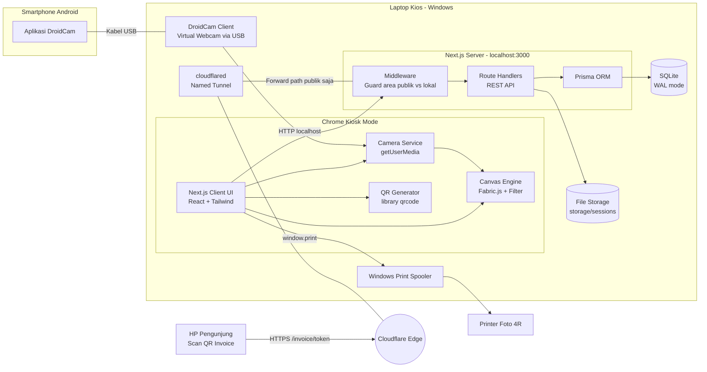

### 1.4 Batas Operasi Hardware dan Software

| Komponen | Batas / Ketentuan | Konsekuensi Desain |
|---|---|---|
| **Laptop** | 1 unit Windows 10/11, i5 gen-8+, RAM 8 GB, SSD. Sleep dimatikan | Satu sesi aktif sekaligus. Render dilakukan di browser |
| **Kamera** | HP Android + DroidCam Client via USB (virtual webcam). Resolusi efektif tergantung versi DroidCam | Constraint ideal 1280×720. Auto-select device berlabel "DroidCam". Fallback manual |
| **Browser** | Chrome/Edge kiosk, flag `--kiosk-printing`, auto-izin kamera | Cetak tanpa dialog. `localhost` termasuk *secure context* sehingga `getUserMedia` diizinkan |
| **Printer** | 1 printer foto 4R sebagai default printer | Layout cetak `@page 4in 6in`, margin 0 |
| **Database** | SQLite (default). MySQL opsional lewat penggantian provider Prisma | File DB tunggal, mudah dibackup, WAL aktif |
| **Storage** | Disk lokal `storage/` di luar `public/` | Tidak ada directory listing. File disajikan lewat API |
| **Jaringan** | Alur inti tanpa internet. `cloudflared` memerlukan internet keluar | Invoice publik hanya aktif saat tunnel online |
| **Daya** | Laptop dan HP harus tersambung daya | Checklist setup, peringatan baterai di dashboard |

#### Matriks Graceful Degradation

| Kondisi | Deteksi | Perilaku Sistem | Aksi Operator |
|---|---|---|---|
| Kamera putus | `track.onended`, `devicechange` | Sesi dijeda, overlay "KAMERA TERPUTUS", status sesi tetap | Cek kabel/DroidCam lalu **Sambungkan Ulang** |
| Printer error / kertas habis | `PrintJob.FAILED` atau timeout | Sesi tetap `COMPLETED`, lencana peringatan, tombol **Cetak Ulang** | Isi kertas lalu cetak ulang dari layar atau dashboard |
| Tunnel/internet mati | Polling `/api/health` (cek `cloudflared`) | Invoice dan QR tetap dibuat. Lencana "Link aktif saat internet tersambung" | Nyalakan hotspot/Wi-Fi |
| DB terkunci (`SQLITE_BUSY`) | Error Prisma | Retry exponential backoff (3×), lalu pesan ramah | Cek log, restart bila perlu |
| Browser refresh/crash | Sesi `PAID` belum `COMPLETED` | Layar "Lanjutkan sesi?" khusus operator (≤ 15 menit) | Lanjutkan atau void |
| Disk hampir penuh (< 2 GB) | `/api/health` | Peringatan di dashboard dan landing (operator-only) | Bersihkan/backup data |
| Server mati | Process monitor (PM2/NSSM) | Auto-restart ≤ 15 detik | Tidak perlu aksi |

### 1.5 Keputusan Arsitektur (ADR Ringkas)

| # | Keputusan | Alternatif | Alasan |
|---|---|---|---|
| ADR-01 | **SQLite + Prisma** sebagai default | MySQL | Zero-config, satu file, mudah backup, cukup untuk 1 kios. MySQL bisa diaktifkan lewat provider |
| ADR-02 | Pemrosesan gambar **di browser** (Canvas/Fabric.js) | Server-side (sharp/node-canvas) | Pratinjau filter instan, tanpa transfer tambahan, server tetap ringan |
| ADR-03 | **Fabric.js** untuk komposisi final. Canvas native untuk capture | Canvas native penuh | Fabric memudahkan penempatan objek, slot, overlay, dan filter. Capture butuh jalur tercepat (native `drawImage`) |
| ADR-04 | Cetak via **`window.print()` + Chrome `--kiosk-printing`** | Print server (node-printer, SumatraPDF CLI) | Paling sederhana. Tanpa dependensi native. Dapat di-upgrade ke SumatraPDF CLI bila perlu kontrol penuh |
| ADR-05 | QR dibuat **di browser** (library `qrcode`) | Server atau layanan eksternal | Offline, cepat, tanpa dependensi jaringan |
| ADR-06 | **Named Tunnel** Cloudflare (hostname tetap) | Quick Tunnel (URL acak) | QR harus stabil. Hostname tetap memudahkan `PUBLIC_BASE_URL` |
| ADR-07 | State sesi: **Zustand** (memori) + DB sebagai *source of truth* | Redux, Context | Ringan. Blob foto di memori untuk kecepatan, DB untuk recovery |
| ADR-08 | Status berupa **String + konstanta TypeScript** (divalidasi zod) | Prisma enum | Kompatibel luas lintas versi Prisma/provider (SQLite vs MySQL) |
| ADR-09 | Font dan ikon **self-hosted** (`next/font/local` atau `@fontsource`) | Google Fonts CDN | Wajib offline |

### 1.6 Struktur Proyek, Rute, dan API

#### Struktur Folder

```text
photobooth/
├─ prisma/
│  ├─ schema.prisma
│  ├─ seed.ts                      # frame default + setting awal
│  └─ migrations/
├─ storage/                        # DI LUAR public/, di-gitignore
│  ├─ sessions/{sessionId}/raw-1.jpg ... raw-5.jpg, final.jpg
│  └─ backups/
├─ public/
│  ├─ frames/                      # overlay PNG + thumbnail frame
│  ├─ qris/qris.png                # gambar QRIS statis
│  └─ fonts/                       # bila memakai next/font/local
├─ src/
│  ├─ app/
│  │  ├─ (kiosk)/
│  │  │  ├─ page.tsx               # Landing
│  │  │  ├─ payment/[transactionId]/page.tsx
│  │  │  └─ session/[sessionId]/
│  │  │     ├─ frame/page.tsx
│  │  │     ├─ capture/page.tsx
│  │  │     ├─ select/page.tsx
│  │  │     ├─ filter/page.tsx
│  │  │     └─ result/page.tsx     # QR + status cetak
│  │  ├─ user/                
│  │  │  ├─ page.tsx
│  │  │  ├─ transactions/page.tsx
│  │  ├─ invoice/[token]/page.tsx 
│  │  └─ api/
│  │     ├─ transactions/...
│  │     ├─ sessions/...
│  │     ├─ operator/...
│  │     ├─ public/invoice/[token]/(route|image)/route.ts
│  │     └─ health/route.ts
│  ├─ components/ui/               # Button, Card, Modal, Badge, Numpad, ...
│  ├─ features/
│  │  ├─ camera/                   # CameraService, useCamera, CaptureEngine
│  │  ├─ canvas/                   # CanvasComposer, filters
│  │  ├─ print/                    # PrintFrame, printService
│  │  └─ invoice/                  # token, qr
│  ├─ lib/                         # prisma client, storage, logger, zod schemas
│  ├─ stores/                      # zustand session store
│  └─ middleware.ts                # pemisah area publik vs lokal
├─ scripts/
│  ├─ start-kiosk.bat              # server + tunnel + chrome kiosk
│  └─ backup.ps1
├─ cloudflared/config.yml
└─ .env
```

#### Rute UI

| Rute | Area | Keterangan |
|---|---|---|
| `/` | Kios | Landing |
| `/payment/[transactionId]` | Kios | Pembayaran |
| `/session/[sessionId]/frame` | Kios | Pilih frame (hanya jika transaksi `PAID`) |
| `/session/[sessionId]/capture` | Kios | Viewfinder + 5× jepret |
| `/session/[sessionId]/select` | Kios | Seleksi 2 dari 5 |
| `/session/[sessionId]/filter` | Kios | Editor filter + render |
| `/session/[sessionId]/result` | Kios | QR invoice + cetak |
| `/invoice/[token]` | **Publik** | Halaman invoice |

#### Kontrak API

| Method | Path | Area | Fungsi | Respons Utama |
|---|---|---|---|---|
| `POST` | `/api/transactions` | Lokal | Buat transaksi `PENDING` | `201 {id, code, amount, expiresAt}` |
| `GET` | `/api/transactions/:id` | Lokal | Status transaksi (polling ringan) | `200 {status, expiresAt}` |
| `PATCH` | `/api/transactions/:id/confirm` | Lokal + PIN | `PENDING → PAID`, buat `PhotoSession` | `200 {sessionId}` / `401` / `409` |
| `PATCH` | `/api/transactions/:id/cancel` | Lokal + PIN | `PENDING → CANCELLED` | `200` |
| `GET` | `/api/frames` | Lokal | Daftar frame aktif | `200 [Frame]` |
| `PATCH` | `/api/sessions/:id/frame` | Lokal (`PAID`) | Simpan frame terpilih | `200` |
| `POST` | `/api/sessions/:id/photos` | Lokal (`PAID`) | Upload foto mentah (multipart: `shotIndex`, `file`) | `201 {photoId}` |
| `PUT` | `/api/sessions/:id/selection` | Lokal (`PAID`) | Simpan 2 foto terpilih (urut) | `200` |
| `POST` | `/api/sessions/:id/finalize` | Lokal (`PAID`) | Upload `final.jpg` + `filter`, buat `Invoice` | `201 {invoiceNumber, token, publicUrl}` |
| `POST` | `/api/sessions/:id/print` | Lokal | Catat `PrintJob` (auto/reprint) | `201 {printJobId}` |
| `PATCH` | `/api/print-jobs/:id` | Lokal | Update status cetak (`SENT`/`FAILED`) | `200` |
| `GET` | `/api/public/invoice/:token` | **Publik** | Data invoice (tanpa data internal) | `200` / `404` seragam |
| `GET` | `/api/public/invoice/:token/image` | **Publik** | Stream `final.jpg` (mendukung `?download=1`) | `200 image/jpeg` / `404` |
| `POST` | `/api/operator/login` | Lokal | Verifikasi PIN → sesi operator (cookie httpOnly) | `200` / `401` / `429` |
| `GET/PATCH` | `/api/operator/settings` | Lokal + Operator | Baca/ubah pengaturan | `200` |
| `GET` | `/api/operator/transactions` | Lokal + Operator | Daftar + rekap + ekspor CSV | `200` |
| `POST` | `/api/operator/sessions/:id/void` | Lokal + Operator | Void sesi + hapus file | `200` |
| `POST` | `/api/operator/invoices/:id/revoke` | Lokal + Operator | Cabut token | `200` |
| `GET` | `/api/health` | Lokal | DB, disk, storage, tunnel | `200 {...}` |

#### Prinsip Middleware (Pemisah Area)

```text
Request masuk
 ├─ Memiliki header Cf-Connecting-Ip / Cf-Ray ? (= datang via Cloudflare Tunnel)
 │    ├─ Path cocok ^/(invoice|api/public|_next|favicon) ?  → LANJUT
 │    └─ selain itu                                          → 404 (jangan bocorkan keberadaan rute)
 └─ Tanpa header Cloudflare (akses localhost langsung)
      ├─ /operator/** , /api/operator/**                     → wajib cookie sesi operator
      └─ rute kios                                           → LANJUT (guard status PAID di handler)
```

---

## 2. BPMN / System Workflow

Diagram berikut memetakan proses bisnis end-to-end dari **Landing Page** hingga **cetak foto** dalam bentuk *swimlane* sederhana (Pengunjung, Operator, Sistem).

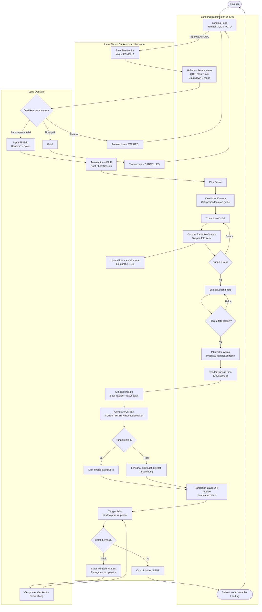

**Titik kontrol (control gates) penting:**

| Gate | Aturan |
|---|---|
| G1 | Rute `/session/**` hanya dapat diakses bila `Transaction.status = PAID` (guard server) |
| G2 | `confirm` hanya valid dari status `PENDING` dan sebelum `expiresAt` |
| G3 | `finalize` hanya valid jika tepat `slotCount` foto terpilih |
| G4 | Invoice hanya dibuat satu kali per sesi (idempoten) |
| G5 | Cetak ulang tidak membuat transaksi atau invoice baru |

---

## 3. UML Diagrams

### 3.1 Use Case Diagram

Mermaid tidak memiliki tipe *use case diagram* native. Diagram berikut memakai `flowchart` dengan konvensi UML: aktor di luar batas sistem, *use case* berbentuk elips di dalam *system boundary*, serta relasi `«include»` dan `«extend»` sebagai garis putus-putus.

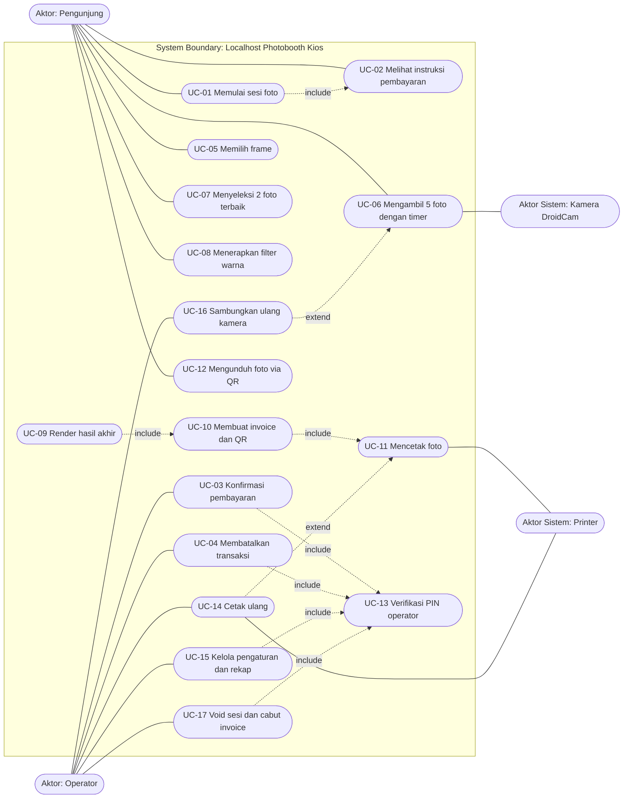

**Deskripsi singkat use case utama**

| ID | Use Case | Aktor | Pra-kondisi | Pasca-kondisi |
|---|---|---|---|---|
| UC-01 | Memulai sesi foto | Pengunjung | Kios idle di Landing | `Transaction PENDING` dibuat |
| UC-03 | Konfirmasi pembayaran | Operator | Transaksi `PENDING`, belum expired, PIN valid | `PAID` + `PhotoSession` dibuat |
| UC-06 | Mengambil 5 foto | Pengunjung, Kamera | Transaksi `PAID`, frame terpilih, kamera aktif | 5 `Photo` tersimpan |
| UC-09 | Render hasil akhir | Pengunjung | 2 foto + filter dipilih | `final.jpg` tersimpan |
| UC-10 | Membuat invoice dan QR | Sistem | `final.jpg` ada | `Invoice` + token + QR tampil |
| UC-11 | Mencetak foto | Printer | `final.jpg` ada | `PrintJob` tercatat |
| UC-12 | Mengunduh foto via QR | Pengunjung (HP sendiri) | Token valid, tunnel online | File terunduh |

### 3.2 Sequence Diagrams

#### 3.2.1 Pembayaran dan Konfirmasi Operator

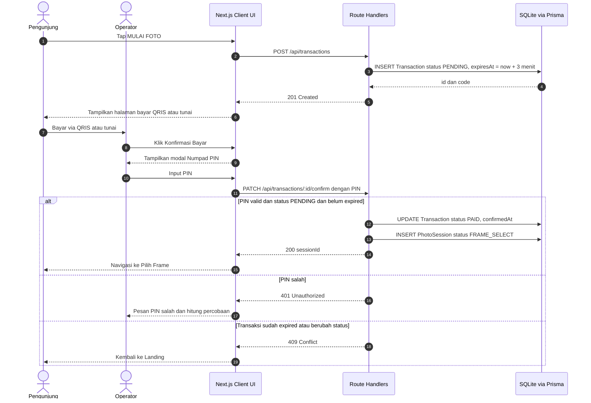

#### 3.2.2 Pengambilan Foto (5× Jepret)

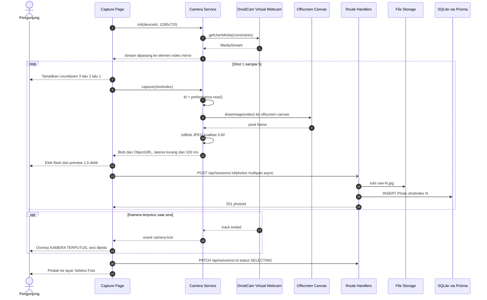

#### 3.2.3 Seleksi, Manipulasi Canvas, dan Render Final

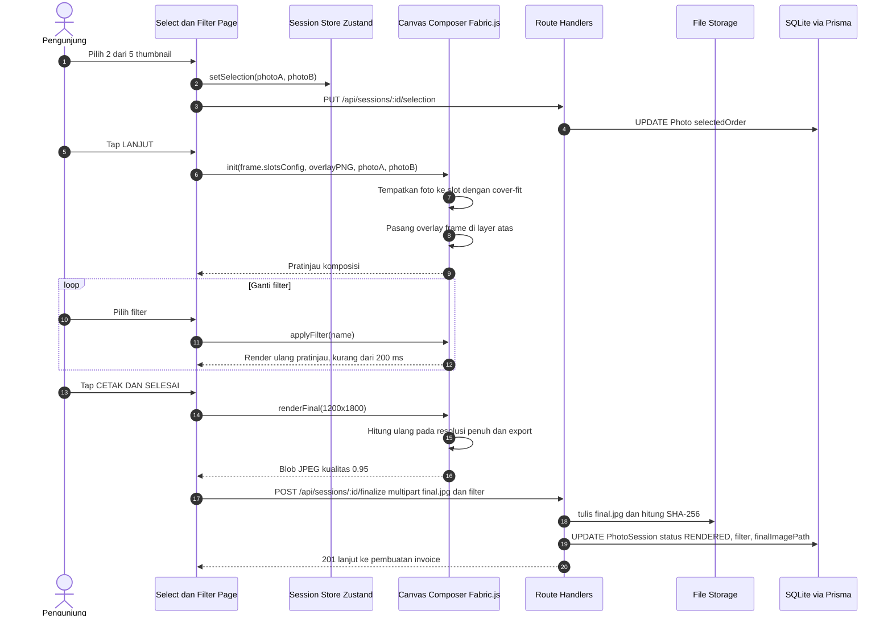

#### 3.2.4 Invoice QR Code, Cetak, dan Akses Publik

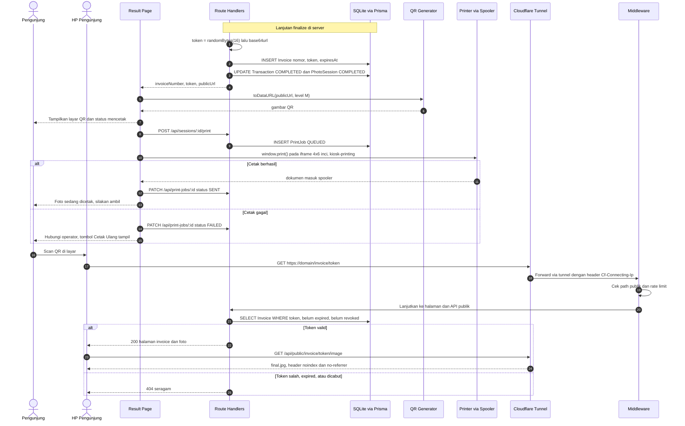

### 3.3 Class Diagram dan ERD

#### 3.3.1 ERD (Skema Database)

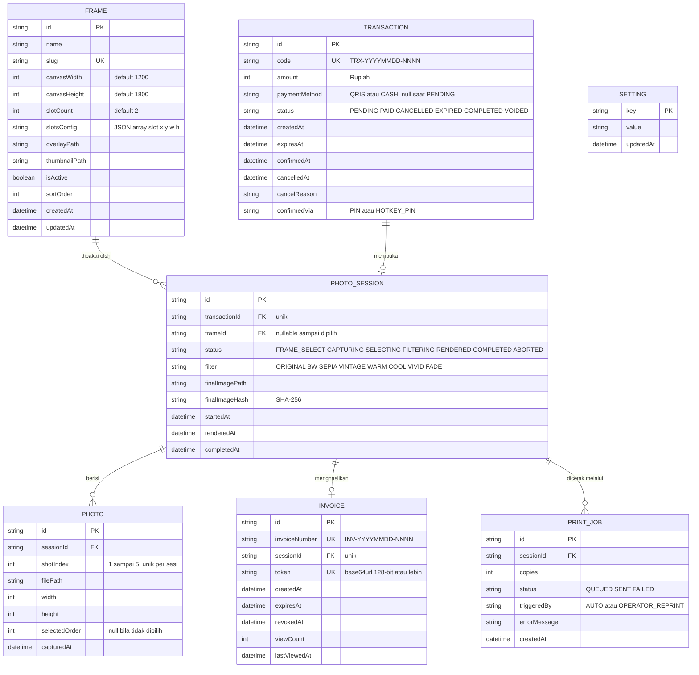

**Indeks dan constraint penting**

| Tabel | Constraint / Indeks | Tujuan |
|---|---|---|
| `Transaction` | `UNIQUE(code)`, `INDEX(status, createdAt)` | Rekap harian dan pencarian cepat |
| `PhotoSession` | `UNIQUE(transactionId)` | 1 transaksi = 1 sesi |
| `Photo` | `UNIQUE(sessionId, shotIndex)`, `CHECK shotIndex BETWEEN 1 AND 5` | Mencegah duplikasi foto |
| `Invoice` | `UNIQUE(token)`, `UNIQUE(sessionId)`, `INDEX(expiresAt)` | Lookup token O(1), idempoten, job retensi |
| `PrintJob` | `INDEX(sessionId, createdAt)` | Riwayat cetak |
| `Setting` | `PRIMARY KEY(key)` | Key-value konfigurasi: `price`, `qrisImagePath`, `operatorPinHash`, `publicBaseUrl`, `invoiceTtlDays`, `paymentTimeoutSec`, `retentionDays`, `cameraDeviceId`, `printCopies`, `mirrorOutput` |

**Skema Prisma (acuan model)**

> Sesuaikan blok `generator` dan `datasource` dengan versi Prisma yang dipakai (konfigurasi koneksi berbeda antar versi major). Model di bawah sengaja memakai `String` untuk status dan JSON agar kompatibel antar provider (SQLite/MySQL).

```prisma
model Frame {
  id            String         @id @default(cuid())
  name          String
  slug          String         @unique
  canvasWidth   Int            @default(1200)
  canvasHeight  Int            @default(1800)
  slotCount     Int            @default(2)
  slotsConfig   String         // JSON: [{ "x":100,"y":100,"w":1000,"h":700 }, ...]
  overlayPath   String
  thumbnailPath String
  isActive      Boolean        @default(true)
  sortOrder     Int            @default(0)
  createdAt     DateTime       @default(now())
  updatedAt     DateTime       @updatedAt
  sessions      PhotoSession[]
}

model Transaction {
  id            String        @id @default(cuid())
  code          String        @unique
  amount        Int
  paymentMethod String?
  status        String        @default("PENDING")
  createdAt     DateTime      @default(now())
  expiresAt     DateTime
  confirmedAt   DateTime?
  cancelledAt   DateTime?
  cancelReason  String?
  confirmedVia  String?
  session       PhotoSession?

  @@index([status, createdAt])
}

model PhotoSession {
  id              String      @id @default(cuid())
  transactionId   String      @unique
  frameId         String?
  status          String      @default("FRAME_SELECT")
  filter          String      @default("ORIGINAL")
  finalImagePath  String?
  finalImageHash  String?
  startedAt       DateTime    @default(now())
  renderedAt      DateTime?
  completedAt     DateTime?
  transaction     Transaction @relation(fields: [transactionId], references: [id])
  frame           Frame?      @relation(fields: [frameId], references: [id])
  photos          Photo[]
  invoice         Invoice?
  printJobs       PrintJob[]
}

model Photo {
  id            String       @id @default(cuid())
  sessionId     String
  shotIndex     Int
  filePath      String
  width         Int
  height        Int
  selectedOrder Int?
  capturedAt    DateTime     @default(now())
  session       PhotoSession @relation(fields: [sessionId], references: [id], onDelete: Cascade)

  @@unique([sessionId, shotIndex])
}

model Invoice {
  id            String       @id @default(cuid())
  invoiceNumber String       @unique
  sessionId     String       @unique
  token         String       @unique
  createdAt     DateTime     @default(now())
  expiresAt     DateTime
  revokedAt     DateTime?
  viewCount     Int          @default(0)
  lastViewedAt  DateTime?
  session       PhotoSession @relation(fields: [sessionId], references: [id], onDelete: Cascade)

  @@index([expiresAt])
}

model PrintJob {
  id           String       @id @default(cuid())
  sessionId    String
  copies       Int          @default(1)
  status       String       @default("QUEUED")
  triggeredBy  String       @default("AUTO")
  errorMessage String?
  createdAt    DateTime     @default(now())
  session      PhotoSession @relation(fields: [sessionId], references: [id], onDelete: Cascade)

  @@index([sessionId, createdAt])
}

model Setting {
  key       String   @id
  value     String
  updatedAt DateTime @updatedAt
}
```

**Contoh `slotsConfig` untuk frame default "Classic Duo" (4R, 2 slot)**

```json
[
  { "x": 100, "y": 100,  "w": 1000, "h": 700, "rotation": 0 },
  { "x": 100, "y": 850,  "w": 1000, "h": 700, "rotation": 0 }
]
```

Area footer (y = 1600 sampai 1800) untuk logo, tanggal, atau QR opsional. Kamera 16:9 di-*crop* cover-fit ke slot 10:7, dan *crop guide* di viewfinder memakai rasio yang sama.

#### 3.3.2 Class Diagram (Modul Inti Sisi Aplikasi)

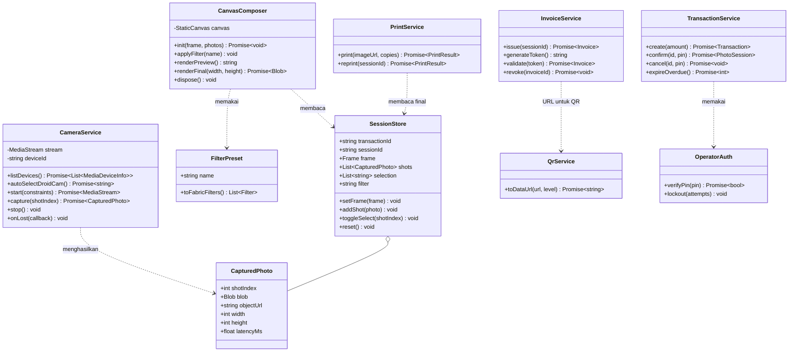

#### 3.3.3 State Diagram Transaksi dan Sesi

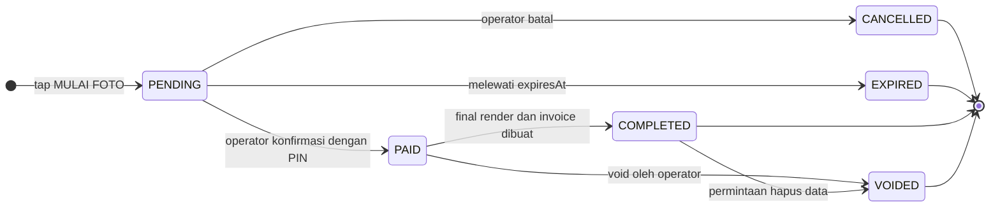

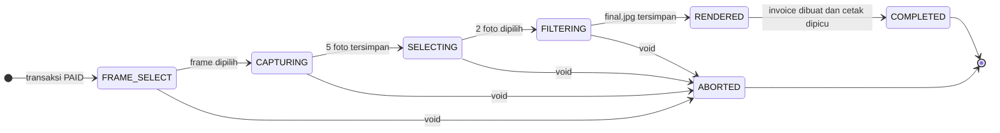

---

## 4. UI/UX Design System Specification

### 4.1 Spesifikasi Gaya Neo-Brutalism

#### 4.1.1 Prinsip Desain

| # | Prinsip | Penjabaran |
|---|---|---|
| 1 | **Jujur dan tegas** | Tidak ada gradien, blur, glassmorphism, atau bayangan lembut. Elemen terlihat apa adanya: kotak, garis tebal, warna datar |
| 2 | **Satu layar, satu aksi** | Tiap layar hanya punya satu aksi dominan (tombol kuning/hijau terbesar) |
| 3 | **Ramah sentuh** | Target ≥ 64 px, tombol utama ≥ 96 px, jarak antar target ≥ 16 px |
| 4 | **Kontras maksimum** | Teks selalu hitam di atas warna terang. Batas elemen selalu hitam tebal |
| 5 | **Playful tapi terkontrol** | Stiker miring (±3°) hanya untuk dekorasi non-interaktif |
| 6 | **Status tidak hanya warna** | Setiap status memakai label teks atau ikon, bukan warna saja |
| 7 | **Offline-safe** | Font, ikon, dan gambar di-bundle. Tidak ada request eksternal |

#### 4.1.2 Palet Warna

| Token | Hex | Peran | Kontras dengan teks hitam |
|---|---|---|---|
| `ink` | `#000000` | Teks, border, bayangan | n/a |
| `paper` | `#FFFBEB` | Latar halaman (dengan dot grid halus) | ≈ 19:1 |
| `white` | `#FFFFFF` | Kartu, input | 21:1 |
| `brand-yellow` | `#FFDE00` | **Aksi utama**, sorotan, tombol terpilih | ≈ 15,7:1 |
| `brand-pink` | `#FF6BB5` | Aksen playful, sekunder, stiker | ≈ 8:1 |
| `brand-cyan` | `#4DD8FF` | Info, item terpilih (radio), badge status | ≈ 12,6:1 |
| `brand-green` | `#3DDC84` | Sukses, **Konfirmasi Bayar**, Cetak & Selesai | ≈ 11,8:1 |
| `brand-red` | `#FF4D4D` | Bahaya, **Batal**, error, kamera terputus | ≈ 6,4:1 (gunakan teks tebal ≥ 24 px) |
| `brand-violet` | `#B197FC` | Dekoratif, placeholder foto | ≈ 8,7:1 |

**Aturan penggunaan:** komposisi sekitar **60%** paper/white, **30%** hitam (garis dan bayangan), **10%** warna aksen. Satu layar maksimal 2 warna aksen dominan.

**Pola latar (dot grid):**
`background-image: radial-gradient(#00000026 2px, transparent 2px); background-size: 24px 24px;`

#### 4.1.3 Tipografi

| Peran | Font | Bobot | Ukuran (1080p) | Catatan |
|---|---|---|---|---|
| Display / Judul / Tombol | **Archivo Black** (alternatif: Space Grotesk 700) | 900 | Hero 72–96 px, judul 40–56 px, tombol 28–40 px | `uppercase`, `tracking-tight`, `leading-none` |
| Isi / Label | **Space Grotesk** | 500–700 | ≥ 20 px | Teks bantu ≥ 16 px (hanya non-kritis) |
| Angka / Kode / Timer | **Space Mono** | 700 | 20–48 px | Kode transaksi, harga, timer |
| Countdown | Archivo Black | 900 | **280–360 px** | Isi kuning, `-webkit-text-stroke: 6px #000`, `text-shadow: 8px 8px 0 #000` |

> **Wajib offline:** pakai `next/font/local` dengan file `.woff2` di repo, atau paket `@fontsource/*`. Hindari `<link>` ke Google Fonts di runtime.

#### 4.1.4 Border, Shadow, Radius, Spacing

| Properti | Nilai | Pemakaian |
|---|---|---|
| **Border kecil** | `3px solid #000` | Badge, chip, input kecil, thumbnail |
| **Border utama** | `4px solid #000` | Kartu, tombol, modal, viewfinder |
| **Radius** | `0` (sudut tajam) | Semua elemen |
| **Hard shadow sm** | `2px 2px 0 0 #000` | Badge, chip |
| **Hard shadow md (default)** | **`4px 4px 0px #000`** | Tombol md, kartu kecil |
| **Hard shadow lg** | `6px 6px 0 0 #000` | Kartu, tombol lg |
| **Hard shadow xl** | `8px 8px 0 0 #000` | Modal, elemen terpilih, hero |
| **Efek tekan** | `translate(4px, 4px)` + `shadow: none` | Semua tombol saat `:active` |
| **Spacing** | Grid 8 px. Padding halaman 32 px. Padding kartu 24 px. Gap 24 px | |
| **Z-order** | Konten 0 · Sticker 10 · Modal overlay 50 (`bg-black/70`) · Toast 60 | |

#### 4.1.5 Spesifikasi Komponen

| Komponen | Spesifikasi | State |
|---|---|---|
| **Button** | `border-4 border-ink shadow-brut font-display uppercase`. Ukuran: `md` h-16 (text-2xl), `lg` h-24 (text-3xl, shadow-brut-lg), `xl` h-28 (text-4xl, shadow-brut-xl, full width di hero). Varian: `primary` kuning, `secondary` putih, `success` hijau, `danger` merah, `ghost` transparan + border | `active`: geser 4 px, shadow hilang. `disabled`: latar garis-garis abu terang, teks abu tua, tanpa shadow. `loading`: label diganti ("MEMBUAT SESI...") + ikon berputar `steps(8)`. `focus-visible`: outline 4 px hitam, offset 4 px |
| **Card** | `bg-white border-4 border-ink shadow-brut-lg p-6`. Opsi header strip berwarna (`border-b-4`, `font-display`) | `selected`: shadow-brut-xl + header cyan "✓ DIPILIH" |
| **Badge / Chip** | `border-3 px-3 py-1 font-mono uppercase text-base shadow-brut-sm` | Warna status: `PENDING` kuning, `PAID` cyan, `COMPLETED` hijau, `CANCELLED` merah, `EXPIRED` pink, `VOIDED` violet |
| **Stepper** | 6 kotak 56×56 px (`border-4`) dengan angka, disambung garis 4 px. Langkah aktif = kuning, selesai = hijau + ✓, belum = putih | Label di bawah (BAYAR, FRAME, FOTO, PILIH, FILTER, CETAK) |
| **Modal** | Overlay `bg-black/70`. Kartu `border-4 shadow-brut-xl`, maks 640 px, header strip berwarna | Animasi masuk `pop` 200 ms `steps(3)` |
| **Numpad** | Tombol 80×80 px (`border-4 shadow-brut`), grid 3×4, `C` merah, `OK` hijau | `active`: efek tekan |
| **PinDots** | 4–6 kotak 40×40 `border-4`. Terisi = hitam penuh | Salah: animasi `shake` |
| **Input** | `h-14 border-4 bg-white px-4 text-xl font-sans` | `focus`: latar kuning + outline 4 px |
| **Toggle (Metode)** | Dua tombol berdampingan, terpilih = cyan + ikon ✓ | |
| **PhotoThumb** | Rasio 10:7, `border-4`, badge urutan (kotak kuning, rotasi -3°, `font-display` 40 px) | `selected`: shadow-xl + badge. `empty`: border putus-putus |
| **FilterChip** | Tombol 96 px tinggi: swatch contoh + label | `selected`: kuning + ✓ + shadow-xl |
| **Countdown** | Lihat tipografi. Animasi `pop` (scale 1,5→1) `steps(4)` 300 ms tiap angka | `prefers-reduced-motion`: tanpa animasi |
| **FlashOverlay** | Layar putih penuh `inset-0`, opacity 1→0, 180 ms `steps(3)` | Hanya saat capture |
| **Toast** | Kartu kecil di kanan atas, `border-4`, merah (error) / hijau (sukses), auto-hilang 4 detik | |
| **ProgressBlock** | Bilah blok-blok 16 px, terisi hitam/hijau, animasi `steps(n)` | Cetak dan render |

#### 4.1.6 Motion

| Aturan | Nilai |
|---|---|
| Timing function | **`steps(n)`** saja (kesan patah-patah khas brutalism), tanpa `ease` |
| Durasi | 100–300 ms. Idle attract loop 1,2 detik |
| Efek | `pop` (countdown/modal), `flash` (capture), `shake` (input salah), `wiggle` (stiker/tombol landing) |
| Aksesibilitas | `@media (prefers-reduced-motion: reduce)` mematikan semua animasi non-esensial |

#### 4.1.7 Aturan Kiosk dan Sentuh

- `user-select: none`, `touch-action: manipulation`, `overscroll-behavior: none`, `-webkit-tap-highlight-color: transparent`.
- Matikan context menu (`contextmenu` → `preventDefault`), drag gambar, pinch-zoom.
- Tidak ada UI yang bergantung pada *hover*.
- Debounce tombol utama 400 ms.
- Kursor disembunyikan pada layar kios (`cursor: none`) bila perangkat sentuh (opsional).
- Gunakan `Wake Lock API` agar layar tidak mati.

#### 4.1.8 Konfigurasi Tailwind (Token Design System)

> Contoh untuk `tailwind.config.ts` (gaya v3). Pada Tailwind v4, pindahkan token yang sama ke blok `@theme` di CSS utama.

```ts
// tailwind.config.ts
import type { Config } from "tailwindcss";

const config: Config = {
  content: ["./src/**/*.{ts,tsx}"],
  theme: {
    extend: {
      colors: {
        ink: "#000000",
        paper: "#FFFBEB",
        brand: {
          yellow: "#FFDE00",
          pink: "#FF6BB5",
          cyan: "#4DD8FF",
          green: "#3DDC84",
          red: "#FF4D4D",
          violet: "#B197FC",
        },
      },
      fontFamily: {
        display: ["var(--font-display)", "Impact", "sans-serif"],
        sans: ["var(--font-body)", "system-ui", "sans-serif"],
        mono: ["var(--font-mono)", "ui-monospace", "monospace"],
      },
      borderWidth: { 3: "3px", 4: "4px" },
      borderRadius: { none: "0" },
      boxShadow: {
        "brut-sm": "2px 2px 0 0 #000",
        brut: "4px 4px 0 0 #000",
        "brut-lg": "6px 6px 0 0 #000",
        "brut-xl": "8px 8px 0 0 #000",
      },
      keyframes: {
        pop:   { "0%": { transform: "scale(1.5)" }, "100%": { transform: "scale(1)" } },
        flash: { "0%": { opacity: "1" }, "100%": { opacity: "0" } },
        shake: { "0%,100%": { transform: "translateX(0)" }, "25%": { transform: "translateX(-8px)" }, "75%": { transform: "translateX(8px)" } },
        wiggle:{ "0%,100%": { transform: "rotate(-2deg)" }, "50%": { transform: "rotate(2deg)" } },
      },
      animation: {
        pop: "pop 300ms steps(4) both",
        flash: "flash 180ms steps(3) forwards",
        shake: "shake 240ms steps(4)",
        wiggle: "wiggle 1.2s steps(2) infinite",
      },
    },
  },
  plugins: [],
};
export default config;
```

```ts
// src/app/layout.tsx (font self-hosted, aman offline)
import localFont from "next/font/local";

const display = localFont({ src: "../assets/fonts/ArchivoBlack-Regular.woff2", variable: "--font-display", display: "swap" });
const body = localFont({
  src: [
    { path: "../assets/fonts/SpaceGrotesk-Medium.woff2", weight: "500" },
    { path: "../assets/fonts/SpaceGrotesk-Bold.woff2", weight: "700" },
  ],
  variable: "--font-body",
  display: "swap",
});
const mono = localFont({ src: "../assets/fonts/SpaceMono-Bold.woff2", variable: "--font-mono", display: "swap" });

export default function RootLayout({ children }: { children: React.ReactNode }) {
  return (
    <html lang="id" className={`${display.variable} ${body.variable} ${mono.variable}`}>
      <body className="min-h-screen bg-paper font-sans text-ink antialiased">{children}</body>
    </html>
  );
}
```

```css
/* src/app/globals.css (potongan penting untuk mode kios) */
html, body { height: 100%; }
body {
  background-color: #FFFBEB;
  background-image: radial-gradient(#00000026 2px, transparent 2px);
  background-size: 24px 24px;
  user-select: none;
  -webkit-user-select: none;
  touch-action: manipulation;
  overscroll-behavior: none;
  -webkit-tap-highlight-color: transparent;
}
img { -webkit-user-drag: none; user-select: none; }
:focus-visible { outline: 4px solid #000; outline-offset: 4px; }

/* Didaftarkan sebagai utility agar bisa dipakai dengan varian, mis. disabled:disabled-stripes.
   (Tailwind v3: @layer utilities. Tailwind v4: gunakan @utility disabled-stripes { ... }) */
@layer utilities {
  .disabled-stripes {
    background-image: repeating-linear-gradient(45deg, #E5E5E5 0 8px, #D4D4D4 8px 16px);
    color: #525252;
    box-shadow: none;
  }
  .text-outline { -webkit-text-stroke: 6px #000; paint-order: stroke fill; text-shadow: 8px 8px 0 #000; }
}

@media (prefers-reduced-motion: reduce) {
  *, *::before, *::after { animation: none !important; transition: none !important; }
}
```

```tsx
// src/components/ui/Button.tsx (referensi implementasi)
import { ButtonHTMLAttributes } from "react";

type Variant = "primary" | "secondary" | "success" | "danger" | "ghost";
type Size = "md" | "lg" | "xl";

const variants: Record<Variant, string> = {
  primary: "bg-brand-yellow",
  secondary: "bg-white",
  success: "bg-brand-green",
  danger: "bg-brand-red",
  ghost: "bg-transparent",
};
const sizes: Record<Size, string> = {
  md: "h-16 px-6 text-2xl shadow-brut",
  lg: "h-24 px-8 text-3xl shadow-brut-lg",
  xl: "h-28 px-10 text-4xl shadow-brut-xl",
};

export function Button({
  variant = "primary", size = "lg", className = "", ...props
}: ButtonHTMLAttributes<HTMLButtonElement> & { variant?: Variant; size?: Size }) {
  return (
    <button
      {...props}
      className={[
        "inline-flex items-center justify-center gap-3 border-4 border-ink font-display uppercase leading-none tracking-tight",
        "select-none active:translate-x-1 active:translate-y-1 active:shadow-none",
        "disabled:disabled-stripes disabled:cursor-not-allowed disabled:active:translate-x-0 disabled:active:translate-y-0",
        variants[variant], sizes[size], className,
      ].join(" ")}
    />
  );
}
```

### 4.2 Wireframe Layout (ASCII)

Target layar: **landscape 1366×768 hingga 1920×1080**. Semua wireframe berikut berskala 16:9 secara kasar. Header tiap layar memuat `STEP n/6` (kecuali Operator) dan status singkat. Tombol utama ditandai kotak tebal.

#### 4.2.1 Landing Page

**Rute:** `/`

```text
+----------------------------------------------------------------------------+
| [LOGO] PHOTOBOOTH KIOS                              CAM:OK  PRN:OK  NET:OK |
| -------------------------------------------------------------------------- |
|                                                                            |
| +------------------------------------+  +--------------------------------+ |
| |                                    |  | CONTOH HASIL                   | |
| |          ABADIKAN MOMENMU          |  +--------------------------------+ |
| |           DALAM 3 MENIT!           |  |                                | |
| |                                    |  |   +------------------------+   | |
| |    5x Jepret | Pilih 2 | Cetak     |  |   |                        |   | |
| |          Rp 25.000 / sesi          |  |   |       [ FOTO 1 ]       |   | |
| |                                    |  |   |                        |   | |
| |   +----------------------------+   |  |   +------------------------+   | |
| |   |                            |   |  |   +------------------------+   | |
| |   |       MULAI FOTO  >        |   |  |   |                        |   | |
| |   |                            |   |  |   |       [ FOTO 2 ]       |   | |
| |   +----------------------------+   |  |   |                        |   | |
| |                                    |  |   +------------------------+   | |
| |                                    |  |        PHOTOBOOTH 2026         | |
| |                                    |  |                                | |
| +------------------------------------+  +--------------------------------+ |
|                                                                            |
|    [1]BAYAR > [2]FRAME > [3]FOTO x5 > [4]PILIH 2 > [5]FILTER > [6]CETAK    |
|      Dengan menekan MULAI FOTO, Anda setuju foto disimpan sementara.       |
+----------------------------------------------------------------------------+
```

| Aspek | Spesifikasi |
|---|---|
| **Komponen** | `StatusStrip` (operator-only), `HeroCard`, `Button size=xl` "MULAI FOTO", `SampleStrip`, `StepRail`, `ConsentNote` |
| **Interaksi** | Tap "MULAI FOTO" → `POST /api/transactions` → `/payment/[id]`. Debounce 400 ms |
| **State** | `idle` / `creating` (tombol loading, nonaktif) / `error` (toast merah, boleh coba lagi) |
| **Catatan** | Animasi *attract loop* ringan (sticker bergoyang, `steps()` easing). Teks harga diambil dari `Setting.price` |

#### 4.2.2 Halaman Pembayaran

**Rute:** `/payment/[transactionId]`

```text
+----------------------------------------------------------------------------+
| STEP 1/6  PEMBAYARAN                                     SISA WAKTU  02:45 |
| -------------------------------------------------------------------------- |
|                                                                            |
| +----------------------------------+  +----------------------------------+ |
| | SCAN QRIS                        |  | RINGKASAN                        | |
| +----------------------------------+  +----------------------------------+ |
| |                                  |  |                                  | |
| |  +----------------------------+  |  | Kode   : TRX-20261013-0007       | |
| |  |                            |  |  | Metode : [QRIS]  [TUNAI]         | |
| |  |      [ GAMBAR QRIS ]       |  |  | Status : MENUNGGU PEMBAYARAN     | |
| |  |      (statis, lokal)       |  |  |                                  | |
| |  |                            |  |  | Sudah bayar? Tunggu operator     | |
| |  |                            |  |  | mengonfirmasi pembayaranmu.      | |
| |  +----------------------------+  |  |                                  | |
| |                                  |  | Waktu habis = kembali ke awal    | |
| |        TOTAL   Rp 25.000         |  |                                  | |
| |   atau bayar TUNAI ke operator   |  |                                  | |
| +----------------------------------+  +----------------------------------+ |
| +------------------------------------------------------------------------+ |
| |                                      | |
| +------------------------------------------------------------------------+ |
| |          +----------------------------+  +------------------+          | |
| |          |                            |  |                  |          | |
| |          |      KONFIRMASI BAYAR      |  |      BATAL       |          | |
| |          |                            |  |                  |          | |
| |          +----------------------------+  +------------------+          | |
| |        Hotkey: F2 = Konfirmasi | Esc = Batal         | |
| |                                                                        | |
| +------------------------------------------------------------------------+ |
+----------------------------------------------------------------------------+
```


#### 4.2.3 Pilih Frame

**Rute:** `/session/[sessionId]/frame`

```text
+----------------------------------------------------------------------------+
| STEP 2/6  PILIH FRAME                                         STATUS: PAID |
| -------------------------------------------------------------------------- |
|                          PILIH BINGKAI FAVORITMU                           |
|                                                                            |
| +---------------+  +---------------+  +---------------+  +---------------+ |
| | [X] DIPILIH   |  | [ ] pilih     |  | [ ] pilih     |  | [ ] pilih     | |
| +---------------+  +---------------+  +---------------+  +---------------+ |
| |               |  |               |  |               |  |               | |
| |  +---------+  |  |  +---------+  |  |  +---------+  |  |  +---------+  | |
| |  |  FOTO 1 |  |  |  |  FOTO 1 |  |  |  |  FOTO 1 |  |  |  |  FOTO 1 |  | |
| |  +---------+  |  |  +---------+  |  |  +---------+  |  |  +---------+  | |
| |  +---------+  |  |  +---------+  |  |  +---------+  |  |  +---------+  | |
| |  |  FOTO 2 |  |  |  |  FOTO 2 |  |  |  |  FOTO 2 |  |  |  |  FOTO 2 |  | |
| |  +---------+  |  |  +---------+  |  |  +---------+  |  |  +---------+  | |
| |               |  |               |  |               |  |               | |
| |  CLASSIC DUO  |  |    NEON POP   |  |    POLAROID   |  |   NIGHT MODE  | |
| |               |  |               |  |               |  |               | |
| |               |  |               |  |               |  |               | |
| +---------------+  +---------------+  +---------------+  +---------------+ |
|                                                                            |
|                       +----------------------------+                       |
|                       |                            |                       |
|                       |         LANJUT  >          |                       |
|                       |                            |                       |
|                       +----------------------------+                       |
+----------------------------------------------------------------------------+
```

| Aspek | Spesifikasi |
|---|---|
| **Komponen** | `FrameCard` (thumbnail, nama, penanda terpilih), `Grid` 4 kolom (maks 8 frame, sisanya geser horizontal), `Button` LANJUT |
| **Interaksi** | Tap kartu = pilih (radio). LANJUT → `PATCH /api/sessions/:id/frame` → `/capture` |
| **State** | Satu frame selalu terpilih (default urutan pertama) agar alur tidak buntu |
| **Guard** | Rute diblokir bila transaksi bukan `PAID` |

#### 4.2.4 Camera Viewfinder

**Rute:** `/session/[sessionId]/capture`

```text
+----------------------------------------------------------------------------+
| STEP 3/6  SESI FOTO                                             FOTO 2 / 5 |
| -------------------------------------------------------------------------- |
| +--------------------------------------------------+  +------------------+ |
| | VIEWFINDER (mirror) - DroidCam                   |  | HASIL            | |
| +--------------------------------------------------+  +------------------+ |
| |   +------------------------------------------+   |  |                  | |
| |   |                                          |   |  | [1]  OK          | |
| |   |                  #####                   |   |  | [2]  ... ambil   | |
| |   |                      #                   |   |  | [3]  -           | |
| |   |                  #####                   |   |  | [4]  -           | |
| |   |                  #                       |   |  | [5]  -           | |
| |   |                  #####                   |   |  |                  | |
| |   |                                          |   |  | FOTO 2 / 5       | |
| |   |       << CROP GUIDE rasio 10:7 >>        |   |  |                  | |
| |   |                                          |   |  |                  | |
| |   +------------------------------------------+   |  |                  | |
| +--------------------------------------------------+  +------------------+ |
|                                                                            |
|                     PROGRES:  [#]  [#]  [ ]  [ ]  [ ]                      |
|                 Lihat lensa HP. Foto berikutnya otomatis!                  |
+----------------------------------------------------------------------------+
```

| Aspek | Spesifikasi |
|---|---|
| **Komponen** | `<video>` mirror (`scale-x-[-1]`), `CropGuide` (rasio slot), `Countdown` (digit raksasa ≥ 240 px), `FlashOverlay`, `ShotRail` (5 slot hasil), `ProgressPips` |
| **Interaksi** | Otomatis: hitung mundur 3-2-1 → capture → flash → review 1,5 detik → foto berikutnya (total 5). Tidak ada tombol yang perlu ditekan pengunjung |
| **State** | `warming-up` / `countdown` / `capturing` / `reviewing` / `paused-camera-lost` / `done` |
| **Catatan** | Upload foto berjalan async di latar belakang. Sinyal kamera hilang memicu overlay (lihat §4.2.10) |

#### 4.2.5 Seleksi Foto

**Rute:** `/session/[sessionId]/select`

```text
+----------------------------------------------------------------------------+
| STEP 4/6  PILIH FOTO                                        TERPILIH 2 / 2 |
| -------------------------------------------------------------------------- |
|                           PILIH 2 FOTO TERBAIKMU                           |
|                                                                            |
| +------------+ +------------+ +------------+ +------------+ +------------+ |
| |            | |            | |            | |            | |            | |
| |   FOTO 1   | |   FOTO 2   | |   FOTO 3   | |   FOTO 4   | |   FOTO 5   | |
| |            | |            | |            | |            | |            | |
| |  <  1  >   | |            | |  <  2  >   | |            | |            | |
| |            | |            | |            | |            | |            | |
| |            | |            | |            | |            | |            | |
| |            | |            | |            | |            | |            | |
| +------------+ +------------+ +------------+ +------------+ +------------+ |
|                                                                            |
| +----------------------------------+  +----------------------------------+ |
| | PRATINJAU FRAME                  |  | PETUNJUK                         | |
| +----------------------------------+  +----------------------------------+ |
| |                                  |  | Ketuk foto untuk memilih.        | |
| |            [ FOTO 1 ]            |  | Pilih TEPAT 2 foto.              | |
| |            [ FOTO 3 ]            |  | Urutan pilih = urutan slot.      | |
| |                                  |  |                                  | |
| |                                  |  |  +----------------------------+  | |
| |                                  |  |  |                            |  | |
| |                                  |  |  |    LANJUT KE FILTER  >     |  | |
| |                                  |  |  |                            |  | |
| |                                  |  |  +----------------------------+  | |
| +----------------------------------+  +----------------------------------+ |
+----------------------------------------------------------------------------+
```

| Aspek | Spesifikasi |
|---|---|
| **Komponen** | `PhotoThumb` (border 4 px, badge urutan terpilih berputar -3°), `FramePreview`, `Button` LANJUT |
| **Interaksi** | Tap thumbnail = pilih/batal. Maksimal = `slotCount`. Pilihan ke-3 menggantikan yang terlama atau ditolak dengan *shake* |
| **State** | LANJUT nonaktif sampai tepat 2 terpilih. Pratinjau frame langsung memperbarui isi slot |

#### 4.2.6 Filter Editor

**Rute:** `/session/[sessionId]/filter`

```text
+----------------------------------------------------------------------------+
| STEP 5/6  FILTER                                           FILTER: VINTAGE |
| -------------------------------------------------------------------------- |
| +--------------------------------+  +------------------------------------+ |
| | PRATINJAU HASIL                |  | PILIH FILTER  (* = aktif)          | |
| +--------------------------------+  +------------------------------------+ |
| |                                |  | +--------------+  +--------------+ | |
| |       +----------------+       |  | |   ORIGINAL   |  |     B&W      | | |
| |       |                |       |  | +--------------+  +--------------+ | |
| |       |   [ FOTO 1 ]   |       |  | +--------------+  +--------------+ | |
| |       |                |       |  | |    SEPIA     |  |  * VINTAGE   | | |
| |       |   [ FOTO 3 ]   |       |  | +--------------+  +--------------+ | |
| |       |                |       |  | +--------------+  +--------------+ | |
| |       |                |       |  | |     WARM     |  |     COOL     | | |
| |       |                |       |  | +--------------+  +--------------+ | |
| |       |                |       |  | +--------------+  +--------------+ | |
| |       |                |       |  | |    VIVID     |  |     FADE     | | |
| |       +----------------+       |  | +--------------+  +--------------+ | |
| |         1200 x 1800 px         |  |                                    | |
| +--------------------------------+  +------------------------------------+ |
|        +----------------------+  +--------------------------------+        |
|        |                      |  |                                |        |
|        |     < GANTI FOTO     |  |       CETAK & SELESAI  >       |        |
|        |                      |  |                                |        |
|        +----------------------+  +--------------------------------+        |
+----------------------------------------------------------------------------+
```

| Aspek | Spesifikasi |
|---|---|
| **Komponen** | `CanvasPreview` (Fabric.js), `FilterChip` ×8, `Button` "GANTI FOTO" (kembali ke seleksi), `Button` "CETAK & SELESAI" |
| **Interaksi** | Tap chip = `applyFilter` (≤ 200 ms). "CETAK & SELESAI" → render final → `finalize` → `/result` |
| **State** | `idle` / `rendering` (overlay "MEMPROSES... 3 detik") / `error` (coba lagi). Tombol dikunci saat `rendering` |

#### 4.2.7 Layar QR Invoice dan Cetak

**Rute:** `/session/[sessionId]/result`

```text
+----------------------------------------------------------------------------+
| STEP 6/6  SELESAI                                        INV-20261013-0007 |
| -------------------------------------------------------------------------- |
| +----------------------+  +----------------------------+  +--------------+ |
| | HASIL FOTO           |  | SCAN UNTUK UNDUH           |  | CETAK        | |
| +----------------------+  +----------------------------+  +--------------+ |
| |                      |  |                            |  |              | |
| | +------------------+ |  |   +--------------------+   |  | Mencetak...  | |
| | |                  | |  |   |                    |   |  | [####    ]   | |
| | |    [ FOTO 1 ]    | |  |   |    [ QR CODE ]     |   |  | 1 salinan    | |
| | |                  | |  |   |                    |   |  |              | |
| | |    [ FOTO 2 ]    | |  |   |                    |   |  | Ambil di     | |
| | |                  | |  |   |                    |   |  | slot printer | |
| | |                  | |  |   +--------------------+   |  |              | |
| | |                  | |  |     INV-20261013-0007      |  |              | |
| | +------------------+ |  |       Berlaku 7 hari       |  |              | |
| |   Filter: VINTAGE    |  |                            |  |              | |
| +----------------------+  +----------------------------+  +--------------+ |
|            +----------------------------+  +------------------+            |
|            |  NET: ONLINE - link aktif  |  |                  |            |
|            | Cetak Ulang (operator): F4 |  |     SELESAI      |            |
|            |                            |  |                  |            |
|            +----------------------------+  +------------------+            |
|                    Auto-reset ke Landing dalam 30 detik                    |
+----------------------------------------------------------------------------+
```

| Aspek | Spesifikasi |
|---|---|
| **Komponen** | `FinalPreview`, `QrCard`, `PrintStatus` (progress bar bergaya blok), `NetBadge`, `Button` SELESAI |
| **Interaksi** | Cetak otomatis saat halaman dimuat. SELESAI atau auto-reset 30 detik → Landing. Hotkey operator `F4` = cetak ulang (PIN) |
| **State** | `printing` / `printed` / `print-failed` (kartu merah + "Cetak Ulang") / `offline-link` (lencana kuning "aktif saat internet tersambung") |
| **Catatan** | QR dibuat lokal dari `publicUrl`. Ukuran QR ≥ 280 px, kuiet zone ≥ 4 modul, latar putih |

#### 4.2.9 Halaman Invoice Publik (Mobile)

**Rute:** `/invoice/[token]  (diakses via domain publik)`

```text
+----------------------------------+  +----------------------------------+
|         PHOTOBOOTH KIOS          |  |                                  |
|    Invoice INV-20261013-0007     |  |                                  |
|                                  |  | +------------------------------+ |
|   +--------------------------+   |  | |                              | |
|   |                          |   |  | |     LINK TIDAK DITEMUKAN     | |
|   |      [ FOTO FINAL ]      |   |  | |                              | |
|   |                          |   |  | +------------------------------+ |
|   |                          |   |  |                                  |
|   |                          |   |  |    Tautan salah, kedaluwarsa,    |
|   +--------------------------+   |  |       atau sudah dicabut.        |
|                                  |  |                                  |
| Tanggal : 13 Okt 2026 14:32      |  |    (Respons 404 seragam untuk    |
| Total   : Rp 25.000              |  |  semua kasus - anti-enumerasi)   |
| Metode  : QRIS                   |  |                                  |
|                                  |  |                                  |
|     +----------------------+     |  |                                  |
|     |      UNDUH FOTO      |     |  |                                  |
|     +----------------------+     |  |                                  |
|     Berlaku s/d 20 Okt 2026      |  |                                  |
|                                  |  |                                  |
+----------------------------------+  +----------------------------------+
```

| Aspek | Spesifikasi |
|---|---|
| **Komponen** | `InvoiceHeader`, `PhotoCard`, `DetailList`, `Button` UNDUH, `NotFoundCard` |
| **Aturan** | Mobile-first (≥ 360 px). Tombol UNDUH → `/api/public/invoice/:token/image?download=1`. Header `noindex`, `no-referrer`. Status 404 sama untuk token salah/expired/revoked |
| **Tema** | Neo-Brutalism yang sama, tombol tinggi ≥ 56 px, font self-hosted |

#### 4.2.10 Overlay Error: Kamera Terputus

Ditampilkan di atas layar mana pun yang memakai kamera, dengan latar `bg-black/70`.

```text
+------------------------------------------------+
| !! KAMERA TERPUTUS - SESI DIJEDA !!            |
+------------------------------------------------+
|                                                |
|      Kabel USB atau DroidCam bermasalah.       |
|          Sesi dan pembayaranmu AMAN.           |
|                                                |
|      Operator: periksa kabel lalu tekan:       |
|                                                |
|      [ SAMBUNGKAN ULANG ]    [ BANTUAN ]       |
|                                                |
|                                                |
+------------------------------------------------+
```

| Aspek | Spesifikasi |
|---|---|
| **Pesan** | Menenangkan pengunjung bahwa pembayaran dan sesi aman |
| **Aksi** | "SAMBUNGKAN ULANG" memanggil `CameraService.start()` ulang. Setelah sukses sesi lanjut dari foto terakhir yang tersimpan |

---

## 5. Prompt AI Studio / Stitch / v0.dev

Semua prompt ditulis dalam **bahasa Inggris** karena AI generator UI umumnya paling presisi dengan instruksi Inggris. **Teks antarmuka tetap Bahasa Indonesia** (sudah ditentukan di dalam prompt).

### 5.1 Cara Pakai

| Platform | Cara | Catatan |
|---|---|---|
| **v0.dev** | Tempel **PROMPT 0 (Master)** + satu **PROMPT screen** dalam **satu pesan** | v0 cenderung memakai shadcn/ui. Master prompt sudah melarangnya. Bila masih muncul, balas: *"Remove shadcn/ui and use only Tailwind utilities + lucide-react."* |
| **Google AI Studio** (Build mode) | Tempel **PROMPT 0** di *System instructions*, lalu kirim **PROMPT screen** satu per satu di chat | Minta satu screen per giliran agar kode tidak terpotong |
| **Stitch** | Pakai **PROMPT 10 (Stitch ringkas)** untuk desain visual semua layar, lalu ekspor kode atau tempel ke v0/AI Studio untuk komponen | Stitch fokus pada desain visual, bukan struktur komponen |
| **Semua** | Setelah generate, jalankan **Checklist Verifikasi** di §5.3 | Pastikan tidak ada resource eksternal |

### 5.2 Prompt Siap Salin

#### PROMPT 0: MASTER SYSTEM PROMPT (wajib, tempel pertama)

````text
You are a senior front-end engineer and UI designer who specialises in Neo-Brutalism touch-kiosk interfaces.

## PROJECT
"Localhost Photobooth Kios": an OFFLINE-first photobooth web app that runs on a touchscreen laptop at live events (landscape, 1366x768 up to 1920x1080). Visitors pay, pick a frame, take 5 photos with a 3-2-1 countdown, pick the best 2, apply a colour filter, then receive a printed photo plus a QR invoice. An operator confirms payments with a PIN.

## TECH CONSTRAINTS (strict)
- Next.js App Router + React + TypeScript (strict). Client components start with "use client".
- Tailwind CSS utility classes ONLY. No CSS-in-JS. NO shadcn/ui, NO Material UI, NO Chakra, NO framer-motion.
- Icons: lucide-react only (bundled, works offline).
- NO external runtime resources: no CDN, no Google Fonts <link>, no remote images, no analytics, no external QR service. Use the Tailwind font families `font-display`, `font-sans`, `font-mono` (fonts are self-hosted by the project). For imagery use CSS shapes, inline SVG or flat placeholder blocks.
- UI ONLY: do NOT implement real backend calls. Expose behaviour through typed props and callbacks (onStart, onConfirm, onNext...) with realistic mock data at the top of each file.
- All visible copy is Bahasa Indonesia (short, bold, friendly). Code, identifiers and comments are English.
- Each screen is ONE default-exported component whose props all have defaults, so it renders standalone.
- Kiosk safety: no hover-only interactions, user-select none, touch targets >= 64x64 px, primary actions >= 96 px tall, debounce primary buttons 400 ms.

## DESIGN SYSTEM: NEO-BRUTALISM (follow exactly)
Colours (extend Tailwind theme with these tokens):
- ink #000000 (ALL text, borders, shadows)
- paper #FFFBEB (page background, with a subtle dot grid: radial-gradient(#00000026 2px, transparent 2px) at 24px)
- white #FFFFFF (cards, inputs)
- brand-yellow #FFDE00 (primary action / highlight)
- brand-pink #FF6BB5 (playful accent / secondary)
- brand-cyan #4DD8FF (info / selected)
- brand-green #3DDC84 (success / confirm)
- brand-red #FF4D4D (danger / cancel / error)
- brand-violet #B197FC (decorative / photo placeholders)
Text is always black. NEVER use gradients (except the dot-grid pattern and disabled stripes), blur, glassmorphism, soft shadows, or opacity-based greys. The ONLY transparency allowed is the modal overlay bg-black/70.
Borders: solid black. 3px for small elements (badges, chips, thumbnails), 4px for cards, buttons, modals, viewfinder.
Radius: 0 everywhere (sharp corners).
Hard shadows (no blur): sm 2px 2px 0 #000, DEFAULT 4px 4px 0px #000, lg 6px 6px 0 #000, xl 8px 8px 0 #000.
Pressed state on every button: translate(4px,4px) and shadow removed. Disabled: striped light-grey background, dark-grey text, no shadow, not-allowed cursor.
Typography: font-display (ultra-bold, uppercase, tight tracking) for titles, buttons and countdown; font-sans medium/bold for body; font-mono bold for codes, prices, timers. Sizes: body >= 20px, section titles 40-56px, hero 72-96px, countdown 280px+ with black text-stroke (6px) and an 8px hard text-shadow.
Layout: 8px grid, page padding 32px, card padding 24px, gaps 24px. Decorative stickers may rotate between -3deg and 3deg (never interactive text).
Motion: `steps()` timing functions only, 100-300ms. Provide Tailwind animations: pop (scale 1.5 -> 1), flash (opacity 1 -> 0), shake, wiggle. Respect prefers-reduced-motion.
Accessibility: visible focus ring (4px solid black, offset 4px), text contrast >= 7:1, never convey state by colour alone (always add label, icon or badge).

## COMPONENT KIT (create once in `ui.tsx`, reuse everywhere)
- Button: variants primary(yellow) / secondary(white) / success(green) / danger(red) / ghost; sizes md(h-16), lg(h-24), xl(h-28); props: loading, disabled.
- Card: white, border-4, shadow-lg, p-6, optional coloured header strip with border-b-4 and font-display title.
- Badge/Chip: border-3, px-3 py-1, font-mono, uppercase, shadow-sm.
- Stepper: 6 square 56px steps (BAYAR, FRAME, FOTO, PILIH, FILTER, CETAK) joined by 4px lines; active = yellow, done = green with check, todo = white.
- Modal: overlay bg-black/70, card with border-4 and shadow-xl, max-w 640px, "pop" entrance.
- Numpad: 3x4 grid of 80x80 keys (C = red, OK = green).
- Toast: small bordered card top-right, red for error and green for success.
- ProgressBlock: row of 16px blocks filled step-by-step.

## OUTPUT FORMAT
Return complete, copy-paste-ready files only: (1) `ui.tsx` with the component kit, (2) the screen component(s) requested, (3) a `tailwind.config.ts` snippet with the tokens and animations. Never abbreviate code with comments like "rest of the code here". After the code, add a summary of at most 3 lines.
````

---

#### PROMPT 1: Landing Page

````text
Apply the MASTER SYSTEM PROMPT. Build `LandingScreen` (default export) in `landing-screen.tsx`.

PURPOSE: idle / attract screen of the photobooth kiosk, landscape 1920x1080 and 1366x768.

PROPS (all with defaults): price (number, 25000), onStart(), isLoading (boolean), status ({ camera, printer, internet }: 'ok' | 'warn' | 'error', all 'ok').

LAYOUT (full viewport, no scroll):
1. Top strip (h-16, bg-white, border-b-4): left = logo (40x40 yellow square, border-3, lucide Camera icon) + "PHOTOBOOTH KIOS" in font-display. Right = three small status chips "KAMERA", "PRINTER", "INTERNET", each with a small square dot + text label (green ok / yellow warn / red error). Keep them small and unobtrusive.
2. Main area, 12-col grid:
   - LEFT (cols 1-7): a hero Card with a yellow header strip reading "SESI 5 FOTO". Headline "ABADIKAN MOMENMU DALAM 3 MENIT!" in hero size, uppercase, with the words "3 MENIT" highlighted by a pink block rotated -1deg. Sub-line "5x jepret • pilih 2 terbaik • langsung cetak". A cyan price sticker rotated 3deg showing the price formatted in id-ID currency ("Rp 25.000 / sesi"). Below it, a full-width XL primary Button "MULAI FOTO" with a lucide Camera icon and an idle `wiggle` animation.
   - RIGHT (cols 8-12): decorative photo strip built from CSS only: a white strip card (border-4, shadow-xl, rotate 2deg) with two stacked placeholder photo boxes (violet and pink flat fills with simple inline-SVG silhouettes), caption "PHOTOBOOTH 2026" in font-mono. Add 2-3 sticker shapes (star, burst, arrow) as inline SVG with black outlines.
3. Bottom StepRail: six numbered square badges joined by thick lines with labels "BAYAR → FRAME → FOTO x5 → PILIH 2 → FILTER → CETAK".
4. Footer line (font-mono text-base): "Dengan menekan MULAI FOTO, kamu setuju foto disimpan sementara untuk unduhan dan dihapus otomatis."

BEHAVIOUR: onStart is debounced 400 ms. While isLoading the button is disabled, shows "MEMBUAT SESI..." and a spinning icon (steps animation).
````

---

#### PROMPT 2: Halaman Pembayaran + Modal PIN Operator

````text
Apply the MASTER SYSTEM PROMPT. Build `PaymentScreen` (default export) in `payment-screen.tsx`, plus `PinModal` in the same file.

PROPS (all with defaults/mocks): transaction ({ code: 'TRX-20261013-0007', amount: 25000, expiresAt: ISO string = now + 3 minutes }), method ('QRIS' | 'CASH', default 'QRIS'), onMethodChange(method), onConfirm(pin: string) => Promise<void>, onCancel(pin: string) => Promise<void>, onExpired(), qrisImageSrc (optional string), status ('pending' | 'confirming' | 'expired' | 'locked'), errorMessage (string | null), lockSecondsLeft (number).

LAYOUT:
1. Header: Stepper (step 1 active) + a "SISA WAKTU" CountdownBadge in mm:ss (font-mono, text-4xl). Under 30 seconds the badge turns red and shows an extra "SEGERA HABIS" label. The countdown ticks from expiresAt and calls onExpired at 0.
2. Two cards side by side:
   - Left Card, cyan header "SCAN QRIS": a large white square (border-4) that shows qrisImageSrc, or a placeholder QR drawn with an inline SVG pattern plus the text "QRIS statis (lokal)". Under it: "TOTAL" label and the amount in huge font-mono ("Rp 25.000"), and the line "atau bayar TUNAI ke operator".
   - Right Card, yellow header "RINGKASAN": rows "Kode" (font-mono), "Metode" (a two-button toggle QRIS / TUNAI, selected = cyan with check icon), "Status" (Badge "MENUNGGU PEMBAYARAN"), helper text "Sudah bayar? Tunggu operator mengonfirmasi pembayaranmu."
3. Bottom "AREA OPERATOR" zone: a 4px DASHED black border container with a small black label chip "KHUSUS OPERATOR" (white text allowed ONLY inside this black chip). Inside: Button lg success "KONFIRMASI BAYAR" and Button lg danger "BATAL", plus a small hint chip "Hotkey: F2 / Esc". Clicking either opens PinModal with the chosen action (confirm or cancel). Keyboard: F2 opens confirm, Escape opens cancel.

PinModal: Modal with a coloured header ("MASUKKAN PIN OPERATOR"), 4-6 PinDots (masked), the Numpad (C clears, OK submits), and an inline error area. On wrong PIN (errorMessage set) the dots play `shake`. status 'locked' disables the Numpad and shows "TERKUNCI {lockSecondsLeft} DETIK". The PIN is 4-6 digits, no paste.

STATES: 'expired' -> full-width red banner "WAKTU HABIS" with a Button "KEMBALI KE AWAL" (calls onExpired) and the operator zone disabled. 'confirming' -> confirm button loading.
````

---

#### PROMPT 3: Pilih Frame

````text
Apply the MASTER SYSTEM PROMPT. Build `FrameSelectScreen` (default export) in `frame-select-screen.tsx`.

PROPS (all with defaults): frames (array of { id, name, slotCount } with 4 mocks: CLASSIC DUO, NEON POP, POLAROID, NIGHT MODE), selectedId (default first), onSelect(id), onNext().

LAYOUT:
1. Header: Stepper (step 2 active, step 1 done) and the title "PILIH BINGKAI FAVORITMU" (font-display, 56px).
2. A responsive grid of FrameCards (4 columns at 1920px, 4 at 1366px, horizontal scroll if more than 8). Each FrameCard is a Card containing a CSS-only portrait preview (aspect 2:3) of the strip with two photo slots: CLASSIC DUO = white strip with black borders and violet slots; NEON POP = pink strip with yellow slots and tiny star stickers; POLAROID = white strip with a thick bottom margin; NIGHT MODE = black strip with cyan slots. Under the preview: the frame name in font-display.
3. Selection is a radio group: selected card gets a cyan header strip "✓ DIPILIH", shadow-xl and a slight translate up-left; unselected cards have a white strip "PILIH". Whole card is the touch target (min 64px, cards are far larger).
4. Bottom: centered XL primary Button "LANJUT ▶" calling onNext.

NOTE: one frame is always selected so the flow can never dead-end.
````

---

#### PROMPT 4: Camera Viewfinder + Countdown

````text
Apply the MASTER SYSTEM PROMPT. Build `CaptureScreen` (default export) in `capture-screen.tsx`.

PROPS (all with defaults/mocks): stream (MediaStream | null, default null), state ('warming-up' | 'countdown' | 'capturing' | 'reviewing' | 'camera-lost'), countdown (3 | 2 | 1 | null), shotIndex (1-5, default 2), totalShots (5), shots (array of 5 items { src?: string } - first one filled), cropRatio (number, default 10/7), mirror (boolean, default true), onReconnect(), onHelp().

LAYOUT:
1. Header: Stepper (step 3 active) and a Badge "FOTO {shotIndex} / {totalShots}".
2. Left (about 70% width): a viewfinder Card (border-4, shadow-xl, bg-black inside). Inside, a <video> bound to `stream` via useEffect/ref (autoPlay, playsInline, muted, object-cover) with CSS mirror (scale-x-[-1]) when mirror is true. If stream is null show a striped placeholder with the text "KAMERA TIDAK TERSEDIA (MODE DEMO)". Over the video draw a CropGuide: a centered rectangle with the aspect ratio of cropRatio shown as four thick yellow corner brackets with black outline, and the label "AREA FOTO" in a small black chip. Over everything, a giant Countdown digit: font-display 280-360px, yellow fill, black text-stroke 6px, hard text-shadow 8px 8px 0 #000, re-mounted with key={countdown} so the `animate-pop` plays on each change. A white FlashOverlay (`animate-flash`) renders when state === 'capturing'.
3. Right (about 30%): ShotRail with 5 stacked square thumbnails; filled = shows image or a violet placeholder with an index badge; current = pink border with a blinking (steps) outline; empty = dashed border. Title "HASIL FOTO".
4. Bottom: ProgressPips (5 squares, filled = black) and the hint "Lihat lensa HP. Foto berikutnya otomatis!".
5. state 'camera-lost' -> full-screen overlay (bg-black/70) with a red Card: "KAMERA TERPUTUS — SESI DIJEDA", "Sesi dan pembayaranmu AMAN.", "Operator: periksa kabel lalu tekan tombol di bawah.", and Buttons "SAMBUNGKAN ULANG" (success) and "BANTUAN" (secondary).

There are NO buttons for visitors on this screen: the flow is automatic.
````

---

#### PROMPT 5: Seleksi Foto

````text
Apply the MASTER SYSTEM PROMPT. Build `PhotoSelectScreen` (default export) in `photo-select-screen.tsx`.

PROPS (all with defaults/mocks): shots (5 items { id, index, src? }), selectedIds (string[], default two ids), maxSelect (2), onToggle(id), onNext().

LAYOUT:
1. Header: Stepper (step 4 active) and the title "PILIH 2 FOTO TERBAIKMU" with a Badge "TERPILIH {n}/{maxSelect}".
2. A row (or 3+2 grid at 1366px) of 5 large PhotoThumbs, aspect 10:7, border-4, using violet/pink/cyan flat placeholders with an inline-SVG silhouette and the label "FOTO {index}". Selected thumbs: shadow-xl, a yellow square badge at the top-left rotated -3deg showing the selection order (1 or 2) in font-display 40px, plus a check icon. Tapping toggles selection. Trying to select more than maxSelect plays the `shake` animation on the tapped thumb and shows a Toast "MAKSIMAL 2 FOTO".
3. Below: two Cards side by side. Left "PRATINJAU FRAME": a portrait strip preview where the selected photos fill slot 1 and slot 2 in selection order (placeholder if fewer than 2). Right "PETUNJUK": three short lines ("Ketuk foto untuk memilih.", "Pilih TEPAT 2 foto.", "Urutan pilih = urutan slot.") and the XL primary Button "LANJUT KE FILTER ▶".
4. The Next button is DISABLED (striped style) until selectedIds.length === maxSelect.
````

---

#### PROMPT 6: Filter Editor

````text
Apply the MASTER SYSTEM PROMPT. Build `FilterScreen` (default export) in `filter-screen.tsx`.

PROPS (all with defaults/mocks): previewNode (ReactNode, optional canvas slot), value (default 'VINTAGE'), onChange(name), onBack(), onFinish(), isRendering (boolean).

FILTERS: ORIGINAL, B&W, SEPIA, VINTAGE, WARM, COOL, VIVID, FADE. Map each to a CSS `filter` string used ONLY to make the mock preview and swatches react (e.g. grayscale(1), sepia(0.8), sepia(0.5) contrast(1.1) saturate(0.8), saturate(1.4) hue-rotate(-10deg), hue-rotate(15deg) saturate(1.1), saturate(1.8) contrast(1.1), contrast(0.85) brightness(1.1) saturate(0.8)).

LAYOUT:
1. Header: Stepper (step 5 active) and a Badge "FILTER: {value}".
2. Left Card "PRATINJAU HASIL": a portrait 2:3 preview of the finished strip (white frame, two violet/pink placeholder photos built from flat shapes). It renders `previewNode` if provided, otherwise the mock, with the CSS filter of the selected option applied. Caption "1200 x 1800 px" in font-mono.
3. Right Card "PILIH FILTER": a 2x4 grid of FilterChips, each at least 96px tall, with a swatch (three flat colour blocks with the filter applied) and the label. Selected chip = yellow background, check icon, shadow-xl.
4. Bottom bar: secondary Button lg "◀ GANTI FOTO" (onBack) and success Button xl "CETAK & SELESAI ▶" (onFinish).
5. isRendering -> overlay (bg-black/70) with a Card "MEMPROSES FOTOMU..." , the subtitle "± 3 detik", and a ProgressBlock animating with steps(). All buttons are disabled while rendering.
````

---

#### PROMPT 7: Layar QR Invoice + Status Cetak

````text
Apply the MASTER SYSTEM PROMPT. Build `ResultScreen` (default export) in `result-screen.tsx`.

PROPS (all with defaults/mocks): invoiceNumber ('INV-20261013-0007'), publicUrl ('https://photobooth.example.com/invoice/xxxxxxxx'), qrSrc (optional data URL), printStatus ('printing' | 'printed' | 'failed'), netOnline (boolean, true), autoResetSeconds (30), onDone(), onReprint() (operator only).

LAYOUT (3 columns):
1. Card "HASIL FOTOMU" (violet header): portrait strip preview with two placeholder photos and a small caption of the chosen filter.
2. Card "SCAN UNTUK UNDUH" (cyan header): a large white QR container (border-4, padding for a 4-module quiet zone, >= 280px) showing qrSrc or a placeholder QR drawn with inline SVG; under it the invoice number (font-mono, text-2xl), "Berlaku 7 hari", and the URL (font-mono, truncated). A NetBadge: netOnline -> green "LINK AKTIF"; offline -> yellow "LINK AKTIF SAAT INTERNET TERSAMBUNG".
3. Card "CETAK" (yellow header): printing -> printer icon + ProgressBlock + "SEDANG MENCETAK..."; printed -> green block "FOTO KELUAR! AMBIL DI PRINTER"; failed -> red block "CETAK GAGAL — HUBUNGI OPERATOR" plus a Button md "CETAK ULANG" calling onReprint (labelled with a small black chip "KHUSUS OPERATOR").
4. Bottom: centered XL primary Button "SELESAI" and the text "Kembali otomatis dalam {n} detik" with a live countdown that calls onDone at 0.
````

---

#### PROMPT 8: Halaman Invoice Publik (Mobile)

````text
Apply the MASTER SYSTEM PROMPT, but this screen is MOBILE-FIRST (360-430px wide, scrolls vertically). Build `PublicInvoicePage` (default export) in `public-invoice-page.tsx`.

PROPS (all with defaults/mocks): state ('ok' | 'not-found'), invoice ({ number, dateLabel: '13 Okt 2026 14:32', total: 25000, method: 'QRIS', imageSrc?: string, expiresLabel: '20 Okt 2026', downloadHref: '#' }).

LAYOUT (state 'ok'):
1. Yellow header bar (border-b-4) with logo square + "PHOTOBOOTH KIOS" and the invoice number in a font-mono Badge.
2. Photo Card: border-4, shadow-lg, the final strip image (or a violet/pink placeholder, aspect 2:3).
3. Detail list inside a white Card: rows Tanggal, Total (id-ID currency), Metode, Berlaku s/d, with font-mono values and 3px dividers.
4. Full-width success Button (h-16 minimum 56px) "UNDUH FOTO" rendered as an <a download href={downloadHref}> styled as a Button, with a lucide Download icon.
5. Footer small text "Link ini bersifat pribadi. Jangan dibagikan ke orang yang tidak dikenal."

STATE 'not-found': a centered red-header Card "LINK TIDAK DITEMUKAN" with the text "Tautan salah, kedaluwarsa, atau sudah dicabut." and no other details (the same screen is used for every failure case).

Include `<meta name="robots" content="noindex">` handling note in a comment (the real page sets headers server-side).
````

---

---

#### PROMPT 9: Versi Ringkas untuk Google Stitch

````text
Design a landscape (1920x1080) touch-kiosk UI for an offline photobooth, in a NEO-BRUTALISM style.

STYLE: cream #FFFBEB background with a subtle dot grid; solid 4px black borders on every card and button; hard offset shadows (6px 6px 0 #000, no blur); ZERO border radius; flat colours only: yellow #FFDE00 (primary), pink #FF6BB5, cyan #4DD8FF, green #3DDC84, red #FF4D4D, violet #B197FC; black text. Ultra-bold uppercase display font (Archivo Black style), Space Grotesk for body, Space Mono for numbers. Huge touch buttons (>= 96px tall). Slightly rotated sticker shapes for playfulness. Every screen has a top bar with the logo "PHOTOBOOTH KIOS" and a 6-step square stepper: BAYAR, FRAME, FOTO, PILIH, FILTER, CETAK.

SCREENS (all UI text in Bahasa Indonesia):
1. LANDING - headline "ABADIKAN MOMENMU DALAM 3 MENIT!", price sticker "Rp 25.000 / sesi", giant yellow button "MULAI FOTO", a decorative photo strip.
2. PEMBAYARAN - left card with a QRIS placeholder and total "Rp 25.000", right card "RINGKASAN" with a QRIS/TUNAI toggle and countdown timer "02:45", bottom dashed-border "AREA OPERATOR" zone with a green button "KONFIRMASI BAYAR" and a red button "BATAL"; also a PIN numpad modal.
3. PILIH FRAME - 4 frame cards (CLASSIC DUO, NEON POP, POLAROID, NIGHT MODE) with one selected ("✓ DIPILIH") and a button "LANJUT".
4. KAMERA - large viewfinder with yellow corner-bracket crop guide, a giant yellow countdown digit "2" with black outline, a right rail with 5 photo slots, progress "FOTO 2 / 5".
5. PILIH 2 FOTO - 5 photo thumbnails, two selected with yellow numbered badges 1 and 2, frame preview card, button "LANJUT KE FILTER".
6. FILTER - left portrait strip preview, right 2x4 grid of filter chips (ORIGINAL, B&W, SEPIA, VINTAGE, WARM, COOL, VIVID, FADE) with VINTAGE selected, green button "CETAK & SELESAI".
7. HASIL - final strip preview, large QR code card "SCAN UNTUK UNDUH" with invoice number "INV-20261013-0007", print progress card "SEDANG MENCETAK...", button "SELESAI".
Keep the design system 100% consistent across all screens.
````

---

#### PROMPT 10: Prototipe Klik-Tembus Seluruh Alur (Opsional, v0 / AI Studio)

````text
Apply the MASTER SYSTEM PROMPT. Using the screen specifications I already gave (Landing, Payment+PinModal, FrameSelect, Capture, PhotoSelect, Filter, Result), build a SINGLE-PAGE CLICKABLE PROTOTYPE `app/prototype/page.tsx` ("use client") that wires them into the real flow with a local state machine (useReducer):

LANDING -> PAYMENT -> FRAME -> CAPTURE -> SELECT -> FILTER -> RESULT -> LANDING

Rules:
- Payment: any 4-digit PIN confirms (mock). "BATAL" returns to LANDING. The countdown expiring returns to LANDING.
- Capture: runs the automatic 5-shot loop with timers (3-2-1 countdown, flash, 1.5s review) using mock thumbnails (colour blocks). If `navigator.mediaDevices.getUserMedia` is available try to use the default camera, otherwise show the demo placeholder.
- Select: choose exactly 2 of 5. Filter: live CSS filter preview. Finish -> 2s "rendering" overlay -> Result.
- Result: auto-return to LANDING after 30s or on "SELESAI". A small floating operator toggle (bottom-left, black chip "DEBUG") lets me jump to any step and toggle states: camera-lost, print-failed, internet-offline.
- Persist nothing; no backend calls.
Return one file `prototype/page.tsx` that imports the existing screen components, plus a `use-kiosk-flow.ts` reducer hook. Complete code only.
````

### 5.3 Checklist Verifikasi Hasil Generate AI

| # | Cek | Cara |
|---|---|---|
| 1 | **Tidak ada resource eksternal** | Cari `http://`, `https://`, `fonts.googleapis`, `cdn.` di kode (kecuali string contoh URL invoice) |
| 2 | Tidak memakai shadcn/ui, Material UI, framer-motion | Cek `import` |
| 3 | Radius selalu 0 | Cari `rounded` (harus tidak ada, kecuali `rounded-none`) |
| 4 | Shadow hanya hard shadow | Cari `shadow-md`, `shadow-lg` bawaan Tailwind (harus diganti `shadow-brut*`) |
| 5 | Border 3–4 px hitam | Cek `border-3` / `border-4` dan `border-ink` |
| 6 | Tidak ada gradien/blur/opacity abu-abu | Cari `gradient`, `blur`, `opacity-` (kecuali pola yang diizinkan) |
| 7 | Target sentuh ≥ 64 px, tombol utama ≥ 96 px | Cek `h-16`, `h-24`, `h-28` |
| 8 | Teks UI berbahasa Indonesia | Review copy |
| 9 | Font memakai `font-display` / `font-sans` / `font-mono` | Tidak ada `font-[...]` eksternal |
| 10 | Animasi memakai `steps()` dan menghormati `prefers-reduced-motion` | Cek keyframes |
| 11 | Setiap screen berjalan standalone dengan props default | Render tanpa props |
| 12 | Tidak ada panggilan `fetch` ke backend | Cari `fetch(` |

---

## 6. Lampiran: Setup, Konfigurasi, dan UAT

### 6.1 Variabel Lingkungan (`.env.example`)

```bash
# Database (SQLite default, jalur relatif terhadap folder prisma/)
DATABASE_URL="file:./photobooth.db"

# URL publik dari Cloudflare Named Tunnel (dipakai untuk isi QR)
PUBLIC_BASE_URL="https://photobooth.example.com"

# Penyimpanan file foto (di luar public/)
STORAGE_DIR="./storage"

# Secret untuk menandatangani cookie sesi operator (acak, minimal 32 karakter)
SESSION_COOKIE_SECRET="ganti-dengan-string-acak-panjang"

# Opsional
LOG_LEVEL="info"
```

> PIN operator, harga, gambar QRIS, device kamera, masa berlaku invoice, dan retensi disimpan di tabel `Setting` (PIN dalam bentuk hash), bukan di `.env`.

### 6.2 Cloudflare Tunnel (Named Tunnel)

```bash
cloudflared tunnel login
cloudflared tunnel create photobooth
cloudflared tunnel route dns photobooth photobooth.example.com
cloudflared tunnel --config cloudflared/config.yml run photobooth
```

```yaml
# cloudflared/config.yml
tunnel: <TUNNEL_UUID>
credentials-file: C:\Users\<user>\.cloudflared\<TUNNEL_UUID>.json
ingress:
  # Hanya path publik yang diteruskan. Path regex.
  - hostname: photobooth.example.com
    path: ^/(invoice|api/public|_next|favicon\.ico)
    service: http://localhost:3000
  # Selain itu: 404
  - service: http_status:404
```

> Dua lapis pertahanan: (1) ingress hanya meneruskan path publik, (2) middleware menolak request yang membawa header `Cf-Connecting-Ip` untuk path non-publik.

### 6.3 Script Startup Kios (Windows)

```bat
@echo off
REM scripts\start-kiosk.bat
cd /d C:\photobooth

start "photobooth-server" cmd /k "npm run start"
start "photobooth-tunnel" cmd /k "cloudflared tunnel --config cloudflared\config.yml run photobooth"

timeout /t 8 >nul

start "" "C:\Program Files\Google\Chrome\Application\chrome.exe" ^
  --kiosk --kiosk-printing --use-fake-ui-for-media-stream ^
  --disable-pinch --overscroll-history-navigation=0 ^
  --user-data-dir="C:\photobooth\chrome-profile" ^
  http://localhost:3000
```

Catatan: `--kiosk-printing` membuat `window.print()` langsung mencetak ke *default printer* tanpa dialog. `--use-fake-ui-for-media-stream` menyetujui izin kamera otomatis. Pada produksi, jalankan server dengan PM2 atau NSSM agar *auto-restart*.

### 6.4 Potongan Kode Kunci

**Capture frame (latensi rendah):**

```ts
// features/camera/capture.ts
export async function capture(video: HTMLVideoElement, quality = 0.92) {
  const t0 = performance.now();
  const width = video.videoWidth;
  const height = video.videoHeight;
  const canvas = new OffscreenCanvas(width, height);
  const ctx = canvas.getContext("2d")!;
  ctx.drawImage(video, 0, 0, width, height);          // tanpa mirror pada output (setting mirrorOutput)
  const blob = await canvas.convertToBlob({ type: "image/jpeg", quality });
  return { blob, width, height, latencyMs: performance.now() - t0 };
}

// Constraint kamera
export const cameraConstraints = (deviceId: string): MediaStreamConstraints => ({
  audio: false,
  video: {
    deviceId: { exact: deviceId },
    width: { ideal: 1280 },
    height: { ideal: 720 },
    frameRate: { ideal: 30 },
  },
});
```

**Token invoice:**

```ts
// features/invoice/token.ts
import { randomBytes } from "node:crypto";

// 24 byte = 192-bit, URL-safe. Jangan memakai Math.random atau ID berurutan.
export const generateInvoiceToken = () => randomBytes(24).toString("base64url");
```

**Pemisah area publik vs lokal:**

```ts
// src/middleware.ts
// Catatan: pada versi Next.js terbaru, file ini dapat bernama proxy.ts. Sesuaikan dengan versi yang dipakai.
import { NextRequest, NextResponse } from "next/server";

const PUBLIC_PATHS = /^\/(invoice|api\/public|_next|favicon\.ico)/;

export function middleware(req: NextRequest) {
  const viaTunnel = req.headers.has("cf-connecting-ip") || req.headers.has("cf-ray");
  if (viaTunnel && !PUBLIC_PATHS.test(req.nextUrl.pathname)) {
    return new NextResponse("Not Found", { status: 404 }); // jangan bocorkan keberadaan rute
  }
  return NextResponse.next();
}
```

**Cetak 4×6 tanpa dialog:**

```ts
// features/print/printImage.ts
export function printImage(src: string, copies = 1): Promise<void> {
  return new Promise((resolve, reject) => {
    const iframe = document.createElement("iframe");
    iframe.style.cssText = "position:fixed;right:0;bottom:0;width:0;height:0;border:0";
    const imgs = Array.from({ length: copies }, () => ``).join("");
    iframe.srcdoc = `<!doctype html><html><head><style>
      @page { size: 4in 6in; margin: 0 }
      html, body { margin: 0; padding: 0 }
      img { width: 4in; height: 6in; display: block; page-break-after: always }
    </style></head><body>${imgs}</body></html>`;
    iframe.onload = async () => {
      try {
        const win = iframe.contentWindow!;
        await Promise.all(Array.from(win.document.images).map((i) => i.decode()));
        win.onafterprint = () => { iframe.remove(); resolve(); };
        win.print();                                     // Chrome --kiosk-printing: langsung ke printer default
      } catch (e) { iframe.remove(); reject(e); }
    };
    document.body.appendChild(iframe);
  });
}
```

> `src` harus URL internal yang dibuat aplikasi (mis. `blob:` atau path API lokal), bukan input pengguna.

### 6.5 Checklist Setup di Venue (≤ 10 menit)

| # | Langkah | Selesai |
|---|---|---|
| 1 | Laptop dicolok daya. Power plan "Never sleep". Layar tidak mati otomatis | ☐ |
| 2 | HP Android: USB debugging aktif, DroidCam berjalan, dicolok ke daya, dipasang di tripod | ☐ |
| 3 | Colok USB HP ke laptop. DroidCam Client terhubung (USB). Pratinjau terlihat | ☐ |
| 4 | Printer menyala, kertas 4×6 terisi, tinta/ribbon cukup, jadi default printer | ☐ |
| 5 | Jalankan `start-kiosk.bat`. Landing muncul ≤ 15 detik | ☐ |
| 6 | Login operator, cek status KAMERA/PRINTER/TUNNEL = hijau | ☐ |
| 7 | Hidupkan hotspot/Wi-Fi bila ingin QR publik aktif | ☐ |
| 8 | **Sesi uji**: bayar (PIN) → 5 foto → filter → cetak → scan QR dari HP | ☐ |
| 9 | Void sesi uji. Set harga dan QRIS untuk event | ☐ |

### 6.6 Skenario UAT

| ID | Skenario | Langkah Singkat | Hasil yang Diharapkan |
|---|---|---|---|
| UAT-01 | **Alur bahagia** | Start → bayar → frame → 5 foto → pilih 2 → filter → cetak → scan QR | Semua langkah sukses. Sesi ≤ 3 menit |
| UAT-02 | **Offline penuh** | Matikan semua koneksi, jalankan UAT-01 | Alur inti sukses. Tidak ada request gagal. QR tampil dengan lencana "aktif saat internet tersambung" |
| UAT-03 | Pembayaran dibatalkan | Start → Batal dengan PIN | Status `CANCELLED`, kembali ke Landing |
| UAT-04 | Pembayaran kedaluwarsa | Start → diamkan 3 menit | Status `EXPIRED`, kembali ke Landing |
| UAT-05 | PIN salah | Masukkan PIN salah 5× | Terkunci 60 detik. Transaksi tetap `PENDING` |
| UAT-06 | **Bypass tanpa bayar** | Buka `/session/{id}/capture` langsung tanpa `PAID` | Redirect ke Landing / API `403` |
| UAT-07 | Kamera putus | Cabut USB saat jepret ke-3 | Overlay "KAMERA TERPUTUS". Sambung ulang → lanjut dari foto ke-3. Sesi tidak hangus |
| UAT-08 | Printer gagal | Matikan printer lalu selesaikan sesi | `PrintJob.FAILED`, tombol Cetak Ulang tampil. Cetak ulang sukses setelah printer hidup |
| UAT-09 | **Crash recovery** | Matikan browser/server saat tahap Filter | Setelah restart, operator dapat melanjutkan sesi (≤ 15 menit). Foto mentah utuh |
| UAT-10 | **Keamanan token** | Ubah 1 karakter token, coba token kedaluwarsa dan token dicabut | Semua menghasilkan 404 seragam. Tidak ada informasi bocor |
| UAT-11 | Pemisahan area | Dari HP, akses `https://domain/operator` dan `/api/transactions` | 404 |
| UAT-12 | Rate limit | 60 request/menit ke `/api/public/invoice/x` | Setelah ambang, respons `429` |
| UAT-13 | **Latensi jepret** | Ukur 50 capture (`latencyMs`) | p95 ≤ 100 ms |
| UAT-14 | Kualitas cetak | Cetak frame default | 1200×1800 px, tanpa crop/shrink, warna wajar |
| UAT-15 | Soak test | 8 jam operasi dengan ≥ 30 sesi berturut-turut | Tanpa restart manual. Tanpa kebocoran memori yang terasa. Disk aman |
| UAT-16 | Sentuh dan kiosk | Tap ganda, pinch, swipe-back, klik kanan | Tidak ada efek tak diinginkan. Tidak ada transaksi ganda |
| UAT-17 | Retensi dan void | Void sesi, jalankan job retensi | File dan invoice terhapus. Catatan transaksi tetap |

### 6.7 Matriks Keterlacakan (PRD → Desain)

| Area PRD | FR/NFR | Bagian Desain |
|---|---|---|
| Landing, pembayaran | FR-01–FR-07 | §2 (BPMN), §3.2.1, §4.2.1–4.2.2, Prompt 1–2 |
| Frame, kamera | FR-08–FR-13 | §1.4, §3.2.2, §4.2.3–4.2.4, §4.2.10, Prompt 3–4 |
| Seleksi, filter, render | FR-14–FR-17 | §3.2.3, §4.2.5–4.2.6, Prompt 5–6 |
| Invoice, QR, cetak | FR-18–FR-23 | §3.2.4, §4.2.7, §4.2.9, §6.2, §6.4, Prompt 7–8 |
| Operasional | FR-24–FR-27 | §1.4, §4.2.8, §6.3, §6.5, Prompt 9 |
| Skema data | semua | §3.3 (ERD, Prisma, State) |
| Keamanan | NFR-S01–S09 | §1.6 (middleware), §3.2.4, §6.2, §6.4 |
| UI/UX | NFR-U01–U10 | §4.1, §4.2, §5 |

